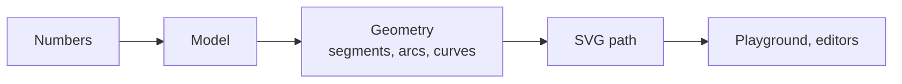

# Synoptic Studio

[](https://github.com/AlexandreGallais/synoptic-studio/actions/workflows/codeql.yml)
[](https://github.com/AlexandreGallais/synoptic-studio/releases)
[](./LICENSE)

Editors for drawing the symbols of **synoptic views** — the schematic screens that supervise plants, networks and buildings — where **every shape is defined by numbers**: whole-number sizes, radii and angles, the geometry computed from them, each shape written as one clean SVG `<path>`.

- **Documentation**: <https://alexandregallais.github.io/synoptic-studio/> — [the software](./docs/the-software.md), [how it is made](./docs/how-it-is-made.md), the API.
- **Playground**: <https://alexandregallais.github.io/synoptic-studio/playground/> — the library at work, as of the last release.

## How it is made

Built by an AI coding agent for one Product Owner: the Product Owner decides what the software does and in which order, tries each change and validates each review; the agent researches, designs, codes and tests. Every calculation rests on a source that was read, every test is written before or with its code, and the library has no runtime dependency.



## Try it

With Node.js 24 and the Rust toolchain of `rust-toolchain.toml`:

```sh
npm install
npm run dev        # the playground on http://localhost:5173
npm run docs:dev   # the documentation site
```

[Contributing](./.github/CONTRIBUTING.md) · [Security](./SECURITY.md) · License: Apache-2.0 ([LICENSE](./LICENSE), [NOTICE](./NOTICE)) · For coding agents: [AGENTS.md](./AGENTS.md)
