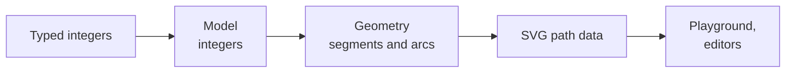

# synoptic-studio

[](https://github.com/AlexandreGallais/synoptic-studio/actions/workflows/codeql.yml)
[](https://github.com/AlexandreGallais/synoptic-studio/releases)
[](./LICENSE)

A dependency-free TypeScript library to draw **SVG symbols** for **synoptic views** — the schematic screens that supervise industrial plants — and the editors built on it. Shapes are typed as whole numbers, every output is a `<path>`, and every function names the source it comes from.

|                   |                                                                                                                                                      |
| ----------------- | ---------------------------------------------------------------------------------------------------------------------------------------------------- |
| **Documentation** | <https://alexandregallais.github.io/synoptic-studio/> — guide, domain, decisions, conventions, API                                                   |
| **Playground**    | <https://alexandregallais.github.io/synoptic-studio/playground/> — the library at work, as of the last release                                       |
| **Status**        | E01 "Draw symbol shapes from numbers" done; next, E14 "Draw curves" — see the [backlog](https://alexandregallais.github.io/synoptic-studio/backlog/) |

## What it does today

- Rectangles and regular polygons, each corner rounded by its own radius, reduced to fit.
- A polygon anchored in its box, or stretched to fill it.
- Free shapes: points moved, added and deleted, decimals kept where nothing was typed.
- Any shape turned by any angle, edited while turned.

## How it is built



- **Integer model, exact output**: sizes, radii and angles are whole numbers; geometry is derived, never stored; 5 decimals in the SVG.
- **Sourced**: each function cites a specification, a paper, a book, or a derivation written from read sources.
- **Built by an agent, decided by a person**: a coding agent designs, implements, tests and documents; the Product Owner decides, tests and merges. The method is the [playbook](https://alexandregallais.github.io/synoptic-studio/playbook/).

## Develop

```sh
npm install
npm run dev        # playground on http://localhost:5173
npm run docs:dev   # documentation site
npm run fix        # Prettier + ESLint --fix
npm run check:all  # every check: lint, types, tests (100 % coverage), audit, knip, docs build
npm run build      # dist/
```

[Contributing](./.github/CONTRIBUTING.md) · [Code of conduct](./.github/CODE_OF_CONDUCT.md) · [Security](./SECURITY.md) · License: Apache-2.0 ([LICENSE](./LICENSE), [NOTICE](./NOTICE)) · Agent instructions: [AGENTS.md](./AGENTS.md)
