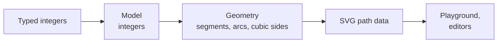

# synoptic-studio

[](https://github.com/AlexandreGallais/synoptic-studio/actions/workflows/codeql.yml)
[](https://github.com/AlexandreGallais/synoptic-studio/releases)
[](./LICENSE)

A dependency-free TypeScript library to draw **SVG symbols** for **synoptic views** — the schematic screens that supervise industrial plants — and the editors built on it. Shapes are typed as whole numbers, the geometry is computed from them, and every shape is written as a `<path>`.

|  |  |
| --- | --- |
| **Documentation** | <https://alexandregallais.github.io/synoptic-studio/> — how the project works, the business rules, the API |
| **Playground** | <https://alexandregallais.github.io/synoptic-studio/playground/> — the library at work, as of the last release |
| **Status** | [where it stands](./docs/where-it-stands.md), and the [order of the epics](./docs/backlog/README.md) |

## How it is built



- **Integer model, exact output**: sizes, radii and angles are whole numbers; the geometry is computed, never stored; 5 decimals at most in the SVG.
- **Small named functions**: each calculation is a function named after what it computes, tested on examples computed by hand.
- **Built by an agent, decided by a person**: a coding agent designs, implements, tests and documents; the Product Owner decides the rules and the priorities, tries each change and validates each review ([how the project works](./docs/how-it-works.md)).

## Develop

With Node.js 24 or later and the Rust toolchain of `rust-toolchain.toml`:

```sh
npm install
npm run dev        # the playground on http://localhost:5173
npm run docs:dev   # the documentation site
npm run fix        # format and apply the linters' fixes
npm run check:all  # every check, as before each push
npm run build      # the library into dist/
```

The other commands: [commands](./docs/commands.md).

[Contributing](./.github/CONTRIBUTING.md) · [Code of conduct](./.github/CODE_OF_CONDUCT.md) · [Security](./SECURITY.md) · License: Apache-2.0 ([LICENSE](./LICENSE), [NOTICE](./NOTICE)) · Agent instructions: [AGENTS.md](./AGENTS.md)
