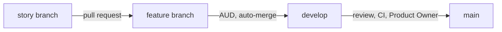

# Backlog

The project's work is planned **in the repository**, as Markdown files: no Jira, no Azure DevOps. The method is the four-level hierarchy Epic → Feature → Story → Task (SAFe levels on top of Scrum, as in Azure Boards' Agile process), adapted from the Product Owner's methodological note.

**No iterations.** Items flow through their statuses one at a time. Scrum's events (planning, review, retrospective) are replaced by two moments: **refinement** (an epic's research, its questions and its stories written at its start) and **acceptance** (the Product Owner tries what changed on `develop` at each return).

The structure is **checked by a test** (`backlog.test.ts`): unique IDs, valid statuses, every story has a feature (a review or an epic's refinement, its epic), every feature has an epic.

## Where we are

| Done | Now | Next | Then |
| --- | --- | --- | --- |
| E01 — draw symbol shapes, E14 — curves, E15 — text, E17 — fast tooling, E02 — select and move shapes on one drawing | E49 — the agent's knowledge in a database, the docs light: refined (SP-034), the knowledge database next | E50 — the agent's setup shared with every coding agent | E21 — resize shapes by their box, E22 — turn shapes about a chosen center |

The full order of the epics is the Product Owner's, in [epics](./epics/); each epic orders its features, each feature its stories.

## Roles in this project

| Role | Who | Does |
| --- | --- | --- |
| Product Owner | one person | writes and prioritizes epics, answers each epic's questions, tries what changed at each return, merges `develop` into `main` |
| Scrum Master | Claude Code | keeps the backlog and its links, prepares refinement, checks the method |
| Developers | Claude Code (with the Product Owner) | split features into stories and stories into tasks, implement, test, demonstrate |

The Product Owner is one person (`REF-SCRUM-GUIDE`). Claude Code never sets an epic or a feature to `ready` without the Product Owner's explicit agreement; a `/run` is that agreement for its feature and stories (ADR-0072). A story is set to `done` in the **last commit of its pull request**, merged into its feature branch (by GitHub in an authorized run once the local checks passed at the push, else by the Product Owner). A feature joins `develop` once its audit ends; the Product Owner's acceptance is given at each return, on `develop`, from the test cards of what changed, before `develop` goes into `main` (ADR-0100).

## The four levels

```text
EPIC          complete business need
└─ FEATURE    capability the user can see and test
   ├─ STORY   one behavior, finished and accepted on its own
   │  └─ TASK one unit of work (≤ 1 day)
```

| Level | File | Written by | Validated by |
| --- | --- | --- | --- |
| Epic | `epics/E01-slug.md` | Product Owner (drafts may be proposed by Claude Code) | Product Owner |
| Feature | `features/E01-F01-slug.md` | Product Owner with the team | Product Owner |
| Story | `stories/E01-F01-US-001-slug.md` (also `EN`, `SP`, `AUD`) | developers | Product Owner |
| Task | checklist inside its story file | developers | the developer |

## Rules

1. **Every item has a parent**: story → feature → epic.
2. **Vertical slice**: a feature or a user story describes an observable behavior, never an isolated layer ("the geometry", "the tests").
3. **A story is small**: finished, tested and accepted on its own, in a few working sessions at most. Without sprints, this replaces Scrum's "done within one sprint" (`REF-SCRUM-GUIDE`). It meets INVEST (`REF-HUMANIZING-SPLITTING`). Too big → split by behavior (simple case first, then variants), never "part 1 / part 2".
4. **Story types** (`REF-SAFE-STORY`): `US` user story (user-visible behavior), `EN` enabler (exploration, architecture, infrastructure — e.g. a geometric function and its derivation), `SP` spike (time-boxed study, its acceptance criteria are the questions), `AUD` audit (compliance enabler: full check of a feature, [audit.md](../conventions/audit.md)), `REV` review at a return of the Product Owner (the features finished since the last merge into `main`, the naming pass over the code changed since, the tool cards, the method, the docs; attached to an epic, no feature; [process](../process/)). The records keep three more types: `VAL` feature validation up to F47 (ADR-0100), `CHK` checkpoint in the middle of a feature up to F21, `NAM` naming pass and `RET` epic retrospective up to E17 (ADR-0086). Each user story carries a **Product Owner test card** (section `## Product Owner test`): what to try in the playground and what to expect.
5. **Acceptance criteria**: Given / When / Then, one block per case, each observable. A **feature's** numbered criteria are its requirements (`F01.AC3`, ADR-0027): each one appropriate, complete, correct, feasible, necessary, singular, unambiguous and verifiable; once the feature is `done`, a criterion is changed only by a new story citing it.
6. **Feature plan**: once a feature is refined, a table maps each acceptance criterion to the stories that realize it and to the story that verifies it, in delivery order.
7. **A task is ≤ 1 day**, one verifiable result, estimated in hours (`REF-SCRUM-GUIDE`: work items of one day or less); stories are estimated in points. Tasks are numbered `T1`, `T2`… inside their story; **one task = one commit**, referenced as `US-004.T2`.
8. **Definition of Done**: `AGENTS.md` — `npm run check:all` green (run again by the pre-push hook), docs updated, demonstrated in the playground or by tests, accepted by the Product Owner.
9. **One story in progress at a time**; an abandoned story is set to `dropped` with the reason, never renamed "part 2".
10. **Commits reference the backlog** through footers (`Refs:`, `Closes:`, see [Git workflow](../tooling/git-workflow.md)).

File names and titles carry the ancestry: `E01-F01-US-001-slug.md`, titled `E01 · F01 · US-001 — …`, so that an item's epic and feature are visible at a glance. The test checks that the prefix matches the front matter. Commits keep the short story ID (`Refs: US-001.T2`): it is unique.

## Feature frame (ADR-0020)

Every feature is delivered in the same order, checked by `backlog.test.ts`: 2 to 4 `US` or `EN` stories, one at a time, each of at most 3 tasks, then one `AUD` (ADR-0084, ADR-0100); a larger feature or story is split, the split proposed to the Product Owner with an example (EN-123). The test keeps the frames of the records: up to F21 an `SP`, a `CHK`, an `AUD` and a `VAL`; F22 to F47 an `AUD` and a `VAL`.

| Step | Story | Content |
| --- | --- | --- |
| 1 | `US`, `EN` | implementation on the feature branch, one story per pull request, `T1` the interface and its failing tests, `T2` the code (ADR-0084), checked by the local Git hooks; in an authorized run they chain, and GitHub merges each one into the feature branch once it is labeled `autonomous` (ADR-0072); a short `SP` first only for a question nobody foresaw (ADR-0100) |
| 2 | `AUD` audit | the feature in depth, the project in breadth ([audit.md](../conventions/audit.md)); then the feature joins `develop` |

An epic has one subject and no closing (ADR-0086, ADR-0100): it opens with its refinement, an `SP` story from `develop` without a feature (`E02-SP-030-slug.md`, `epic: E02` alone), holding the whole research, every question for the Product Owner at once and each feature's stories counted ([research protocol](../research/) §8); the naming pass (ADR-0049), the review and the method are held at each return of the Product Owner, in a `REV` story from `develop` (template `_review.md`, its `epic` the epic of the first feature it reviews). `backlog.test.ts` asks no epic for a closing and refuses a new `NAM` or `RET`; the closings of E01 to E17 (`NAM`, `REV`, `RET`, ADR-0023, listed in the epic's **Closing** table) stay as records.

## Statuses

| Item | Statuses |
| --- | --- |
| Epic | `draft` → `ready` → `in-progress` → `done`; or `dropped`, its content taken by the epics it names (SP-033, 2026-10-25) |
| Feature | `draft` → `ready` → `in-progress` → `done` |
| Story | `draft` → `ready` → `done` on `develop` (`in-progress` only on its branch; or `dropped`); `parked` while a question waits for the Product Owner, the question written in the story, then `ready` again once answered (EN-086) |

An epic or a feature becomes `in-progress` when its first story starts, and `done` when its closing stories are merged: its `AUD` for a feature; for an epic, the review of its last feature. The agent proposes the change, the Product Owner agrees (decision of 2026-10-08).

The order of the files in a folder is not the priority: the Product Owner's order lives in the parent's table (epics in `epics/README.md`, features in their epic, stories in their feature).

## Files

Every item is a Markdown file starting with a front-matter block (`key: value` lines, no nesting). Templates: `_epic.md`, `_feature.md`, `_story.md`, `_spike.md`, `_checkpoint.md` (up to F21), `_audit.md`, `_review.md` in this folder (not published on the site).

| Field | Epic | Feature | Story |
| --- | --- | --- | --- |
| `id` | `E01` | `F01` | `US-001`, `EN-001`, `SP-001`, `CHK-001`, `AUD-001`, `VAL-001`, `REV-001`, `RET-001` |
| `title` | ✔ | ✔ | ✔ |
| `status` | ✔ | ✔ | ✔ |
| parent | — | `epic: E01` | `epic: E01`, `feature: F01` |
| other | — | — | `points` |

## Workflow

From refinement to release (Git details: [Git workflow](../tooling/git-workflow.md), ADR-0072):

1. **Refine**: the epic's refinement spike reads the sources and the code, asks the Product Owner every question at once (business rules, edge cases, what is out of scope), splits each feature into its stories with its feature plan; what the Product Owner agrees to is set `ready`.
2. **Implement**: one `ready` story at a time, on its own branch from the feature branch, one commit per task, Definition of Done, then a pull request into the feature branch; its merge sets the story to `done`, no status commit following.
3. **Audit**: the feature's `AUD`; the feature's pull request then goes into `develop` by the auto-merge, and the feature is `done`.
4. **Review**: at each return of the Product Owner, a `REV` from `develop`; the Product Owner tries what changed, then merges the pull request from `develop` into `main`, the only one checked by the CI.
5. **Release**: the Product Owner's button on `main` ([releases](../tooling/releases.md)).



| Index | Content |
| --- | --- |
| [epics](./epics/) | business needs |
| [features](./features/) | capabilities |
| [stories](./stories/) | small, accepted-on-their-own behaviors |
