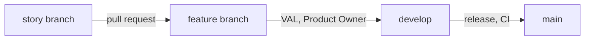

# Backlog

The project's work is planned **in the repository**, as Markdown files: no Jira, no Azure DevOps. The method is the four-level hierarchy Epic → Feature → Story → Task (SAFe levels on top of Scrum, as in Azure Boards' Agile process), adapted from the Product Owner's methodological note.

**No iterations.** Items flow through their statuses one at a time. Scrum's events (planning, review, retrospective) are replaced by two moments: **refinement** (writing and splitting) and **acceptance** (the Product Owner accepts a story or validates a feature).

The structure is **checked by a test** (`backlog.test.ts`): unique IDs, valid statuses, every story has a feature (a review or an epic's refinement, its epic), every feature has an epic.

## Where we are

| Done | Now | Next | Then |
| --- | --- | --- | --- |
| E01 — draw symbol shapes, E14 — curves, E15 — text, each with its retrospective | E17's refinement — fast tooling with Oxc and Rust, in two rounds | E17's stories, then the release of 0.3 (#259) | E02 |

The full order of the epics is the Product Owner's, in [epics](./epics/); each epic orders its features, each feature its stories.

## Roles in this project

| Role | Who | Does |
| --- | --- | --- |
| Product Owner | one person | writes and prioritizes epics, defines features with the team, accepts stories, validates features |
| Scrum Master | Claude Code | keeps the backlog and its links, prepares refinement, checks the method |
| Developers | Claude Code (with the Product Owner) | split features into stories and stories into tasks, implement, test, demonstrate |

The Product Owner is one person (`REF-SCRUM-GUIDE`). Claude Code never sets an epic or a feature to `ready` without the Product Owner's explicit agreement; a `/run` is that agreement for its feature and stories (ADR-0072). A story is set to `done` in the **last commit of its pull request**, merged into its feature branch (by the Product Owner, or by GitHub in an authorized run once the local checks passed at the push). The Product Owner's acceptance is given on the test cards and at the feature's validation, by merging the feature pull request: `develop` and `main` only ever hold a story as `done` once its feature is accepted (ADR-0072).

## The four levels

```text
EPIC          complete business need
└─ FEATURE    capability the user can see and test
   ├─ STORY   one behavior, finished and accepted on its own
   │  └─ TASK one unit of work (≤ 1 day)
```

| Level | File | Written by | Validated by |
| --- | --- | --- | --- |
| Epic | `epics/E01-slug.md` | Product Owner (drafts may be proposed by Claude Code) | Product Owner |
| Feature | `features/E01-F01-slug.md` | Product Owner with the team | Product Owner |
| Story | `stories/E01-F01-US-001-slug.md` (also `EN`, `SP`, `AUD`, `VAL`) | developers | Product Owner |
| Task | checklist inside its story file | developers | the developer |

## Rules

1. **Every item has a parent**: story → feature → epic.
2. **Vertical slice**: a feature or a user story describes an observable behavior, never an isolated layer ("the geometry", "the tests").
3. **A story is small**: finished, tested and accepted on its own, in a few working sessions at most. Without sprints, this replaces Scrum's "done within one sprint" (`REF-SCRUM-GUIDE`). It meets INVEST (`REF-HUMANIZING-SPLITTING`). Too big → split by behavior (simple case first, then variants), never "part 1 / part 2".
4. **Story types** (`REF-SAFE-STORY`): `US` user story (user-visible behavior), `EN` enabler (exploration, architecture, infrastructure — e.g. a geometric function and its derivation), `SP` spike (time-boxed study, its acceptance criteria are the questions), `AUD` audit (compliance enabler: full check of a feature, [audit.md](../conventions/audit.md)), `VAL` feature validation (demo page in the [guide](../guide/), the Product Owner tries the lines of the epic's checklist page and checks the feature's criteria), `REV` review at a return of the Product Owner (the features finished since the last merge into `main`, the naming pass over the code changed since, the tool cards, the method, the docs; attached to an epic, no feature; [process](../process/)); up to E17, `CHK` checkpoint in the middle of a feature, `NAM` naming pass and `RET` epic retrospective, kept as records (ADR-0086). Each user story carries a **Product Owner test card** (section `## Product Owner test`): what to try in the playground and what to expect.
5. **Acceptance criteria**: Given / When / Then, one block per case, each observable. A **feature's** numbered criteria are its requirements (`F01.AC3`, ADR-0027): each one appropriate, complete, correct, feasible, necessary, singular, unambiguous and verifiable; once the feature is `done`, a criterion is changed only by a new story citing it.
6. **Feature plan**: once a feature is refined, a table maps each acceptance criterion to the stories that realize it and to the story that verifies it, in delivery order.
7. **A task is ≤ 1 day**, one verifiable result, estimated in hours (`REF-SCRUM-GUIDE`: work items of one day or less); stories are estimated in points. Tasks are numbered `T1`, `T2`… inside their story; **one task = one commit**, referenced as `US-004.T2`.
8. **Definition of Done**: `AGENTS.md` — `npm run check:all` green (run again by the pre-push hook), docs updated, demonstrated in the playground or by tests, accepted by the Product Owner.
9. **One story in progress at a time**; an abandoned story is set to `dropped` with the reason, never renamed "part 2".
10. **Commits reference the backlog** through footers (`Refs:`, `Closes:`, see [Git workflow](../tooling/git-workflow.md)).

File names and titles carry the ancestry: `E01-F01-US-001-slug.md`, titled `E01 · F01 · US-001 — …`, so that an item's epic and feature are visible at a glance. The test checks that the prefix matches the front matter. Commits keep the short story ID (`Refs: US-001.T2`): it is unique.

## Feature frame (ADR-0020)

Every feature is delivered in the same order, checked by `backlog.test.ts` (a feature with stories has at least one `SP`, one `CHK`, one `AUD` and one `VAL` up to F21; from F22, ADR-0084, a feature holds 2 to 4 `US` or `EN` stories, one at a time, each of at most 3 tasks, a short `SP` first when questions remain, with one `AUD` and one `VAL`; a larger feature or story is split, the split proposed to the Product Owner with an example, EN-123):

| Step | Story | Content |
| --- | --- | --- |
| 1 | `SP` research spike, short, when the refinement left questions (ADR-0086) | sources, derivations and research requests for **all** the feature's stories, before any code ([research protocol](../research/) §8) |
| 2 | `US`, `EN` (a `CHK` in the middle before F22) | implementation on the feature branch, one story per pull request, `T1` the interface and its failing tests, `T2` the code (ADR-0084), checked by the local Git hooks; in an authorized run they chain, and GitHub merges each one into the feature branch once it is labeled `autonomous` (ADR-0072) |
| 3 | `AUD` audit | the feature in depth, the project in breadth ([audit.md](../conventions/audit.md)) |
| 4 | `VAL` validation | plain-language demo page and checklist page; the Product Owner checks the feature's acceptance criteria |

No epic has a closing since ADR-0086: an epic is a list of features grouped by theme, opened by its refinement, an `SP` story from `develop` without a feature (`E02-SP-030-slug.md`, `epic: E02` alone); the naming pass (ADR-0049), the review and the method are held at each return of the Product Owner, in a `REV` story from `develop` (template `_review.md`, its `epic` the epic of the first feature it reviews). `backlog.test.ts` asks no epic for a closing and refuses a `NAM` or a `RET` written since. The closings of E01 to E17 (`NAM`, `REV`, `RET`, ADR-0023, files such as `E01-REV-001-slug.md` listed in the epic's **Closing** table) stay as records.

## Statuses

| Item | Statuses |
| --- | --- |
| Epic, feature | `draft` → `ready` → `in-progress` → `done` |
| Story | `draft` → `ready` → `done` on `develop` (`in-progress` only on its branch; or `dropped`); `parked` while a question waits for the Product Owner, the question written in the story, then `ready` again once answered (EN-086) |

An epic or a feature becomes `in-progress` when its first story starts, and `done` when its closing stories are merged: `VAL` for a feature; for an epic, the review of its last feature (`REV` and `RET` up to E17). The agent proposes the change, the Product Owner agrees (decision of 2026-10-08).

The order of the files in a folder is not the priority: the Product Owner's order lives in the parent's table (epics in `epics/README.md`, features in their epic, stories in their feature).

## Files

Every item is a Markdown file starting with a front-matter block (`key: value` lines, no nesting). Templates: `_epic.md`, `_feature.md`, `_story.md`, `_spike.md`, `_checkpoint.md` (up to F21), `_audit.md`, `_review.md` in this folder (not published on the site).

| Field | Epic | Feature | Story |
| --- | --- | --- | --- |
| `id` | `E01` | `F01` | `US-001`, `EN-001`, `SP-001`, `CHK-001`, `AUD-001`, `VAL-001`, `REV-001`, `RET-001` |
| `title` | ✔ | ✔ | ✔ |
| `status` | ✔ | ✔ | ✔ |
| parent | — | `epic: E01` | `epic: E01`, `feature: F01` |
| other | — | — | `points` |

## Workflow

From refinement to release (Git details: [Git workflow](../tooling/git-workflow.md), ADR-0072):

1. **Refine**: interview the Product Owner on the next feature (business rules, edge cases, what is out of scope), split it into stories — research spike first, audit and validation last — write its feature plan, set what the Product Owner agrees to `ready`.
2. **Implement**: one `ready` story at a time, on its own branch from the feature branch, one commit per task, Definition of Done, then a pull request into the feature branch.
3. **Accept**: the merge of the story pull request already sets the story to `done`; no status commit follows.
4. **Validate**: the feature pull request goes into `develop`, merged by the Product Owner; the feature is then `done`.
5. **Release**: a pull request from `develop` into `main`, the only one checked by the CI, merged by the Product Owner.



| Index | Content |
| --- | --- |
| [epics](./epics/) | business needs |
| [features](./features/) | capabilities |
| [stories](./stories/) | small, accepted-on-their-own behaviors |
