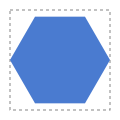
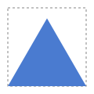
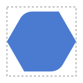
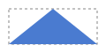
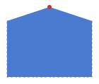
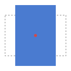
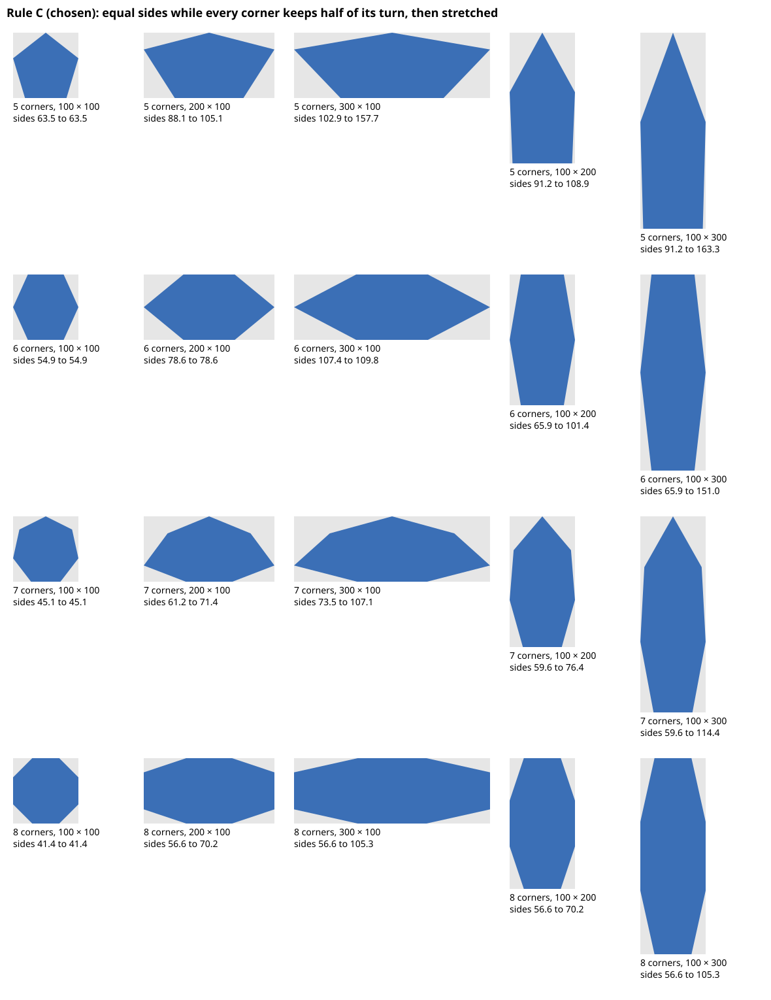

# E01 — Drawing symbol shapes from numbers

## In one paragraph

Before E01 there was nothing to draw. Now you can make the two shapes symbols are built from, a **rectangle** and a **regular polygon** of 3 to 12 corners. Every shape comes from the numbers you type. You can round each corner on its own, place the polygon in its box or stretch it to fill the box, move, add and delete points, and turn any shape by any whole angle. Every drawing is a single SVG `<path>` written with at most 5 decimals, and it is the same each time you type the same numbers. Eight features, released from version 0.7.0 to 0.14.0, all tried in the [playground](https://alexandregallais.github.io/synoptic-studio/playground/).

## Feature by feature

### F01 — A rectangle with rounded corners

Type a width, a height and a radius: the corners are rounded exactly. When the radius is too big, the rounding is reduced just enough to fit, and the page says so. Your number is kept, and the rounding grows back when the rectangle grows. [Demo page](./f01-rounded-rectangle.md).

### F02 — A regular polygon with rounded corners

Choose Polygon and a number of corners from 3 to 12. You get the largest regular polygon that fits the box without being stretched, always with a flat side at the bottom. The radius works as for the rectangle. [Demo page](./f02-regular-polygon.md).

### F07 — A polygon anchored in its box

A grid of nine buttons says where the polygon sits in the room its box leaves: top left, middle, bottom right and so on. Rounding goes inwards, so a flat side placed against the box stays there. [Demo page](./f07-polygon-anchor.md).

### F03 — A rounding for each corner

The **Points** button shows the corners as handles. Select one or several, type a radius, and only those corners are rounded. When the corners differ, the shape's Radius field reads **Mixed**. [Demo page](./f03-radius-per-vertex.md).

### F09 — The rectangle, a free shape you can stretch

Nothing changes on screen: behind it, the rectangle is now a **free shape**. Its points are kept in a box of their own and stretched to the width and height you type, with no loss. [Demo page](./f09-stretchable-free-shape.md).

### F08 — Moving, adding and deleting points

In Points mode, type the X or Y of a point to move it. You can add a point in the middle of an edge, or delete points, keeping at least three. **Convert to free shape** turns a polygon into a free shape without moving it. [Demo page](./f08-node-editing.md).

### F04 — Turning a shape by any angle

Every shape has an **angle**, from 0 to 359, clockwise about the center of its box, and a **position**, the x and y of its straight box. A turned shape can still be resized and edited without jumping. [Demo page](./f04-free-rotation.md).

### F06 — A polygon stretched to its box

Tick **Stretched to its box** and the polygon touches all four sides of its box. Its sides stay as even as possible, under rule C, the rule you chose. [Demo page](./f06-stretched-polygon.md).

## Words you will meet

| Term            | In plain words                                                                              | Where it shows                     |
| --------------- | ------------------------------------------------------------------------------------------- | ---------------------------------- |
| Box             | the width × height you type, drawn in grey behind a polygon                                 | every shape                        |
| Radius          | how much a corner is rounded; the **effective** radius is what fits, your number is kept    | Radius field, « Effective radius » |
| Regular polygon | a polygon with all its sides and all its corners equal                                      | Polygon                            |
| Anchor          | where the polygon sits in the room its box leaves, one of nine places                       | Anchor grid                        |
| Point, handle   | a corner of the shape, and the round button drawn on it in Points mode                      | Points mode                        |
| Free shape      | a shape whose points are typed one by one; the rectangle is one, a polygon becomes one      | « Free shape » in the selector     |
| Angle           | how far the shape is turned, clockwise, about the center of its box                         | Angle field, −90° and +90°         |
| Turned box      | the box turned with the shape, drawn as a thin blue frame                                   | a turned shape                     |
| Straight box    | the smallest upright rectangle around the drawn shape, dashed; its x and y are the position | X, Y, « Straight box »             |
| Stretched       | a polygon touching the four sides of its box                                                | « Stretched to its box »           |

## User test of the epic

Run `npm run dev` and open `http://localhost:5173/?step=67`. Steps 67 to 72 each mix several features. **Next** types the shape for you; the clicks and the extra values written in the step are yours.

| Step | Do                                                                                                     | You should see                                                                                                          | OK? |
| ---- | ------------------------------------------------------------------------------------------------------ | ----------------------------------------------------------------------------------------------------------------------- | --- |
| 67   | Rectangle 160 × 100, radius 12 (F01); type Width 200 (F09)                                             | it widens, its left side fixed; « Effective radius: 12 (as requested) »                                                 |     |
| 68   | Rectangle 160 × 40, radius 1000 (F01); type Angle 90 (F04)                                             | a capsule, effective radius 20; standing up, Width and Height still 160 and 40; straight box x 60, y −60                |     |
| 69   | Triangle 120 × 120 anchored bottom (F02, F07); Points, point 1, Ctrl + point 2, radius 15 (F03)        | only the base corners rounded, the base still on y 120; « Effective radius: mixed »                                     |     |
| 70   | Hexagon stretched in 160 × 100 (F06); Points, Convert (F08); points 1 and 2, add a middle point, Y 120 | converting moves nothing; a new point under the base; Height 120                                                        |     |
| 71   | The same hexagon; Angle 30 (F04), then Points and Convert (F08), then Width 200                        | nothing moves when converting; once widened, point 3 stays at x 10.71797, y 10; the angle stays 30                      |     |
| 72   | The stretched hexagon with radius 1000 (F06, F01); type X 0 (F04)                                      | every corner rounded by 50, the shape leaves the left and right of its box; « Straight box: x 0, y 0, width 124.08793 » |     |

## Decisions taken on the way

- Every value you type is a whole number. The computed drawing may have decimals, written with at most 5 (ADR-0003, Q10).
- A radius too big is reduced locally, edge by edge, never refused; your number is kept (ADR-0007, Q8).
- Each corner has its own radius; the radii follow the point numbers when the number of corners changes (ADR-0029).
- The rectangle is a free shape: its points live in a box of their own and stretch without loss (ADR-0032, ADR-0033).
- A converted polygon keeps its exact points, decimals included; only a coordinate you type is a whole number (ADR-0031, ADR-0034).
- Every shape has an angle and a position; editing a turned shape leaves it where it is (ADR-0035).
- A stretched polygon follows rule C: equal sides while every corner keeps half of its usual turn, then a plain stretch (ADR-0037).
- Point numbers never change once a shape exists, except when a point is added or deleted (Q11, Q18).
- A polygon has 3 to 12 corners (Q19); a size has no upper limit in the library, and the playground caps typing at 100 000 (Q20).
- Free V1, then a paid pro edition for new features (ADR-0030).

## Limits and next epic

- Only straight sides and rounded corners: no curve with handles, no ellipse, no round shape. That is E14, the next epic: Bézier curves typed as numbers, the ellipse, and the round shape F10.
- No text: E15, right after E14.
- Points are typed, not dragged; one shape at a time; the eight handles of a box, the rotation centre you move, and the warnings on shapes that cross themselves come with the editor (E02).
- Shapes in a tree and a layout box that places them: E13.
- The playground is a demonstration of the library, not the Symbol Editor.

## Questions for the review

1. **Closure.** E01's closure criterion was "the cases of `shapes.md` §2–3 render as specified in the playground". §3 still holds text (now E15) and the layout box (E13). Should the criterion keep only the rectangle and the regular polygon?
2. **Anything unwanted.** Is there something E01 built that you did not mean, or that works differently from what you had in mind?
3. **Next epic.** Is E14 (curves, ellipse, round shape) still the right next step, before E15 (text)?

## Your feedback

Given by the Product Owner during `REV-001` (2026-10-12), spoken, written here by the agent in its own words.

**Answers to the questions.** 1: yes, the closure criterion now keeps only the rectangle and the regular polygon. 2: nothing was built that they did not mean, and nothing works differently from what they had in mind. 3: yes, E14 (curves, ellipse, round shape) is the right next epic, before E15 (text).

**The user test, step by step.**

| Step | What they saw                                                                                                                                                             | Matches the step |
| ---- | ------------------------------------------------------------------------------------------------------------------------------------------------------------------------- | ---------------- |
| 67   | the rectangle widened to 200 and kept its radius of 12                                                                                                                    | yes              |
| 68   | the capsule with an effective radius of 20 stood up at 90°; trying radius 20 by hand, the "reduced to fit" message went away, and smaller radii rounded less, as expected | yes              |
| 69   | only the two corners of the base were rounded by 15                                                                                                                       | yes              |
| 70   | nothing moved on converting; the point added in the middle of the base went down to y 120 and the height became 120                                                       | yes              |
| 71   | turned by 30°, converted and widened, point 3 did not move; going back undid it all without a change                                                                      | yes              |
| 72   | every corner had an effective radius of 50; with X 0 the shape seemed to go partly off the canvas — not blocking, kept for later (improvement log)                        | yes, one doubt   |

**What the demo meant and what they understood.** Each step showed what it meant to show. One wording to fix: the steps say "press Enter" after typing a point's X or Y, but the drawing already follows the typing, so Enter is not needed.
