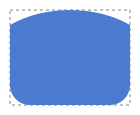
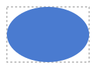
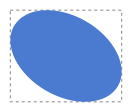

# E14 — Drawing curves with handles, ellipses and round shapes

## In one paragraph

Before E14 a shape's only curves were the roundings of its corners. Now a free shape's point can sit **on a curve**, with two **handles** typed as numbers, as in Figma; a **Round** tool draws a circle or an ellipse filling its box; and the code reads as the mathematics it applies, every calculation named after what it is.

## Feature by feature

### F11 — A code base ready for curves

Nothing changes on screen. The code was sorted into folders by business domain, one function writes every path, and each mathematical function has a property test. [Demo page](./f11-code-base-ready-for-curves.md)

### F12 — Points on a curve with handles

In Points mode, the **Handles** switch turns a point into a point on the curve. Its two handles are typed as x and y on the page, or as an angle and a length from the side. There are three modes: **No mirroring**, **Mirror angle**, **Mirror angle and length**. A corner beside a curve keeps its rounding, reduced if it is too large. [Demo page](./f12-curves-with-handles.md)

### F10 — Round shape

The **Round** tool draws a circle in a square box and an ellipse otherwise, always touching the four sides of its box. Its 4 points (top, right, bottom, left) are shown in Points mode. **Convert to free shape** turns them into points with handles, and nothing moves. [Demo page](./f10-round-shape.md)

### F13 — Every calculation named

Nothing changes on screen. Each calculation that a field names (a rotation, a signed angle, a regular partition) is now a function of that name, with its source. Every result is unchanged, bit for bit. [Demo page](./f13-every-calculation-named.md)

## Words you will meet

| Term                    | In plain words                                                                                 | Where it shows                                |
| ----------------------- | ---------------------------------------------------------------------------------------------- | --------------------------------------------- |
| Point on a curve        | a point the outline passes through smoothly, shaped by its two handles                         | **Handles** switch, Points mode               |
| Handle                  | a direction and a pull leaving a point: the curve starts towards it                            | the handle fields, before and after the point |
| Mirror angle            | moving one handle turns the other one opposite; each keeps its own length                      | handle mode                                   |
| Mirror angle and length | the other handle is the exact opposite: same angle, same length                                | handle mode                                   |
| Angle from the side     | a handle measured from the side towards the neighbouring point, not from the page's horizontal | **Angle and length** input                    |
| Round shape             | a circle or an ellipse that always fills its box; no radius to type                            | **Round** tool                                |
| Cubic side              | the curve between two points, drawn from their handles                                         | the path's `C` commands                       |

## User test of the epic

The review was a free walk through the playground on `develop`, crossing the features in the order below.

| Step | Do                                                                   | You should see                                              | OK? |
| ---- | -------------------------------------------------------------------- | ----------------------------------------------------------- | --- |
| 1    | **Round**, then widen it (F10)                                       | a circle, then an ellipse touching its box, as in Figma     | yes |
| 2    | Points mode on the round shape (F10)                                 | its 4 points, no radius to type until it is converted       | yes |
| 3    | **Convert to free shape**, then type handles in each mode (F10, F12) | nothing moves; the handles bend the sides as typed          | yes |
| 4    | Put both handles of a point on the same side (F12)                   | the outline crosses itself and makes a loop                 | yes |
| 5    | Delete a point; turn the shape with **Angle** (F08, F04, F12)        | the curves are kept; the shape turns about its box's centre | yes |
| 6    | A triangle, handles of length 0 then longer, angle and length (F12)  | each handle follows its side towards the neighbouring point | yes |

## Decisions taken on the way

- A curve in a symbol is a cubic side drawn from typed handles; a circular arc stays only for a corner's rounding (ADR-0046).
- A rounded corner beside a curve keeps its rounding: a tangent arc, the curve cut, a radius too large reduced (ADR-0047).
- The round shape is four cubic sides, within 0.014 of a true circle of diameter 100; this lets it convert to points with handles without moving (ADR-0048).
- Point 1 of a round shape is its top point, then clockwise.
- A round shape converts to a free shape only: its conversion to a rounded rectangle was removed at its validation, because it turned an ellipse into a capsule.
- Folders by business domain (ADR-0043); every calculation named, and a naming pass at the end of each epic from E15 on (ADR-0049).

## Limits and next epic

- Points and handles are typed, not dragged: that comes with the editor (E02).
- Strokes and dashes along a curve: E04.
- No text yet: E15, the next epic.
- Copying a point's rounding or handles onto another point waits for the editors' interface.

## Review

Held with the Product Owner on 2026-10-14 (`REV-002`), right after the validation of F10 and F13.

**The walk-through, step by step.** Every step showed what it meant to show:

- the circle widened into an ellipse, as Figma does;
- the round shape's points take no radius until it is converted, which they found expected;
- the handles worked in every mode and both inputs, x and y or angle and length;
- crossing two handles made a loop;
- deleting a point and turning the shape kept the curves;
- the same angle and length on two different corners gives two different curves, because the sides meet at different angles. They found this logical.

**Remarks.**

| Remark                                                                                                                                                                                               | Where it went                                                                                 |
| ---------------------------------------------------------------------------------------------------------------------------------------------------------------------------------------------------- | --------------------------------------------------------------------------------------------- |
| The angle measured from the side towards the neighbouring point is unusual, but coherent: the same values on two right-angled corners give the same curve.                                           | kept as built                                                                                 |
| The interface stays simple: few options, many shapes possible.                                                                                                                                       | kept as built                                                                                 |
| Every shape's point 1 could be its lowest right point, as a polygon's is, so that all shapes start alike. A round shape would start at its bottom or its right point. Not urgent, for the end of V1. | note in [E10](../backlog/epics/E10-draw-static-drawings.md), before E11 fixes the file format |

**Closure criteria.** A round shape and an ellipse render as specified. A propeller blade is a free shape with curved sides, which F12 draws; the propeller symbol itself is assembled once symbols exist (E05).
