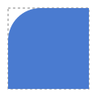
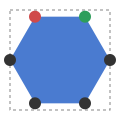

# F03 — A rounding for each corner

## What you can do now

Each corner of a rectangle or a regular polygon can have its own **rounding** (its corner radius). In the playground, the **Points** button of the toolbar above the drawing shows the corners of the shape as round **handles**. Click one, or its row in the list of points, then type a radius: only the corners you selected are rounded. The **Shape** button, next to it, goes back to the whole shape, where the Radius field rounds every corner, as before.

## The ideas behind it

**A corner of its own.** A square with only its top-left corner rounded is now a shape like any other: the other three corners stay sharp.

**Point 1 and point 2.** The outline of a shape starts at a corner and goes around it clockwise. In Points mode, the corner where it starts is **red** (point 1) and the next one **green** (point 2); for a polygon, since F08, they are the two ends of its base, right then left, so that you can read where it starts and which way it goes. The list of points follows the same order.

**Choosing corners.** A click selects one point. Ctrl + click (Cmd on a Mac) adds or removes one. In the list, Shift + click selects every point between the last one clicked and this one; on the drawing, Shift + click adds or removes one point, as there is no "between" on a drawing. Here points 1 and 4 got a radius of 20.

**"Mixed".** When the corners the Radius field speaks for do not all have the same rounding, it is empty and reads **Mixed**. Typing a number gives it to all of them. With no point selected in Points mode, it is greyed and reads **Select points**.

**Too big for its corner.** As in F01, a rounding too big for its corner is reduced to fit, and your number is kept. Only the corners next to a short side are reduced. In a 100 × 20 rectangle, a radius of 30 on the top-left corner and 10 on the top-right gives 20 and 10: the left side is only 20 high. The list of points shows both numbers: `radius 30 (effective 20)`.

**Fewer or more corners.** Each point keeps its rounding by its number: a hexagon with point 1 rounded becomes a pentagon with point 1 still rounded. A point that goes away takes its rounding with it, and a new point is sharp.

| Term | In plain words |
| --- | --- |
| Point | a corner of the shape |
| Handle | the round mark drawn on a point in Points mode, to click it |
| Rounding, radius | how much a corner is rounded: the radius of the circle drawn in it |
| Mixed | the selected points do not all have the same rounding |
| Effective radius | the rounding actually drawn, smaller when the corner is too small for the one asked |

## Try it

Run `npm run dev` and open `http://localhost:5173/?guide=epic&step=29`: the **Guided test** opens on the first step of F03 (steps 29 to 33). **Next** types the shape for you; the clicks on the points are yours, as each step says. The same steps are listed in the test cards of US-012 and US-013.

## Limits

- Moving, adding and deleting points came with node editing, F08, which also turns a regular polygon into a free shape by a deliberate action; the rectangle is one already (F09).
- When the number of corners goes down then up, the points that went away do not get their rounding back (decided at the refinement; a "memory" is noted for later, see below).
- The playground is a demonstration: the tools of the editor applications (drawing, selecting shapes, points) come with them.

## Validation

Validated by the Product Owner on 2026-10-11 (`VAL-004`): point 1 and point 2 show the direction of the contour as intended, and nothing is missing.

| Remark | Where it went |
| --- | --- |
| a polygon could remember the rounding of removed points: 12 corners, then 3, then 12 again gets the 9 back | Q26, settled on 2026-10-25: kept while the session lasts, not in the saved file, with E23 |
| the free contour, with x and y typed in the list of points | F08 |
