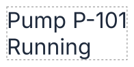
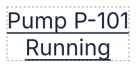
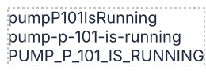
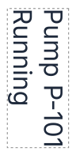

# F05 — Text and its characters

## What is new

A **Text** tool writes a label in a symbol: "Pump P-101" over "Running", in the font, size, weight and color chosen. The library **measures** the text itself, from the font's numbers, so that it knows where the text ends without showing it in a page; the SVG then holds plain lines that every SVG reader draws the same way.

| Option | What it does |
| --- | --- |
| **Content** | the lines, broken where the designer pressed Enter; empty, nothing is drawn |
| **Font** | a family the editor can measure, chosen in a list: Inter, the fonts imported, the installed ones (F15); written with `sans-serif` after it |
| **Size** | an integer from 1 to 100 000, in the one unit used everywhere |
| **Weight**, **Bold**, **Italic** | 100 (thin) to 900 (black); Bold sets 700 and, pressed again, gives back the weight before; Italic slants |
| **Color**, **Opacity** | `#` and six hexadecimal digits; 0 to 100 % |
| **Letter spacing**, **Word spacing** | added between the letters, or at each space; negative to tighten |
| **Underline**, **Strike-through** | a thin rectangle under or through each line, where the font says, in its own color once chosen, else the text's (US-041) |
| **Case** | the text written in upper, lower or title case, or as `camelCase`, `kebab-case` and more |
| **Direction** | left to right, or right to left (Hebrew) |
| **Alignment** | each line on the left, the center or the right of the block |
| **X**, **Y**, **Angle** | the block's top-left corner, and a turn about its middle; a new text starts straight, centred on the click (F35) |

Rules: [domain, "Text"](../domain/shapes.md#text); decisions: [ADR-0052](../adr/0052-text-measured-and-drawn-as-positioned-lines.md), [ADR-0054](../adr/0054-text-font-list-and-spaces-kept.md), [ADR-0055](../adr/0055-text-fallback-metrics-and-turn-on-its-group.md), [ADR-0057](../adr/0057-a-turned-text-keeps-its-turned-corner-when-it-grows.md); formula: [`DERIV-text-width`](../derivations/text-width.md).

## The ideas behind it

| Term | In plain words |
| --- | --- |
| **Font metrics** | the numbers a font file holds for each letter: how wide it is (its **advance**), how far the letters reach up and down, where the underline sits |
| **Kerning** | a small correction between two letters that look too far apart: in "To", the o slides under the T, 2.5 closer at size 32 |
| **Measured block** | the rectangle the text fills: as wide as its widest line, as tall as its lines; shown dashed when the text is selected |
| **Baseline** | the line the letters sit on; each line is written at its baseline |
| **Missing glyph** | the box a font draws for a character it does not have, such as a Hebrew letter in Inter |

**Measuring.** A line's width is the sum of its letters' advances, scaled to the size, plus kerning and spacing. "Pump P-101" in Inter 32 measures 175.90625; each line is 38.71875 tall, so the two lines make a block 175.90625 × 77.4375. Fonts are read once and kept: measuring a text is then a sum of stored numbers, fast enough for a view that changes a thousand texts a hundred times a second.

**Inter.** The default font is Inter 4.1, whose numbers ship with the library. The playground measures each text with the metrics of the font chosen in its list (F15, US-036); Inter's ship with the library.

**Alignment.** Centered, each line starts halfway into the room it leaves; aligned right, after all of it. Below, "Running" starts 26.15 into the block, and each line is underlined as long as itself.

**Cases.** A value typed once comes out formatted. "pump P-101 is running" gives:

**Turning.** A text turns clockwise about the middle of its block, by an integer angle kept from 0 to 359: 370 becomes 10, −90 becomes 270. Its underline, strike-through and dashed frame turn with it. When its block changes size, its turned top-left corner stays in place ([ADR-0057](../adr/0057-a-turned-text-keeps-its-turned-corner-when-it-grows.md)).

## How to try it

**Validation**: `npm run dev`, then `http://localhost:5173/?checklist=E15`: one page listing E15's options, one line each, what to try and what to see, a check box before it, the boxes ticked kept in this browser (US-051). Since then the plain address opens no guided test: the steps below come back only in `?guide=epic`, at the numbers given for the epic review.

Install Inter 4.1 first (Font Book on macOS shows it). Then `npm run dev` and `http://localhost:5173`: 36 steps, each one line to do and one to look at; **Next** types the text. E15 is validated at once (VAL-017): they are steps 1 to 36 of its 176, before F14's, F16's and F15's; at the epic review, steps 88 to 123 of `?guide=epic`.

| Steps | What |
| --- | --- |
| 1 | Inter installed: the frame hugs the letters |
| 2–14 | every field: content, empty text, size, weight, italic, color, spacing, underline, cases, alignment, right to left, Hebrew |
| 15–21 | position, turning, the angle kept, the dashed frame, the turn on a group, values refused, a new shape leaving the text as it was |
| 22–32 | the decisions to confirm and the audit's questions, one step each with its example |
| 33–34 | two checks in Chrome, Firefox and Safari, in the browser's console |
| 35 | a turned text grows in place, its turned top-left corner kept (ADR-0057) |
| 36 | back to the rectangle, drawn as before |

The two browser checks: "HH" in Inter 16 with letter spacing 10 measures 33.78125 when the spacing goes between the letters only, as the library measures, and 43.78125 when the browser adds it after the last letter too; a native underline drawn over ours shows whether the browser reads the font's underline position as the top of the stroke, as the library does, or as its middle, 6.84 lower at size 200.

## Decided by the Product Owner

| Question | Decided | Step |
| --- | --- | --- |
| The bold button | gives back the weight before: 100, Bold 700, Bold again 100; 800, 700, 800; a weight chosen in the list, or a family that changes it, forgets it (US-037) | 24 |
| Cases (Q36) | sentence case removed as of no use; the other cases kept, nine in the list with none (US-037); programmers' cases cut words at spaces, hyphens and underscores: `pumpP101IsRunning` | 11 |

## Decided by the agent, to confirm

Each was built as the first option and is shown by its step; the full list, with every option, is in VAL-014.

| Question | As built | Step |
| --- | --- | --- |
| Left and right in a right-to-left text | the physical sides: aligned left, each line starts on the block's left edge | 13 |
| The turn | one `rotate` on the group of the text and its strokes | 19 |
| A font without metrics | the editor lists only fonts with metrics (US-036); the library's rule, a fallback's metrics else Inter's, still to confirm | 22 |
| A font's name | stored trimmed; a line break or a tab refused | 23 |
| Spacing bounds | −100 000 to 100 000 | 25 |
| A line tightened past nothing | kept negative: at letter spacing −20, "Pump P-101" is −4.09 wide and may leave its block | 26 |
| Strokes under such a line | none | 27 |
| Line breaks | LF, CR and CR LF; the line separator U+2028 is a missing glyph | 28 |
| Characters measured | Latin, Greek, Cyrillic, Hebrew and the symbols labels use (€ − → ≤ ™): 2 080 code points | 29 |
| Line gap (audit) | after each line, the last included: Arial 16 two lines 36.80 tall | 30 |
| A font of line height 0 or less (audit) | kept as read | 31 |
| Kerning across scripts (audit) | every script of the font at once | 32 |
| The dashed frame | dashed, as a shape's straight box | 18 |

## Limits

- No box of text yet: lines are broken only where the designer pressed Enter. Wrapping in a box, an ellipsis, a maximum number of lines, a line height and a background come with F14.
- No color picker yet (F16).
- Arabic and Indic scripts need shaping: they are not supported (ADR-0060).

## Validation

Run by the Product Owner on 2026-10-15 (`VAL-014`, T3), with the whole of E15, in a Chromium-based browser; the details are in `VAL-014`.

| Remark | What was done or where it went |
| --- | --- |
| every decision confirmed as built; the editor targets the Latin script (ADR-0060); a turned text's frames drawn as a shape's; weight 450 drawn with another face; a lag with keys held | SP-019, US-047, US-048, US-050 (F17) |
