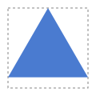
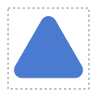

# F07 — A polygon anchored in its box

## What you can do now

In the playground, when you draw a **polygon**, a small grid of nine round buttons appears under **Anchor**. It says where the polygon sits in its **box**, the width × height you typed, drawn in grey behind it: top left, top middle, and so on down to bottom right. The middle button is checked at first, which is the placement of F02.

## The ideas behind it

**A regular polygon leaves room on one side.** It stays regular, so it fills its box in one direction only. A triangle in a 100 × 100 box is 100 wide but 86.6 high. The anchor says where that room goes. At the bottom, the triangle's base lies on the bottom of the box, at y = 100 exactly, instead of 93.30127 when centered. So a face of the polygon lands on a whole number, in line with the rectangles drawn next to it.

**Your choice is kept even when nothing moves.** The triangle already fills the width, so left, middle and right give the same drawing. The button you checked is still kept and shown: it is your **intention**, and it will count as soon as the box changes shape.

**Rounding does not move the polygon.** The anchor places the polygon with sharp corners, and the radius then rounds it inwards. With a radius of 10, the triangle anchored at the top keeps its place. Its rounded apex leaves the top edge by 10, and its base stays where it was. A flat side on the anchored edge keeps touching it at any radius.

**A corner button holds two choices.** A square in a 100 × 50 box fills the height and leaves room across. Middle right puts it on the right. The bottom left button then puts it on the left. In the 100 × 100 box of the triangle, the same button put the triangle at the bottom. Which of its two choices counts follows the shape of the box.

| Term | In plain words |
| --- | --- |
| Box | the width × height you type, drawn in grey; the polygon fits inside it |
| Anchor | where the polygon sits in its box: one of nine places, from top left to bottom right |
| Room | the part of the box the polygon does not fill, above and below it or on its left and right |
| Intent | the anchor you chose, kept even when it does not move the polygon, used as soon as the box changes shape |

## Try it

Run `npm run dev` and open `http://localhost:5173/?guide=epic&step=20`: the **Guided test** opens on step 20, the first of F07, and takes you through the steps one at a time. The address always shows the step on screen, so it can be copied as a link to that step. **Next** types the values, chooses the shape and checks the anchor button for you. The same steps are listed in the test card of [US-010](../backlog/stories/E01-F07-US-010-anchor-picker-playground.md#product-owner-test). Step 26 shows a corner button in a wide box.

## Limits

- The polygon only: the anchor of any shape placed in a layout box comes with epic E13.
- The arrow keys move from one button to the next in reading order, as in any group of round buttons. They do not move in two directions as in Figma.
- No option to make a rounded polygon touch its box: the sharp polygon touches it, the rounding goes inwards (decided at the refinement).
- A polygon stretched to fill its whole box came with F06.

## Validation

Validated by the Product Owner on 2026-10-11 (`VAL-003`), after the guided test.

| Remark | What was done |
| --- | --- |
| only five of the nine places matter for a polygon; the choice was left to the agent | the nine buttons stay: a corner button holds both choices, and the one that counts follows the shape of the box (step 26); E13 needs all nine |
| the Next button moved as the text above it changed length | Next is large and stays in place; a link with `?step=N` opens a given step |
| an option pushing a rounded polygon onto its box | judged not useful: measures are taken from the face that touches the box |
