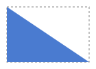

# F08 — Moving, adding and deleting points

## What you can do now

In the playground, in **Points** mode, the points of a shape can now be edited one by one:

- type the **X** or the **Y** of the point selected, then press Enter: it moves there;
- with two neighbouring points selected, **Add a point in the middle** adds one between them;
- **Delete points**, or the delete key, removes the points selected.

A rectangle can be edited straight away. A regular polygon is first turned into a **free shape** with **Convert to free shape**: it does not move, but it loses its number of corners and its anchor.

## The ideas behind it

**Converting does not move anything.** The hexagon keeps its exact points, decimals included (25, 6.69873…), so that it stays exactly where it was. Here point 1 (red) was then moved to x 80; the dashed outline is the hexagon before.

**Only what you type is a whole number.** Typing X 80 on that point leaves its Y at 93.30127: nothing is rounded behind your back. The value you change is a whole number, though: Up or `+1` in that Y gives 94 (since AUD-047). Width and height still stretch the whole shape, every point following, and moving a point after a stretch starts from where the points are drawn.

**A point in the middle.** The new point lands exactly in the middle of the side, without rounding, so the drawing does not change; it is selected alone, ready to be moved. Here it was moved up by 20 to make a peak.

**Deleting joins the neighbours.** The two points around a deleted one are joined by a straight side. A shape keeps at least 3 points: otherwise Delete is greyed and a line says why.

**The rounding follows its point.** Each point carries its own rounding when it moves; a point added in the middle is sharp. In Points mode a Radius field of the points rounds the points selected, while the shape's Radius field, shown in both modes, rounds every corner.

| Term | In plain words |
| --- | --- |
| Free shape | a shape whose points are edited one by one; the rectangle is one from the start |
| Convert | turn a regular polygon into a free shape, without moving it |
| Neighbours | two points joined by a side; the last and the first are neighbours too |
| Point selected | the point clicked in the list or on the drawing; X and Y show when exactly one is |

## Try it

Run `npm run dev` and open `http://localhost:5173/?guide=epic&step=39`: the **Guided test** opens on the first step of F08 (steps 39 to 46). **Next** types the shape for you; the clicks on the points are yours, as each step says. The same steps are in the test cards of US-014, US-015 and US-016.

## Limits

- One point moves at a time. Moving several selected points together, by typing `+10`, and simple arithmetic in every number field are noted for the editor applications.
- Points are typed, not dragged: dragging comes with the editor applications (E02).
- Two points at the same place, points on one slanted line, or sides that cross are allowed and may draw nothing; the warnings you asked for come with the editor applications (Q29).

## Validation

Validated by the Product Owner on 2026-10-11 (`VAL-005`): moving, adding and deleting points, the update after a stretch and the decimals kept on the coordinate not typed work as they meant; the last point settled Q28 (ADR-0034).

| Remark | What was done or where it went |
| --- | --- |
| a Radius field for the points selected, the shape's own Radius field kept in Points mode | done at once |
| a field lost the focus at each key | fixed: typing goes on, the arrow keys repeat |
| moving several points at once by typing `+10`; arithmetic in every number field, as in a spreadsheet | editor applications (`interaction.md`) |
| two points at the same place: flagged in the list, with an offer to delete one, never refused nor merged | editor applications (Q29) |
