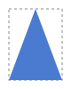

# F09 — The rectangle, a free shape you can stretch

## What you can do now

Nothing looks different in the playground, and that is the point: the rectangle is now a **free shape**. It keeps its corners in a box of its own and stretches them to the width and height you type. Every shape you can reshape point by point will work the same way.

## The ideas behind it

**Points in a box of their own.** The rectangle tool keeps a square of side 1 — the points (0, 0), (1, 0), (1, 1), (0, 1) — and draws it stretched to your width and height. In the **Pipeline** column (the toolbar's **Pipeline** button shows or hides it), under **Model (integers)**, the playground shows that square, the radii, and the width and height. Since F08, each point is shown with its radius, as a corner.

**Width and height stretch the shape.** The top-left corner of the box stays where it is: the width grows to the right, the height downwards. A rectangle stays a rectangle; any other free shape is stretched. The same triangle, stretched to 100 × 40 and to 60 × 80:

 

**Nothing is lost.** The points kept in the box never change when you resize: a width of 0 draws nothing, and the width typed back gives exactly the shape of before. Useful for animations, where a size can go to 0 and back.

| Term       | In plain words                                                                  |
| ---------- | ------------------------------------------------------------------------------- |
| Free shape | a shape kept as its points in a box of their own, stretched to its size         |
| Stretch    | change the width or the height, the points following in proportion              |
| Box        | the rectangle around the points; its top-left stays in place when you resize it |

## Try it

Run `npm run dev` and open `http://localhost:5173/?guide=epic&step=34`: the **Guided test** opens on the first step of F09 (steps 34 to 38). The same steps are in the test card of [US-017](../backlog/stories/E01-F09-US-017-rectangle-as-free-shape.md#product-owner-test).

## Limits

- Resizing from another side than the top-left, with the eight handles of the box as in Inkscape, comes with the editor (E02).
- The polygon stays a shape of its own; turning it into a free shape, and moving, adding or deleting points, came with F08.
- Each point and its rounding were kept in two lists; since F08 they are kept together, as a corner (a point and its radius, ADR-0033).

## Validation

Validated by the Product Owner on 2026-10-11 (`VAL-006`): width, height and the stretched points of the rectangle work as they meant.

| Remark                                                                                | Where it went                             |
| ------------------------------------------------------------------------------------- | ----------------------------------------- |
| a radius kept apart from its point is confusing: a point and its radius make a corner | the free shape of corners, F08 (ADR-0033) |
