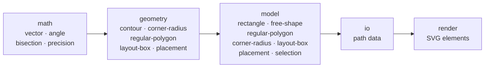

# F11 — A code base ready for curves

## What changed for you

Nothing you can see in the playground: every drawing is the same, to the last decimal. F11 tidied the code before curves arrive (E14), so that the curves are built on one structure instead of two. This page shows the figures before and after, and how to check them yourself.

## The figures, before and after

| What                                                       | Before F11                                   | After F11                                               |
| ---------------------------------------------------------- | -------------------------------------------- | ------------------------------------------------------- |
| Largest folder of code                                     | `playground/`, 77 modules side by side       | `playground/user-actions/`, 23 modules, listed with why |
| Folders of code                                            | 7                                            | 33, each named after a domain                           |
| A folder holding both files and folders                    | possible                                     | refused by the lint, in the editor at once              |
| Functions of `math` and `geometry` without a property test | 9, on a list of exceptions                   | 0, the list removed                                     |
| Small helpers written again in the playground's tests      | 72                                           | 12, each used by one file only; the rest shared once    |
| Writers of SVG path data in the library                    | 2                                            | 1 (`contourPiecesToPathData`)                           |
| Passes over each corner to round a contour                 | several (angles computed again by each step) | one: each corner and its angle computed once            |
| Tests                                                      | 793                                          | 859, every old value unchanged                          |

A **property test** checks a rule on hundreds of random inputs (for instance, "a mirrored point mirrored again is the point itself"), where an ordinary test checks one hand-computed example.

## How the code is now arranged

The library is divided into the **domains** of the business, the words of the [domain pages](../domain/): the same folder name wherever the domain has code.

| Word   | In plain words                                                                                           |
| ------ | -------------------------------------------------------------------------------------------------------- |
| domain | a subject of the business: the corner radius, the regular polygon, the placement of a shape              |
| module | one file of code holding one function or one value                                                       |
| signal | 15 modules in a folder: past it, a domain may be missing; the folder is split, or listed with its reason |
| lint   | the checker that reads the code as it is typed and underlines what breaks a rule of the project          |

The rules and their reasons: [Files](../conventions/files.md#folders) and [ADR-0043](../adr/0043-folders-by-domain.md).

## Check it yourself

| Step | Do                                                        | You should see                                                                                    |
| ---- | --------------------------------------------------------- | ------------------------------------------------------------------------------------------------- |
| 1    | open `src/` in the editor                                 | five layers, each holding only folders named after a domain (`math/` holds `vector/`, `angle/`…)  |
| 2    | create an empty file `src/math/test.ts`                   | the editor underlines it: the folder holds domain folders, move the file into one; then delete it |
| 3    | run `npm run dev`, then walk a few steps of `?guide=epic` | the playground draws as before                                                                    |

## Limits

F11 changes no drawing. Curves themselves come in the next features of E14, after the ADR that allows them.

## Validation

Not yet validated (`VAL-010`).

| Remark | What was done or where it went |
| ------ | ------------------------------ |
