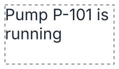
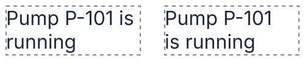
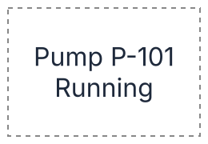
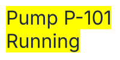
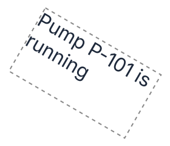

# F14 — A box of text

## What is new

A text can now sit in a **box** of a given width and height instead of fitting its content: its lines wrap at the spaces, a text too long ends with "…", and the lines are placed across and down the box. A label or an explanation then keeps to its frame in a synoptic view, as in Figma or a word processor.

| Option                                  | What it does                                                                                             |
| --------------------------------------- | -------------------------------------------------------------------------------------------------------- |
| **Fit**                                 | **Fit content**, as in F05, or **Box**; the box's own fields show only for a box                         |
| **Width**, **Height**                   | the box, integers from 0 to 100 000; the dashed frame is the box, not the lines                          |
| **Long words**                          | a word wider than the box: **Break** at a character, without a hyphen, or **Move whole** to its own line |
| **Max lines (0 none)**                  | the most lines shown; the last one shown ends with "…"                                                   |
| **Ellipsis**                            | on by default; off, a cut text simply stops                                                              |
| **Vertical alignment**                  | the block of lines at the top, the middle or the bottom of the box                                       |
| **Wrap**                                | **Automatic**, as many words a line as fit, or **Balance**, lines of even length                         |
| **Line height (0 auto)**                | the distance between two baselines; 0 keeps the font's own                                               |
| **Trim**                                | the block starts at the capitals' top, not at the font's ascender                                        |
| **Background**, its color and opacity   | a band behind each line, as a highlighter, yellow and opaque when ticked                                 |
| **Alignment**, **Angle** (F05's fields) | each line on the left, the center or the right of the box; a text in a box turns about the box's middle  |

Rules: [domain, "Text"](../domain/shapes.md#text); formulas: [`DERIV-text-box`](../derivations/text-box.md); decisions: [ADR-0052](../adr/0052-text-measured-and-drawn-as-positioned-lines.md), [ADR-0055](../adr/0055-text-fallback-metrics-and-turn-on-its-group.md).

## The ideas behind it

| Term               | In plain words                                                                                                               |
| ------------------ | ---------------------------------------------------------------------------------------------------------------------------- |
| **Wrap**           | starting a new line when the next word does not fit; the lines break only at spaces, or inside a word too long               |
| **Ellipsis**       | the "…" that ends a text cut short; characters are removed until the line and its "…" fit                                    |
| **Line height**    | the distance from one baseline to the next; the room it adds is spread half above and half below the letters                 |
| **Content area**   | the height from the font's ascender (the top of tall letters) to its descender (the bottom of "g" or "p"): 19.36 at Inter 16 |
| **Cap height**     | the height of a capital letter, 11.64 at Inter 16; trimming starts the block there                                           |
| **Balanced wrap**  | the same number of lines, the words moved so that the room each line leaves is as even as possible                           |
| **No-break space** | a space that keeps the two words around it on one line                                                                       |

**Wrapping and cutting.** "Pump P-101 is running" in a box 110 wide: "Pump P-101 is" (104.77) fits, "running" goes to the next line. At most one line, "Pump P-101 is…" would be 118.6 wide: characters go until it fits, "Pump P-101…" (101.78).

**Balance.** The automatic wrap fills each line in turn and leaves a short last line; the balanced wrap keeps two lines and evens them: "Pump P-101" over "is running". On equal evenness the later break wins. A paragraph with a word too long, more than 10 lines or 500 words, or cut by its box, keeps the automatic lines.

**Placing the lines.** Across the box, each line follows the text's alignment; down the box, the block of lines sits at the top, the middle or the bottom. Below, "Pump P-101" over "Running", centered and in the middle of a box 120 × 80.

**Background.** Each line gets a band from the ascender to the descender, as long as the line, its "…" included; an empty line has none. All bands are one `<path>` under the letters, so that where bands overlap, under a small line height, the overlap is filled once.

**Turning.** A text in a box turns about the middle of its box, with its frame, bands and strokes.

## How to try it

Install Inter 4.1 first, as for F05. Then `npm run dev` and `http://localhost:5173`: 41 steps, each one line to do and one to look at; **Next** types the text and its box. At the epic review they come back as steps 124 to 164 of `?guide=epic`. The steps give each example in Inter 16, whose metrics ship with the library.

| Steps | What                                                                                                                                                                      |
| ----- | ------------------------------------------------------------------------------------------------------------------------------------------------------------------------- |
| 1–11  | Fit content or Box, width and height, long words broken or moved whole, the ellipsis, max lines, vertical alignment, alignment across the box, line height, trim, balance |
| 12–13 | the background, its color and opacity                                                                                                                                     |
| 14–15 | turned about the box's middle, values refused                                                                                                                             |
| 16    | back to Fit content: the text draws as in F05                                                                                                                             |
| 17–38 | the 22 decisions below, one step each with its example                                                                                                                    |
| 39    | a turned box resized in place, its turned top-left corner kept (ADR-0057, US-038)                                                                                         |
| 40    | a turned box's straight box, upright, with its x, y, width and height (US-039)                                                                                            |
| 41    | back to the rectangle, drawn as before                                                                                                                                    |

## Decided by the agent, to confirm

Each is built as written and shown by its step; the full list, with its examples in Arial 16, is in [VAL-015](../backlog/stories/E15-F14-VAL-015-validate-f14.md#decisions-to-confirm).

| #   | Question                            | As built                                                                                                    | Step |
| --- | ----------------------------------- | ----------------------------------------------------------------------------------------------------------- | ---- |
| 1   | Box size                            | integers from 0 to 100 000                                                                                  | 17   |
| 2   | Spaces opening a paragraph          | kept with its first word: " Hello" over "World"                                                             | 18   |
| 3   | A word too long, broken             | on its own line, broken without a hyphen; the next word may join its last part                              | 19   |
| 4   | A word too long, moved whole        | on its own line, cut with "…", or whole and overflowing without the ellipsis                                | 20   |
| 5   | No-break space                      | no line ends after it                                                                                       | 21   |
| 6   | A box shorter than a line           | one line shown at least; max lines from 0 (none) to 100 000                                                 | 22   |
| 7   | The ellipsis                        | an option, on by default                                                                                    | 23   |
| 8   | What the ellipsis removes           | characters, not whole words: "Hell…" in a box 50                                                            | 24   |
| 9   | One character wider than the box    | no ellipsis                                                                                                 | 25   |
| 10  | Empty lines left out                | no ellipsis                                                                                                 | 26   |
| 11  | Even "H…" too wide                  | drawn past the box's edge; or draw only what fits, or nothing                                               | 27   |
| 12  | Line height                         | 0 automatic, or 1 to 100 000, the room spread half above, half below                                        | 28   |
| 13  | Balanced wrap                       | the most even lines, the later break on a tie                                                               | 29   |
| 14  | Balance and a cut                   | a text cut keeps its automatic lines                                                                        | 30   |
| 15  | The "pretty" wrap style             | not built: keep it for later, or drop it                                                                    | 31   |
| 16  | Options of every text               | line height, trim and background for every text; the others in a box only                                   | 32   |
| 17  | Defaults                            | fit content, automatic line height, no trim, no background, ellipsis on; a box 0 × 0                        | 33   |
| 18  | The background's height             | the content area, from the ascender to the descender                                                        | 34   |
| 19  | Bands under a line height or a trim | still from the ascender to the descender, so a band may rise above the box                                  | 35   |
| 20  | Overlapping bands                   | one path, the overlap filled once                                                                           | 36   |
| 21  | The turn of a text in a box         | about the box's middle (ADR-0055, decision 3); grown or resized, its turned top-left corner kept (ADR-0057) | 37   |
| 22  | Other no-break characters           | only U+00A0 holds a line; U+202F, U+2007 and U+2060 may end one                                             | 38   |

## Limits

- Fonts other than Inter are still measured with Inter until fonts are read from files (F15).
- No hyphenation: a long word breaks at a character, without a hyphen.
- No "pretty" wrap style (decision 15).
- A line's characters are never clipped at the box's edge: what overflows is drawn.

## Validation

To be run by the Product Owner (`VAL-015`, T3).

| Remark | What was done or where it went |
| ------ | ------------------------------ |
