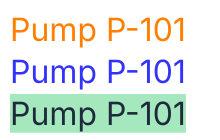

# F16 — Colors and their picker

## What is new

A color is now typed or pasted in any common hexadecimal form, or picked with a **picker**: a swatch beside the field opens a plane, a hue bar and an opacity bar, with the values in HSB or HSL. The text's color, its background's, its underline's and its strike-through's each have one. What is stored stays the hexadecimal and the opacity, so a symbol's file never changes with the way its color was chosen.

| Part | What it does |
| --- | --- |
| **Color** field | 3, 4, 6 or 8 hexadecimal digits, with or without `#`, in any case; kept as `#` and six lower-case digits |
| **Opacity** field | an integer from 0 to 100 %; 4 or 8 digits typed set it from their alpha |
| **Swatch** | the square left of the field, in the color; a click opens the picker under the color's fields, another click closes |
| **Plane** | the saturation across, 0 at the left; the brightness (HSB) or the lightness (HSL) up, 100 at the top |
| **Hue bar** | the hue from 0 to 359°, whole degrees |
| **Opacity bar** | the opacity from 0 to 100 %, a whole percent |
| **Model**, **H**, **S**, **B** or **L** | HSB or HSL, and their three values as whole numbers, typed or shown |

Rules: [domain, "Colors"](../domain/interaction.md#colors) and Q38; formulas: [`DERIV-color-spaces`](../derivations/color-spaces.md); decisions: [ADR-0056](../adr/0056-color-stored-as-hexadecimal-hsl-and-hsb-as-views.md), [ADR-0058](../adr/0058-hsl-and-hsb-shown-and-typed-as-integers.md), [ADR-0059](../adr/0059-an-open-picker-rebuilds-against-the-color-it-read.md).

## The ideas behind it

| Term | In plain words |
| --- | --- |
| **Hexadecimal color** | red, green and blue, each from 0 to 255 written in two digits from 00 to ff: `#ff8000` is orange |
| **Alpha** | a fourth pair of digits for the opacity: `cc` is 204 of 255, 80 % |
| **Hue** | the color's place on the color wheel, in degrees: 0 red, 120 green, 240 blue |
| **Saturation** | how far from grey: 0 % is a grey |
| **Brightness** (HSB) | how far from black: 100 % is the pure hue or white |
| **Lightness** (HSL) | from black to white, 50 % being the pure hue |
| **Slider** | a bar with a thumb, moved by mouse or keys: arrows 1, Page Up and Page Down 10, Home and End to the ends |

**Short forms.** `f80` doubles each digit: `#ff8800`. `#0000ffcc` keeps `#0000ff` and sets the opacity to 80 %. Anything else, `red` or `#ff800`, is refused: the field shows its previous color again, a line under it says why.

**HSB and HSL are views.** They are computed from the hexadecimal each time the picker opens, never stored. `#ff8000` is HSB 30°, 100 %, 100 % and HSL 30°, 100 %, 50 %, whole numbers, the decimals kept inside (ADR-0058). Editing one value keeps the exact others: `#336699` is HSB 210°, 67 %, 60 %; its brightness set to 61 gives `#34689c`, where the three whole numbers would give `#33679c`, and 67 left as shown keeps `#336699` (ADR-0059).

**The plane**, described rather than drawn: in HSB, white at the top left, the pure hue at the top right, black along the bottom; in HSL, white along the top, black along the bottom, grey at the left and the pure hue in the middle of the right edge. At the hue 210°, the middle of the right edge in HSB is `#004080`.

**A grey has no hue.** `#808080` opens at 0°; while the picker stays open it keeps the hue its bar shows, so dragging towards more saturation gives a blue at 200°, not a red.

## How to try it

**Validation**: `npm run dev`, then `http://localhost:5173/?checklist=E15`: one page listing E15's options, one line each, what to try and what to see, a check box before it, the boxes ticked kept in this browser (US-051). Since then the plain address opens no guided test: the steps below come back only in `?guide=epic`, at the numbers given for the epic review.

`npm run dev` and `http://localhost:5173`: 42 steps, each one line to do and one to look at; **Next** types the text and its colors. E15 is validated at once (VAL-017): they are steps 78 to 119 of its 176, numbered so below; at the epic review, steps 165 to 206 of `?guide=epic`. Next does not choose the picker's model: a step that needs one names it.

| Steps | What |
| --- | --- |
| 78–84 | six digits, with `#` and spaces, three, four and eight digits, a color pasted, a value refused |
| 85–87 | the opacity, the swatch opening the picker, the picker closed by the swatch, Escape and a click outside |
| 88–90 | the hue bar by mouse and by keys, the opacity bar |
| 91–94 | the plane in HSB and in HSL, values typed, a grey keeping its hue |
| 95 | the background's color and its picker |
| 96 | the underline's and the strike-through's colors, the underline's picker (US-041) |
| 97–117 | the 21 decisions below, one step each with its example |
| 118–119 | back to F14 and F05, then to the rectangle, drawn as before |

## Decided by the agent, to confirm

Each is built as written and shown by its step; the full list, with its examples, is in VAL-016.

| # | Question | As built | Step |
| --- | --- | --- | --- |
| 1 | What is stored | the hexadecimal and the opacity; HSL and HSB computed, never stored | 97 |
| 2 | Forms typed | with or without `#`, any case, spaces around ignored; kept as six lower-case digits | 98 |
| 3 | Short forms and alpha | 3 digits doubled; 4 and 8 digits set the opacity to the nearest percent (`ec` gives 93 %) | 99 |
| 4 | Anything else; a copy | refused, the previous color back; a copy is six digits, the opacity apart | 100 |
| 5 | Opening and closing | the swatch opens; the swatch, Escape or a click outside closes | 101 |
| 6 | First model | HSB, the agent's own choice; HSL one choice away | 102 |
| 7 | The plane's axes | saturation across, 0 at the left; brightness or lightness up, 100 at the top | 103 |
| 8 | Values shown | whole numbers; one value edited rebuilt with the exact others, against the color last read (ADR-0058, ADR-0059) | 104 |
| 9 | Rounding to the hexadecimal | each of red, green and blue to the nearest, a tie up | 105 |
| 10 | A grey's hue | 0° shown; an open picker keeps its bar's hue | 106 |
| 11 | Keys | arrows 1, Page Up and Down 10, Home and End; on the plane Left and Right the saturation | 107 |
| 12 | The hue bar | whole degrees from 0 to 359: arrows add 1, End 359°, a hue rounding to 360 shown 0 | 108 |
| 13 | The background's color | read into F16's fourth criterion: the same swatch and picker | 109 |
| 14 | A color refused | the color the field had when it got the focus, a line under it | 110 |
| 15 | Beyond the ends; empty | held at the end; an empty value shown again; a click on the opacity bar a whole percent | 111 |
| 16 | Where the picker opens; Escape | under its color's fields, which stay usable; Escape gives the focus back to the swatch | 112 |
| 17 | Another model chosen | reads the color's values again, its own hue; a grey keeps the hue the picker holds | 113 |
| 18 | What a screen reader reads | each bar's track is the slider, with its name and value; the thumb only drawn | 114 |
| 19 | A value on a half-tenth | dropped (ADR-0058): no tenth is shown | 115 |
| 20 | Page keys on the plane | Page Up, Page Down, Home and End act on the saturation | 116 |
| 21 | Underline and strike-through colors | follow the text's color until one is chosen, its box then unticked; ticked again, it follows (US-041) | 117 |

## Limits

- Colors of a text, its background, underline and strike-through only: shapes have no color field yet.
- No saved colors yet: with the epic of libraries (F16, "Left for later"); no named colors such as `red`.
- One opacity per color: the alpha typed in 4 or 8 digits goes to the Opacity field, never into the hexadecimal stored.
- The plane and the bars are drawn by the page's styles, outside the symbol: they are not exported.

## Validation

Run by the Product Owner on 2026-10-15 (`VAL-016`, T3), with the whole of E15, in a Chromium-based browser; the details are in `VAL-016`.

| Remark | What was done or where it went |
| --- | --- |
| every rule confirmed as built; the stroke colors kept for now, a reset button and fewer options for a later epic on ease of use | E02 (ideas) |
