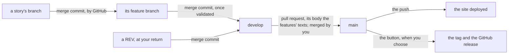

# F22 — One story at a time, the release by a button, its CI green

## What changed for you

The CI of a pull request into `main` failed 6 runs of 6 on three tests that passed on the Mac; they now hold on GitHub's runner as on the Mac, each still failing when the fault it guards is planted. A release no longer needs a release branch, a commit of the version nor a `CHANGELOG.md`: once a review is merged into `main`, you press **Run workflow** in GitHub's Actions tab and the tool computes the version, tags `main`'s head and publishes the GitHub release, its notes the features' texts written at the review. A merge into `main` deploys the site only, so the site follows each review without a version. A run works one story at a time, a fresh worker for each, and every merge is a merge commit; the review, the naming pass, the tool fixes and the method happen at each of your returns, no longer at an epic's end. Nothing changes in the editor.

## The words

| Word | In plain words |
| --- | --- |
| the CI | the checks GitHub runs on a pull request, on its own machine, the runner (`ubuntu-latest`) |
| the button | _Actions → Release → Run workflow_ on GitHub: it starts `release.yml` on demand (`workflow_dispatch`) |
| a tag `vx.y.z` | a name GitHub puts on one commit, `v0.3.0`: the version lives there only |
| the release text | the part of a pull request's body before its first line `---`: the changes it brings, written for the library's users; the release's notes join those texts |
| a merge commit | a commit with two parents that joins a branch into another: the branch stays visible as a bubble in the history, its commits unchanged |
| a feature branch | `feature/f22-release-by-a-button`: one per feature, from `develop`, each story of the feature merged into it |
| a `REV` | the story of a review, held at each of your returns, its branch from `develop` |
| a patch, a minor version | the last, then the middle number of a version: `0.2.0` → `0.2.1` for fixes or tooling only, → `0.3.0` for a new feature before 1.0.0 (`REF-SEMVER`) |

## The flow, from a story to a release

The graph of this flow, branch by branch, is in the [Git workflow](../tooling/git-workflow.md); the release, step by step, in [Releases](../tooling/releases.md).

## The CI green on GitHub's runner

Read from the logs of the failed runs of #259 (EN-116); each test now holds on both machines.

| Test | What failed on the runner | Why | Now |
| --- | --- | --- | --- |
| `[F19.AC6]`, a planted type error reported as `tsc` does | oxlint printed `::error file=planted.ts,…` | oxlint picks its format from its environment: GitHub's under `GITHUB_ACTIONS`, an agent's under Claude Code; the test passed only in an agent's session | the test names `--format agent`: the same line everywhere |
| `[F19.AC9]`, a crate with a known advisory | `Unexpected end of JSON input` | the runner's crate cache lacked the crates of the other targets, so `cargo metadata` failed with an empty output | the CI fetches every crate first (`cargo fetch --locked`); a failure now names Cargo's own message |
| `[F02.AC1]`, the walk of the guided test | over Vitest's 5 s | 72 steps drawn take 0.5 s alone, ten times that on the loaded runner | a limit of 20 s, as the other long tests; 0.52 s here |

## The release by a button

| Before (ADR-0079, F21) | Now (ADR-0086, EN-117) |
| --- | --- |
| `release prepare` made a branch `release/x.y.z` and a commit of the version and of `CHANGELOG.md` | `release notes` prints the draft of the features' text, no branch nor file |
| the pull request into `main` held that commit; its merge was the release | the merge into `main` deploys the site; the release waits for your button |
| the version typed into `package.json` | `package.json` holds `0.0.0-development`; the version is computed from the last tag and the commits since |
| the notes in `CHANGELOG.md` | the notes the release texts of the pull requests into `main` merged since the last tag; `CHANGELOG.md` deleted, 0.1.0's and 0.2.0's notes kept in their GitHub releases |

`release check` refuses a text that breaks a rule of good notes, naming its line: a heading other than a group's, a change without its references, a line still marked `[draft]`. `release publish` refuses notes that disagree with the version (AUD-024): a text listing changes when no commit changes the library nor the playground, or none when one does. A release with only tooling since the last tag is a patch with the notice _No change to the library nor the playground: documentation and tooling only._; with no commit since the last tag, the button does nothing, so a second press releases nothing.

Drafted here by `release notes`: 57 lines from the 930 commits `main` lacks, grouped under _Changed_, _Added_, _Removed_ and _Fixed_; they become the body of the next review's pull request into `main`, then the notes of 0.3.0, the first release made this way.

## One story at a time, a review at each return

A run works one story at a time, a fresh worker for each, in the background, so that the main thread stays free for you: an agent's cost is its context read again at each call: EN-122's worker ended near 255,000 tokens, when a fresh one starts at about 10,600 (EN-123). Every merge is a merge commit: each story stays a small bubble on its feature's line, each feature a bubble on `develop`, and no commit is rewritten.

An epic is a list of features grouped by theme, with no closing: no naming pass, review nor retrospective at its end (EN-123). At each of your returns, a feature under way is finished first; then a `REV` from `develop` holds the review of the features finished since the last merge into `main`, the naming pass over the code changed since then, the tool incident cards fixed, the method's changes decided with you and the docs; then `develop` → `main` is opened. A new epic opens with a refinement `SP` from `develop`, a feature with a short `SP` when questions remain, and a feature of more than 4 stories, or a story of more than 3 tasks, is proposed to you split, with an example.

## What the audit found

AUD-024 had one independent review, the `auditor` alone (ADR-0086, one agent at a time); each finding was reproduced before it was fixed.

| Finding | Outcome |
| --- | --- |
| nothing compared the version with the notes: a range of tooling only, its body listing changes, would have been published as a patch with those changes | **fixed**: `release publish` refuses notes that disagree with the commits |
| a Dependabot security update merged into `main` put Dependabot's body among the notes, which the check refuses: the button would fail | **fixed**: a pull request from `dependabot/…` is left out of the notes |
| `/audit` and `/spike` still started reviewers in parallel; `CLAUDE.md` listed the `doc-editor` with no condition | rewritten: one at a time, each only where its independence pays |
| an epic's refinement `SP`, its branch from `develop`, is refused by the auto-merge, which lets into `develop` only a feature or a `REV` | a tool incident card; whether the auto-merge should take it is a question for your next review |
| no test tagged for criteria 1 and 5 | tagged; 1's run on GitHub and 4's half on the docs left to this validation |
| words of the old flow left (a release commit, a changelog, the epic's end) | removed; one comment of a tool left for the next review |

The release was also made from a copy of the repository's history, `main` at `v0.2.0` merging F22's branch, with a fake GitHub: `v0.3.0` on the merge, its notes the body, no commit nor tag made.

## Decisions for you to confirm

| Decision | Why | Where |
| --- | --- | --- |
| The oxlint test names its output format, `--format agent`, rather than letting oxlint pick it | the same line on GitHub, in a terminal and in an agent's session | EN-116 |
| The CI fetches every target's crates before `check:all`, and the push to `main` saves them in the cache | `cargo metadata` and `cargo deny` read the crates of every target, the build fetches the host's only | EN-116, EN-117 |
| `release prepare` is gone: `release notes` prints the draft, no branch nor file | both would have drafted the same text, and the flow has no release branch | EN-117 |
| A release text ends at the body's first line `---` | the evidence and the attribution of the pull request stay out of the notes | EN-117 |
| Only the library's and the playground's commits count for the version: a tooling commit marked breaking is a patch | the version tells the library's users what changed for them | EN-117 |
| Notes that disagree with the commits are refused; Dependabot's bodies are left out, what its update changes for a user written in the next review's text | the button never publishes notes that contradict the version, nor fails on a security update | AUD-024 |

One thing for you to do once: the token release-please needed is no longer read; delete the secret `RELEASE_PLEASE_TOKEN` (_Settings → Secrets and variables → Actions_) and the token itself in your GitHub account ([Releases](../tooling/releases.md)).

## Each criterion and its evidence

Proven again on 2026-10-18 by VAL-023, on `feature/f22-release-by-a-button` at `ec18baca`, `develop` already merged: `check:all` passed in 116.2 s, and the 18 Rust tests named `f22_ac…` and the 18 TypeScript tests tagged `[F22.ACn]` passed. Two halves only GitHub can show wait for your next review: they are pending, not passed.

| Criterion | What you get | Evidence | Result |
| --- | --- | --- | --- |
| AC1 the CI green on GitHub's runner, a failure of `cargo metadata` with its message | the three tests hold on both machines | 3 tests tagged `[F22.AC1]` (`tests/type-check-with-lint.test.ts`, `tests/rust-advisories.test.ts`, `playground/mount/mount-playground.test.ts`): passed here, the oxlint one too under `GITHUB_ACTIONS=true` without the agent's variables; with an empty Cargo home, `cargo metadata failed (exit 101): error: no matching package named …` | holds here; **its run on GitHub pending** until the CI of `develop` → `main` at the next review |
| AC2 the button, its tag and notes, no release branch nor commit; a push deploys only; `0.0.0-development`, no `CHANGELOG.md` | the release by **Run workflow** on `main` | `tools/release/tests/`, 12 tests `f22_ac2_`; `tests/release-flow.test.ts`, 7 tests `[F22.AC2]`; `release notes` drafted 57 lines, no file written; `release check` refused a heading and a change without references | holds; **the first press pending**, 0.3.0 at the next review |
| AC3 tooling only a patch with its notice, nothing without a commit | a second press releases nothing | `tools/release/tests/`, 5 tests `f22_ac3_`, among them the notes that disagree refused | holds |
| AC4 a story from its feature branch, every merge a merge commit, a review after the feature, one agent at a time | the graph's bubbles; the run's rules | `tests/story-automerge.test.ts`, 4 tests `[F22.AC4]`; `tools/worktree/tests/plan.rs`, `f22_ac4_`; F22's five stories merged by merge commits, #362 to #366; the run skill, the worker brief, `project-rules`, `AGENTS.md` and `docs/tooling/git-workflow.md` read again: one agent at a time, a merge commit for every merge, a review at each return, nothing of the rebase merges, the parallel stories nor two agents per story | holds |
| AC5 no epic closing, a `REV` at each return, a refinement `SP`, a feature over 4 stories split | the review at each return | `tests/backlog.test.ts`, 4 tests `[F22.AC5]`; no closing template left, `_review.md` for a return's review | holds |

## How to try it

Run `npm run dev` and open `http://localhost:5173/?checklist=E17`: E17's checklist, F22's 12 lines after F21's, each a command to run in a terminal at the repository's root or something to look at on GitHub; six carry a decision for you to confirm, two wait for your next review.

| Try | You should see |
| --- | --- |
| `env -i PATH="$PATH" HOME="$HOME" GITHUB_ACTIONS=true npx vitest run tests/type-check-with-lint.test.ts -t F22.AC1` | 1 passed, as on GitHub's runner |
| `CARGO_HOME="$(mktemp -d)" npx vitest run tests/rust-advisories.test.ts -t F22.AC1` | 1 failed with Cargo's own message, as meant with no crate at hand |
| at the next review, the pull request `develop` → `main`, its Checks tab | the CI green on `ubuntu-latest` |
| `node -p "require('./package.json').version"`, `ls CHANGELOG.md`, `grep -n 'if: github' .github/workflows/release.yml` | `0.0.0-development`; no such file; the release only by the button on `main` |
| `target/release/release notes > /tmp/notes.md`, then `git status` | 57 lines marked `[draft]`; the working tree clean |
| a body with a heading, given to `target/release/release check` | refused, naming its lines |
| `cargo test -q -p release f22_ac3_`, then `cargo test -q -p release dependabot` | 5 tests passed, then 1 |
| after the merge into `main`: _Actions → Release → Run workflow_ on `main`, then again | `v0.3.0` on `main`'s head, its notes the review's text; the second press releases nothing |
| `git log --first-parent --oneline origin/develop..origin/feature/f22-release-by-a-button --grep "Merge pull request"` | the five stories of F22, each a merge commit |
| `grep -n "One agent at a time" AGENTS.md .claude/skills/run/SKILL.md`, then `cargo test -q -p worktree f22_ac4_` | the rule in both; 1 test passed |
| `ls docs/backlog/_*.md`, then `npx vitest run tests/backlog.test.ts -t F22.AC5` | no closing template; 4 tests passed |

## Limits

- The CI's run on GitHub's runner and the button are seen for the first time at your next review: the pull request `develop` → `main`, then the press that makes 0.3.0. Until then criterion 1 holds on this Mac only, and criterion 2's publication on a copy of the history with a fake GitHub.
- The first press reads the bodies of the pull requests into `main` merged after `v0.2.0`: the next review's alone, whose text must pass `release check`.
- An epic's refinement `SP` is not taken by the auto-merge yet: a question for your next review (AUD-024).
- `tools/lint` still ignores a file named `CHANGELOG.md`, and a comment of the commit-message check names the old release commit: harmless with the file gone, left for the next review.

## Validation

Validated by the agent on 2026-10-18 (`VAL-023`), F22 being a tooling feature (ADR-0072): each of its five criteria proven again by its tests and a command, F22's 12 checklist lines tried, and the run's rules read again; criterion 1's run on GitHub and the CI of `develop` → `main` pending until your next review. You may try the lines that concern you, and confirm the six decisions above.

| Remark | What was done or where it went |
| --- | --- |
