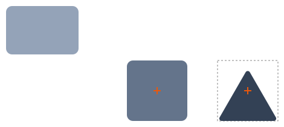

# F35 — Several shapes on one drawing

## What you can do now

Choose the Rectangle, Polygon, Round shape or Text tool, click the drawing, and a shape is added where you clicked, above the shapes already there. The export holds every shape, in the order drawn.

Choosing a tool changes nothing yet: its button stays pressed until you click the drawing. The new shape is then the one the panel edits, and the Selector button is pressed again, as in Figma; a click with the Selector places nothing. A shape the page refuses, a value out of its range, is not kept when you place the next one. Reset, and each step of the guided test, start the drawing again as the page opens, the next text Inter 32 Regular again. A text placed before any font can measure it has its top-left corner on the click; a text kept in the drawing stays as it was drawn, in the export too, even if its font is later dropped from the list.

## The ideas behind it

**A shape is centred on the click.** Its box, 100 × 100, has its top-left corner at the point clicked less half its size: a click at (250, 140) gives a box at (200, 90). Below, the page's rectangle 120 × 80 at (0, 0), then a rectangle placed by a click at (250, 140), then a triangle placed by a click at (400, 140), its box dashed: anchored at its bottom center, it sits on its box's bottom. Each new shape is drawn above the ones before, which do not move; the export lists them in that order, the last on top.

A text has no box of 100 × 100: it is the size of its content, `Text` in Inter 32 being 64.65625 × 38.71875, and that block is centred on the click, its corner rounded, (218, 121) for a click at (250, 140).

**A new shape starts with the settings of the last shape of its kind.** A polygon set to 3 corners and a radius of 4, then a rectangle set to a radius of 0: the next polygon placed is again a triangle of radius 4, and the next rectangle has a radius of 0. Only its box, its place and its angle are new: 100 × 100 centred on the click, straight. Before any shape of a kind, the new one has the values the page opens with: a radius of 10, 6 corners, the anchor at the center, Inter 32 Regular. A new text has the content `Text`, selected, so that typing replaces it.

Graphic editors do this in three ways (research note 0027): Figma gives every new shape the same fixed values and leaves alike shapes to duplicating, components and styles; Inkscape gives each tool the values last used; Sketch and Affinity Designer let you make a shape's settings the default, by a command. E02 has no duplicating yet, so the agent chose Inkscape's way, which is also Figma's and Inkscape's for a text: what the panel shows is what the next shape gets. To confirm at VAL-036.

| Term | In plain words |
| --- | --- |
| kind | rectangle, polygon, round shape or text: each keeps its own last settings |
| starting values | the settings a new shape has before you change any |
| on integers | the click's point may fall between two pixels once the view is scaled: the shape's corner is rounded to the nearest whole number, a half rounded up, so (250.5, 140.4) gives a shape at (201, 90) |
| selector | the arrow tool, pressed when no shape tool waits for a click |
| export | the SVG file made by Export SVG: every shape of the drawing, without the editor's frames and handles |

## How to try it

**Validation**: `npm run dev`, then `http://localhost:5173/?checklist=E02`: E02's checklist, F35's 11 lines, each what to try and what to see, a check box before it, the boxes ticked kept in this browser (US-051). The panel stays beside the drawing; no guided step was added.

| Try | You should see |
| --- | --- |
| Reset, then Rectangle | the page's rectangle alone; Rectangle pressed, nothing else changed |
| a click on the drawing, then another | a rectangle 100 × 100 centred on the first click, above the page's; the Selector pressed again; the second click adds nothing |
| Polygon, a click; Round, a click | a hexagon of radius 10, then a circle, each 100 × 100 centred on its click |
| Polygon, a click, Corners 3, Radius 4, Anchor Bottom center; Rectangle, a click, Radius 0; Polygon and Rectangle again | a triangle of radius 4 on its box's bottom, then a rectangle of radius 0: each kind's last settings |
| Text, a click, then type Pump | `Text` centred on the click, selected in Content; Pump replaces it |
| the browser zoomed to 110 %, Rectangle, a click | X and Y whole numbers |
| Width emptied, then Rectangle, a click | the refused rectangle gone, the new one drawn |
| Polygon, a click, Corners 3, Points, Convert to free shape, Shape; Polygon, a click | a free shape, then a new triangle |
| Text, a click, Size 20, Weight 700 Bold; Reset; Text and Polygon, a click each | the page's rectangle alone, then a text in Inter 32 Regular and a hexagon of radius 10 |
| three shapes over each other, Export SVG, the file opened | every shape, in the order drawn, the last on top |
| in a terminal, `npx vitest run playground/placing/place-shape.test.ts -t "metrics"` | 3 passed: the two choices on texts no font measures, which a browser shows only once a font is missing |

The tests proving F35's criterion are titled `[F35.AC1]`: the drawing as a list of shapes (`src/model/drawing/drawing-with-shape.test.ts`), the box centred on a point (`src/model/placement/centred-position.test.ts`), the tools placing shapes in the page (`playground/placing/place-shape.test.ts`) and this checklist (`playground/checklist/checklist-page.test.ts`).

## Decided by the agent, to confirm

Each is built as written and shown by its line of the checklist; the full list, with its reasons, is in [VAL-036](../backlog/stories/E02-F35-VAL-036-validate-f35.md#decisions-to-confirm), the rules in `interaction.md` §1.

| # | Question | As built | Line |
| --- | --- | --- | --- |
| 1 | What a new shape starts with (SP-026) | the settings of the last shape of its kind the panel showed, one memory per kind, the page's values before any; its box, place and angle from the click | 4 |
| 2 | A new text's content (SP-026) | `Text`, selected in Content, so that typing replaces it | 5 |
| 3 | A point between two integers (US-063) | the corner rounded to the nearest integer, a half up, as CSS rounds: (250.5, 140.4) gives (201, 90) | 6 |
| 4 | What a tool's button does (US-063) | it only arms the tool; the click places the shape and the Selector is armed again, as Figma does | 1, 2 |
| 5 | A click with the Selector (US-063) | places nothing, until F36 selects by a click | 2 |
| 6 | A shape refused (US-063) | not kept when another is placed | 7 |
| 7 | A shape made a free shape (US-063) | its settings kept for the next one of its kind | 8 |
| 8 | Reset and a guided step (US-063, AUD-037) | the drawing started again, the shapes placed and the settings kept forgotten, the Text tool's too: the next text Inter 32 Regular | 9 |
| 9 | A text no font measures (US-063) | its box's top-left on the point clicked, rounded, its size unknown | 11 |
| 10 | A kept text whose font is no longer read (AUD-037) | drawn and exported with the metrics it was last drawn with, rather than dropped | 11 |

## Limits

- A shape is placed by a click only: dragging to draw a shape of another size, selecting a shape by a click and Delete come with [F36](../backlog/features/E02-F36-draw-pick-and-remove-shapes.md).
- The panel edits the shape last placed; the shapes below cannot be edited again until F36 selects them.
- The drawing is a flat list, the last drawn on top; groups come with E13.
- No button yet puts a kind's settings back to the page's values, as Inkscape's does, but Reset, which also clears the drawing.

## Validation

Not yet validated: the Product Owner validates the features of E02 together, at the epic's end (`VAL-036`).

| Remark | What was done or where it went |
| --- | --- |
