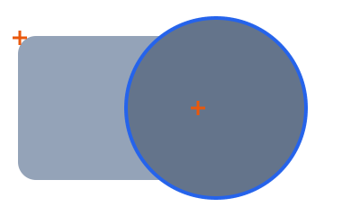

# F36 — Draw and pick shapes

## What you can do now

Choose the Rectangle, Polygon, Round shape or Text tool, press the drawing and drag: the new shape follows the pointer, from the point pressed to the pointer, in any direction, and stays where you release it, at the size dragged. A text dragged sits in a box of that size, Fit set to Box. Hold Shift and the box stays square, so that a round shape is a circle; pressing or releasing Shift during the drag changes the shape at once. A text is never made square. Released where you pressed, the drag is a click: the shape is placed 100 × 100 centred on the point, as in F35. With the Selector, pass the pointer over the drawing: the shape under it is outlined in blue, the top one where shapes overlap, and the outline goes when the pointer leaves it; the outline is never in the SVG exported. With the Selector, click a shape: it is outlined as selected and the panel edits it, while it stays where it was among the others, under the shapes drawn after it; the next shape you add goes on top of all. A rectangle comes back as a Rectangle with its radius, and a text with its whole style, its font chosen in the list, so that the next text you type is in that style. Click the empty drawing and none is selected: the panel says so until you click a shape or add one.

## The ideas behind it

**The box's corners land on whole numbers.** The point pressed and the point released are each rounded to the nearest whole number, a half rounded up, as a click is; the box runs between them, so a drag from (130, 90) to (10, 10) gives the same rectangle 120 × 80 at (10, 10) as a drag from (10, 10) to (130, 90). With Shift, the side is the larger of the two distances dragged, laid from the point pressed toward the pointer.

**A drag straight down or straight across keeps its width or height of 0.** A shape may have a side of 0, so the agent chose to keep it as drawn: nothing shows until a side is typed, but the panel edits it. Placing it as a click, adding nothing, or making the side 1 were the other ways. To confirm at VAL-037.

**Only what is painted is under the pointer.** The shape under the pointer is the last one drawn whose painted area holds it, computed from the shapes themselves, never read back from the page: the cut corner of a rounded rectangle, or the inside of a circle's box outside the circle, picks nothing. A text counts anywhere in its block, or in its box when it sits in one, so that the room between its words and lines picks it too; the agent chose this, its letters' outlines and its backgrounds being the other ways. To confirm at VAL-037.

Below, the page's rectangle 120 × 80 at (0, 0), radius 10, and a round shape placed by a click at (110, 40) above it, both drawn by the library, twice their size. The pointer at (100, 40), the left cross, is in both: the round shape, drawn last, is the one under it, outlined by its band. The pointer at (1, 1), the top-left cross, is in the rectangle's box but in its cut corner, 12.7 from the arc's center (10, 10), farther than its radius 10: nothing is outlined.

**A shape of width or height 0 is reached within 4 pixels.** It paints nothing, so the agent chose to find it when the pointer is within 4 pixels of the screen of its outline, whatever the zoom. Never picking it, or widening it to a side of 1, were the other ways. To confirm at VAL-037.

**The outline follows the shape's own edge.** The shape under the pointer is outlined by a line 2 pixels wide along its edge as drawn, rounded corners and curves included, a text along its block; the agent chose this, outlining its box or tinting it being the other ways. It shows only with the Selector, since with a tool a click places a shape rather than picks one. It is drawn in a layer above the drawing which the pointer passes through, so the drawing and its export never hold it. To confirm at VAL-037.

**A click picks only when it started with the Selector.** The click that ends a drag with a tool, or that places a shape, arms the Selector again, but never also picks the shape under the pointer: the agent chose to look at the tool chosen when the button was pressed. To confirm at VAL-037.

**The shape selected is outlined as the hover is.** The same blue line, 2 pixels wide along its edge, shows the shape the panel edits, even while a tool is chosen, as in Figma; the agent chose this, its box with handles coming with moving and resizing. To confirm at VAL-037.

**None selected hides the panel's fields.** After a click on the empty drawing, every shape stays drawn and the panel only says how to select or add one; the agent chose this. To confirm at VAL-037.

| Term | In plain words |
| --- | --- |
| drag | press the drawing, move the pointer with the button held, release |
| box | the rectangle a shape fills, from its top-left corner, with its width and height |
| Shift | held while dragging, keeps the box square, as in Figma |
| painted area | the part of the drawing a shape colors: the inside of its outline, not the whole of its box |
| outline, band | the line 2 pixels wide drawn along a shape's edge, half outside and half inside, in a layer the export never holds |
| selected | the shape the panel edits, outlined as the hover is |

## How to try it

**Validation**: `npm run dev`, then `http://localhost:5173/?checklist=E02`: E02's checklist, F35's 11 lines then F36's 12, each what to try and what to see, a check box before it, the boxes ticked kept in this browser (US-051). The panel stays beside the drawing; no guided step was added.

| Try | You should see |
| --- | --- |
| Reset; Rectangle, a drag down and to the right; Rectangle, a drag up and to the left | each rectangle following the pointer, kept at the release, its values whole numbers; the second's X and Y the point released |
| Round, a drag with Shift; Polygon, a drag, Shift pressed then released | a circle; the polygon square only while Shift is held |
| Text, a wide and low drag with Shift, then type Pump | the text in a box of the size dragged, not square, Fit Box |
| Rectangle, press and release on one point; Polygon, a drag back to its press | each 100 × 100 centred on the point, as a click |
| Rectangle, a drag straight down; the empty drawing clicked; the pointer 2, then 10 pixels beside it | nothing drawn, Width 0; outlined at 2 pixels, not at 10 |
| Reset; Round, a click on the rectangle's right end; the empty drawing clicked; the pointer over each shape, the rounded corner, the circle's box corner; then Rectangle, the same | the band along the shape under the pointer, the circle where both overlap; nothing in the corners; nothing with a tool |
| Text, a click, type Pump Valve; the empty drawing clicked; the pointer between the words | the text outlined along its block |
| Reset; Round on the rectangle's right end; a click on the rectangle's left end, Radius 30; Polygon, a click | the rectangle selected, its values in the panel, rounded under the circle; the polygon above all |
| two texts of different styles, then a click on the first | its content and its whole style in the panel |
| Reset; a click on the rectangle, Polygon, a drag from the empty drawing released on the rectangle; a click on the polygon | the rectangle outlined while Polygon is pressed; the new polygon selected, not the rectangle |
| a click on the empty drawing; Rectangle, a click | every shape drawn, none outlined, No shape selected, the fields and Export SVG hidden; then the new rectangle edited |
| the question below | to answer |

The tests proving F36's criteria are titled `[F36.AC1]` to `[F36.AC3]`: the box dragged (`src/model/placement/dragged-box.test.ts`) and the drag in the page (`playground/shape-drawing/drag-shape.test.ts`) for the first; the shape at a point (`src/model/drawing/shape-at-point.test.ts`) and the hover (`playground/hover/hover.test.ts`) for the second; the drawing split about the shape picked (`src/model/drawing/split-drawing.test.ts`), the click (`playground/selection/select-shape.test.ts`) and the panel loading it (`playground/selection/load-picked-shape.test.ts`) for the third; and this checklist (`playground/checklist/checklist-page.test.ts`).

F35's line 2 changed with F36: its second click, on the new rectangle, now picks it again rather than doing nothing, so it says the new rectangle stays edited.

## Decided by the agent, to confirm

Each is built as written and shown by its line among F36's lines of the checklist; the full list, with its reasons, is in [VAL-037](../backlog/stories/E02-F36-VAL-037-validate-f36.md#decisions-to-confirm), the rules in `interaction.md` §1 and §2.

| # | Question | As built | Line |
| --- | --- | --- | --- |
| 1 | Where a drag's corners land (US-064) | the press and the pointer each rounded to the nearest integer, a half up, as a click; the box from the smaller to the larger of each coordinate, in any direction | 1 |
| 2 | The box with Shift (US-064) | its side the larger distance, laid from the press toward the pointer, down or right when level with it | 2 |
| 3 | A text with Shift (US-064) | never squared | 3 |
| 4 | A release on the press's point (US-064) | a click: the shape 100 × 100 centred on the point, even after the pointer went away and came back | 4 |
| 5 | A drag straight down or across (US-064) | the shape kept as drawn, a side of 0, nothing visible until a side is typed | 5 |
| 6 | A shape of width or height 0 (EN-143) | under the pointer within 4 pixels of the screen of its outline, whatever the zoom | 5 |
| 7 | How the shape under the pointer is shown (US-065) | a band 2 pixels wide along its contour as drawn, only with the Selector | 6 |
| 8 | Where a text is under the pointer (EN-143) | anywhere in its block, or in its box when it sits in one, turned with it | 7 |
| 9 | Which click picks (US-067) | only one pressed with the Selector, so that the click ending a drag never picks; a click on the shape selected loads it again | 10 |
| 10 | How the shape selected is shown (US-067) | the hover's band, in the same color, whichever tool is armed, as Figma does | 10 |
| 11 | None selected (US-067) | every shape drawn, the panel's fields hidden, its title and status saying how to select or add one | 11 |
| 12 | Export SVG with none selected (US-067) | not reachable, since it sits in the Text panel's options: to settle now or with the editors' interface (E20) | 11 |

## Question for the Product Owner

From US-067: a text picked whose family is no longer in the font list, its files read ahead but not readable again after being removed during the session (US-061), cannot have its family chosen in the list, so loading it measures it with the family the list falls back to, which changes a kept text (AUD-037). Three ways: (1) load it anyway, its family changed; (2) select it without loading its family until a field is typed; (3) show it selected with a message, its fields read-only. Rare: only after a font file is removed during the session. Line 12.

## Limits

- One shape is selected at a time; Delete, and selecting several shapes, come with [F37](../backlog/features/E02-F37-select-shapes.md).
- A shape selected is not moved nor resized by the pointer: its box has no handles yet, and its values are typed in the panel.
- The drawing order cannot be changed: a shape picked stays where it was among the others.
- With none selected, Export SVG cannot be reached (decision 12).

## Validation

Not yet validated: the Product Owner validates the features of E02 together, at the epic's end (`VAL-037`).

| Remark | What was done or where it went |
| --- | --- |
