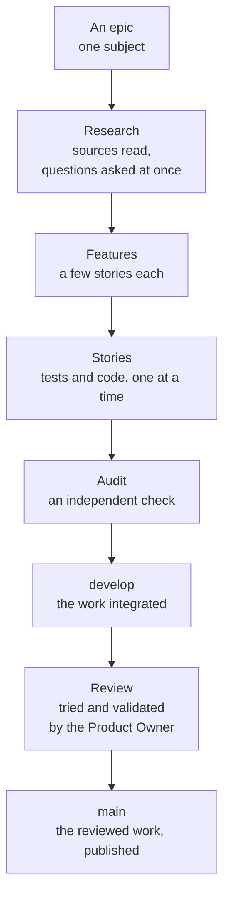

# How it is made

Synoptic Studio is built by an **AI coding agent** working for one **Product Owner**. This page explains how the two work together and how the quality is kept.

## Two roles

The **Product Owner** decides what the software must do and in which order. They own the business rules, try what was built and validate it. They are also the agent's manager: their "no" stands, and the agent may always ask for the reason behind it.

The **agent** is developer and architect. It turns each need into research, code and tests, organises its own work and its own tools, and says what it needs to work better.

## The way work flows

The method is a light form of agile: work is cut small, delivered often, and tried by the Product Owner rather than described in long documents.

- **An epic** covers one subject — resizing shapes, colours, pipes. It starts with research: the sources are read and every question for the Product Owner is asked at once, so the work can then run without interruption.
- **A feature** groups a few small stories. Each story is written test first, then coded, then merged.
- **An audit** closes each feature: an independent agent re-derives the formulas, re-reads the sources and tries to break the tests.
- **A review**, when the Product Owner asks for one, shows what changed. Once they validate it, the work goes to `main` and can be released.

The Git history shows this at a glance: each story is a small bubble merged into its feature, each feature a bubble merged into `develop`.

## Where the knowledge lives

The agent does not work from these pages. Everything it needs — the backlog, the business rules, the decisions and their reasons, the sources, the conventions, its own notes and measurements — lives in a database outside the repository, shaped for quick questions. These pages are written for people, and refreshed at each review.

## How quality is kept

- **Every calculation has a source.** A formula comes from a specification, a paper or a book that was read, or from a derivation whose every step cites one. Nothing is invented.
- **Tests come first**, with values computed by hand, the edge cases, and properties checked on thousands of random inputs.
- **The checks are fast and strict.** Formatting, linting, types, tests and coverage run before anything is shared; the tools that run them are written in Rust so that they answer in seconds.
- **No runtime dependency.** The library depends on nothing but the browser.
