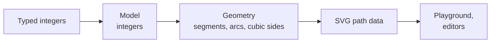

# How the project works

## What it is

`editor` is a dependency-free TypeScript library that draws SVG symbols for synoptic views, the schematic screens that supervise industrial plants. Four tools will be built on it: the Symbol Editor, the Configurator, the View Editor and its drawing tools ([the editor](./the-editor.md)). Today the library and its playground exist; the editors come later, in the Product Owner's order of the epics.

## How the library computes

- **Integers in, exact geometry out**: every value typed is a whole number; the geometry is computed from it and never stored; the SVG is written with 5 decimals at most.
- **Small named functions**: each calculation is a function named after what it computes, tested on examples computed by hand, so that the code reads like the formulas it applies.
- **Pure core**: the library never reads the page back and never changes its arguments; only the playground touches the browser.
- **Portable**: plain ECMAScript and plain data, so the library runs in any JavaScript engine and can be rewritten in another language.

## Who does what

- **The Product Owner** owns the business rules and the priorities, answers the questions, tries each change in the browser and validates the review.
- **A coding agent** writes every change: the research, the code, the tests, the docs and the merges. Outside contributions come as issues, never as pull requests.

## How work flows

- **Epics, features, stories**: an epic is one subject; it opens with a refinement that reads the sources, asks every question at once and cuts its features; a feature is a capability the user can see, with numbered acceptance criteria; a story is one behavior, at most 3 tasks.
- **One story at a time**: each story is worked on its own branch, tests first, then merged into its feature's branch; a feature is audited, then merged into `develop`.
- **The review**: at each return of the Product Owner, they try on `develop` what changed; the agent renames what reads badly, fixes the tools that failed, refreshes these pages, then merges `develop` into `main` once the review is validated.
- **The release**: a button on `main` computes the version from the tags and publishes it on GitHub; the library is never published on npm.
- **The agent's records**: the backlog, the decisions, the research and the history live in a database outside the repository, read by `target/release/knowledge`; these pages keep what a person reads.

## How quality is kept

- **Tests first**: every behavior has tests computed by hand, then property tests for the mathematics; 95 % of the library's lines are covered while it is developed.
- **One full check** before each push: format, lint, types, tests, the docs build, unused code, secrets, and the dependencies' audit ([commands](./commands.md)).
- **No runtime dependency**: the library ships alone; every development tool is pinned, its release notes read, and at least 7 days old.
- **Tooling in Rust**: the project's own linter, formatter driver, hooks and agent tools are Rust programs, fast enough to run at every step.
