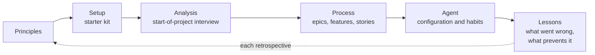

# Playbook

How to run a software project with a coding agent and a Product Owner who questions rather than codes — written from this project, reusable for the next ones. Updated at every retrospective (ADR-0023); each rule says where it comes from.

| Page | Content |
| --- | --- |
| [principles.md](./principles.md) | the rules that make agent-written code trustworthy |
| [setup.md](./setup.md) | the starter kit: what to copy, in which order, the rhythm, what to read first |
| [analysis.md](./analysis.md) | the start-of-project interview, the agent as functional analyst |
| [process.md](./process.md) | backlog, research, audit, demo, review, retrospective |
| [agent.md](./agent.md) | configuring and steering the agent; the Product Owner's lessons, habit by habit |
| [lessons.md](./lessons.md) | what went wrong, and the check that now prevents it |

To start a new project: read these pages, then follow [setup.md](./setup.md); copy files from this repository rather than rewriting them, and keep the links to the ADRs that justify them.
