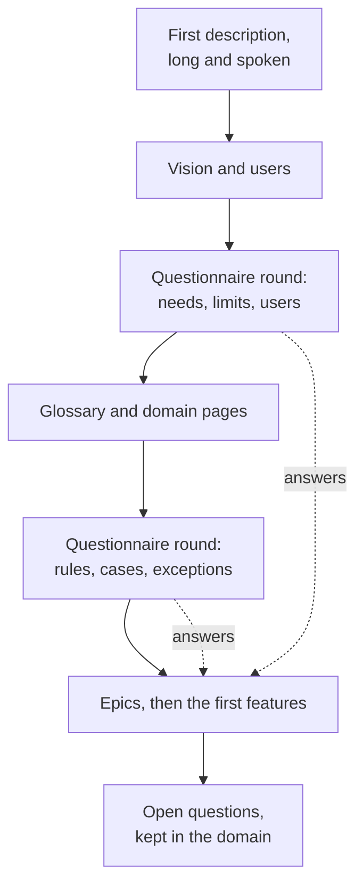

# Start-of-project interview

How the agent, acting as a functional analyst, turns a long first description into a vision, a glossary, open questions and a first backlog — before any code. The `functional-analyst` agent prepares each round; the Product Owner answers, often speaking.

## The flow

The backlog is written **while** the questions go on: each answer lands at once in the domain pages and the epics, so the next round asks only what is still open.

## What to ask

| Topic | Questions |
| --- | --- |
| Vision | what exists today, what hurts, what the product changes, what it will never do |
| Users | who uses it, how expert, on which machine and screen, alone or as a team |
| Work | the work as prescribed, as described, as really done; the exceptions and the degraded modes |
| Objects | which things the user names, which are kinds of one thing (a rectangle is a free shape), what is stored, what is derived |
| Rules | each rule with a numeric example; what happens at zero, at the largest value, when two values conflict |
| Limits | sizes, counts, speed, files, offline or online |
| Editions | what is free, what is paid, what stays private |
| Reference tools | which tools the users know (Figma, Inkscape…), what to copy, what to do differently |

## How to ask

- **A questionnaire, not prose**: two to four options per question, each with a short example in numbers, a recommendation first ([agent sheet](./agent.md#lessons-from-the-product-owner)).
- **Several questions at once**, answered by voice; the agent reads for intent and asks again only what stays ambiguous.
- **Search before asking**: a question already answered in the domain or a past feature is not asked again.
- **Natural reading first**: when a rule has two readings, give both with a numeric example and ask.
- **Ask early which things are kinds of one thing** — the rectangle should have been a free shape from the start (E01).

## What comes out

| Output | Where |
| --- | --- |
| vision, users, editions | `docs/domain/README.md`, `editions.md` |
| glossary (with the users' words) | `docs/domain/README.md` |
| rules with examples | `docs/domain/*.md` |
| open questions, numbered | `docs/domain/README.md` |
| epics in the Product Owner's order | `docs/backlog/epics/` |
