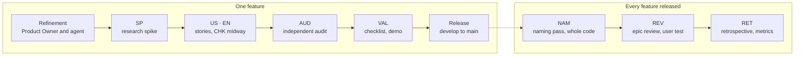

# The method on one page

How work is cut, who writes what, and who accepts it. The full rules are in the [backlog](../backlog/); the reasons in ADR-0017, ADR-0020, ADR-0023 and ADR-0028.

## Four levels

| Level   | Is                                                | Example from E01                                 | Written by                   | Accepted by                  |
| ------- | ------------------------------------------------- | ------------------------------------------------ | ---------------------------- | ---------------------------- |
| Epic    | a business need, several features                 | E01 — draw symbol shapes from numbers            | Product Owner (agent drafts) | Product Owner, at `REV`      |
| Feature | a capability the user can see and test            | F04 — turn a shape by any angle                  | Product Owner with the agent | Product Owner, at `VAL`      |
| Story   | one behavior or one piece of work, finished alone | US-018 — turn and move a shape in the playground | agent, from the refinement   | the checks, then the feature |
| Task    | one commit, an hour to a day                      | US-018.T2 — the angle field and the two boxes    | agent                        | the checks                   |

## Story types

The type says **who can see the result**, not who wrote it or whether it is code.

| Type  | Name          | The result                                                                                                              | Who checks it                                 | Example                                        |
| ----- | ------------- | ----------------------------------------------------------------------------------------------------------------------- | --------------------------------------------- | ---------------------------------------------- |
| `US`  | user story    | a behavior a user sees in the playground or the tools; comes with a **test card**                                       | the Product Owner, on the card, then at `VAL` | US-014 — convert a polygon and move its points |
| `EN`  | enabler       | work no user sees: a geometric function and its derivation, a model change, tooling                                     | the tests, the auditor                        | EN-017 — the stretched polygon's geometry      |
| `SP`  | spike         | answers: sources read, derivations, research requests, before any code                                                  | the stories it unblocks                       | SP-009 — research for F06                      |
| `CHK` | checkpoint    | midway through a feature: docs and methods brought up to date, consistency checked                                      | the agent                                     | CHK-008                                        |
| `AUD` | audit         | the feature re-checked by an independent reviewer: formulas, values, sources, duplicates                                | the `auditor` agent, then the Product Owner   | AUD-009                                        |
| `VAL` | validation    | the demo page and the checklist page; the Product Owner's validation recorded                                           | the Product Owner                             | VAL-009                                        |
| `NAM` | naming pass   | the whole code gone over twice: every calculation a field names is a named function, every result unchanged bit for bit | the `math-expert` and `auditor` agents        | F13, before the type existed                   |
| `REV` | epic review   | the epic report and a user test crossing its features                                                                   | the Product Owner                             | REV-001                                        |
| `RET` | retrospective | what helped and hurt, metrics, evolvability, playbook and configuration updated                                         | the Product Owner and the agent               | RET-001                                        |

> [!TIP]
> A story that changes code can be either: a function the user never sees directly is an `EN`; the playground field that uses it is a `US`. The Product Owner writes features and their criteria; the agent cuts them into stories.

## Who does what

| Moment                | Product Owner                                         | Agent                                                                            |
| --------------------- | ----------------------------------------------------- | -------------------------------------------------------------------------------- |
| refinement            | answers the questionnaire, decides the business rules | prepares the questions (with the `functional-analyst` agent), writes the feature |
| spike and stories     | starts a run (`/run`): its stories become `ready`     | researches, implements, tests, has each story reviewed                           |
| validation            | ticks the checklist, says what they see               | records the result and the remarks, opens the feature pull request               |
| release               | merges the feature, then the release pull request     | prepares both, brings `develop` up to date                                       |
| review, retrospective | answers, decides what changes                         | reports with figures, updates the playbook and the configuration                 |

## Cadences beyond the epic

| When                                                      | What                                                                                                                                                                                              |
| --------------------------------------------------------- | ------------------------------------------------------------------------------------------------------------------------------------------------------------------------------------------------- |
| every retrospective                                       | metrics read (`npm run metrics`), overrides and "considered for later" tools re-checked, improvement and feedback logs emptied                                                                    |
| around the 4th or 5th epic, and at the end of the project | **review of every rule**: configuration, lint, hooks, skills, process — each one questioned against how the project went; harden by default, relax only with a reason (Product Owner, 2026-10-13) |
