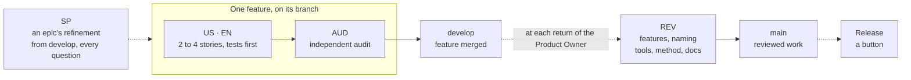

# The method on one page

How work is cut, who writes what, and who accepts it. Rules of the backlog: [backlog](../backlog/); reasons: ADR-0017, ADR-0020, ADR-0023, ADR-0072, ADR-0074, ADR-0084, ADR-0086, ADR-0100.

## Four levels

| Level | Is | Written by | Accepted by |
| --- | --- | --- | --- |
| Epic | one subject, small if need be, with no closing of its own (ADR-0086, ADR-0100) | Product Owner (agent drafts), at its refinement | — |
| Feature | a capability the user can see and test, 2 to 4 stories | Product Owner with the agent | Product Owner, on `develop`, at the next `REV` |
| Story | one behavior or one piece of work, finished alone, at most 3 tasks | agent, from the refinement | the checks, then the feature |
| Task | one commit, an hour to a day | agent | the checks |

A feature of more than 4 stories, or a story of more than 3 tasks, is not written: the agent proposes its split to the Product Owner, with an example (ADR-0084, EN-123); `tests/backlog.test.ts` refuses it from F22.

## Story types

The type says **who can see the result**, not who wrote it or whether it is code. On doubt, ask who would notice the change: a user of the playground or the tools makes it a `US`, nobody makes it an `EN`.

| Type | Name | The result | Who checks it |
| --- | --- | --- | --- |
| `US` | user story | a behavior a user sees in the playground or the tools; comes with a **test card** | the Product Owner, on the card, at the next return |
| `EN` | enabler | work no user sees: a geometric function and its derivation, a model change, tooling | the tests, the auditor |
| `SP` | spike | an epic's refinement from `develop` (the Product Owner's account, the whole documentary research, every question at once, the features and their stories counted), or a feature's short spike on its branch for a question nobody foresaw: sources read, derivations, research requests, before any code | the stories it unblocks |
| `AUD` | audit | the feature re-checked by an independent reviewer: formulas, values, sources, duplicates | the `auditor` agent, then the Product Owner |
| `REV` | review | at each return of the Product Owner, from `develop`: the features finished since the last merge into `main`, the naming pass over the code changed since then, the tool incident cards fixed, the method's improvements decided with the Product Owner, the docs brought up to date | the Product Owner |

The records keep three more types, of which no new story is written: the validation `VAL` of each feature up to F47 (ADR-0100), the checkpoint `CHK` midway through a feature up to F21 (ADR-0084), and an epic's closing up to E17, a naming pass `NAM`, a review `REV` and a retrospective `RET` (ADR-0086).

> [!TIP]
> One change can make both: the function the user never sees is an `EN`; the playground field that uses it is a `US`. The Product Owner writes features and their criteria; the agent cuts them into stories.

## Who does what

| Moment | Product Owner | Agent |
| --- | --- | --- |
| refinement | gives their account of the epic, answers the questionnaire, every question at once, decides the business rules | reads the sources and the code, prepares the questions, cuts the features and the stories, proposes a split for any too large |
| spike and stories | starts a run (`/run`) and sets its scope, a time or an end: its stories become `ready`; answers the parked questions on return | researches, implements, tests, checks each story by its level (ADR-0064); parks a story whose question waits and goes on with the others (EN-086) |
| audit, at a feature's end | — | holds the `AUD`, fixes its findings, labels the feature pull request `autonomous`: GitHub merges it into `develop` (ADR-0100) |
| review, at each return | tries what changed on `develop`, answers, decides what changes; merges `develop` → `main` | finishes a feature under way first, holds the `REV`, reports with figures, fixes the tool cards, updates the playbook and the configuration, opens `develop` → `main` |
| release | runs `release.yml` on `main` from GitHub's Actions tab, when they choose | nothing to type: `release publish` computes the version and makes the release (ADR-0086) |

## Cadences

| When | What |
| --- | --- |
| every review | metrics read (`target/release/metrics`), the tool incident cards fixed or decided, overrides and "considered for later" tools re-checked, improvement and feedback logs emptied |
| around the 4th or 5th epic, and at the end of the project | **review of every rule** (configuration, lint, hooks, skills, process): each is questioned against how the project went. Harden by default; relax only with a written reason (decided on 2026-10-13) |

## The agent's own method and tools

The agent chooses how it works and proposes changes to its own method and tools, so that its working conditions improve with evidence (ADR-0074, 2026-10-17):

| When | The agent | The Product Owner |
| --- | --- | --- |
| while working | writes each friction, error, slow step, or reading that suggests a faster, cheaper or healthier way to work, at once in the improvement log (LOG-improvements); a tool that fails is worked around and written as a card in tool incidents (LOG-tool-incidents); a worker writes its rows and its cards in its story file, under `## For the main thread`, moved into the logs in its `done` commit (ADR-0091) | — |
| at each review, beside its naming pass | presents a **method and tools** point: the cards, what it wants to change in its own work, the backlog method included where it does not fit an agent, and methods or Rust tools to adopt, each with its evidence (metrics, incidents, sources); a tool that failed is fixed in that review | decides each proposal |
