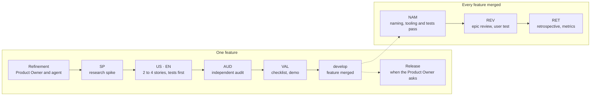

# The method on one page

How work is cut, who writes what, and who accepts it. Rules of the backlog: [backlog](../backlog/); reasons: ADR-0017, ADR-0020, ADR-0023, ADR-0072, ADR-0074.

## Four levels

| Level | Is | Written by | Accepted by |
| --- | --- | --- | --- |
| Epic | a business need, several features | Product Owner (agent drafts) | Product Owner, at `REV` |
| Feature | a capability the user can see and test | Product Owner with the agent | Product Owner, at `VAL` |
| Story | one behavior or one piece of work, finished alone | agent, from the refinement | the checks, then the feature |
| Task | one commit, an hour to a day | agent | the checks |

## Story types

The type says **who can see the result**, not who wrote it or whether it is code. On doubt, ask who would notice the change: a user of the playground or the tools makes it a `US`, nobody makes it an `EN`.

| Type | Name | The result | Who checks it |
| --- | --- | --- | --- |
| `US` | user story | a behavior a user sees in the playground or the tools; comes with a **test card** | the Product Owner, on the card, then at `VAL` |
| `EN` | enabler | work no user sees: a geometric function and its derivation, a model change, tooling | the tests, the auditor |
| `SP` | spike | answers: sources read, derivations, research requests, before any code | the stories it unblocks |
| `CHK` | checkpoint | midway through a feature of 5 stories or more (ADR-0084): docs and methods brought up to date, consistency checked | the agent |
| `AUD` | audit | the feature re-checked by an independent reviewer: formulas, values, sources, duplicates | the `auditor` agent, then the Product Owner |
| `VAL` | validation | the demo page and the checklist page; the Product Owner's validation recorded | the Product Owner |
| `NAM` | naming pass | a whole-repository pass: every calculation a field names is a named function with its result unchanged bit for bit, then tooling and tests cleaned of duplicates, slow steps and waits, each timed before and after (ADR-0069, ADR-0070) | the `math-expert`, `auditor` and `verifier` agents |
| `REV` | epic review | the epic report and a user test crossing its features | the Product Owner |
| `RET` | retrospective | what helped and hurt, metrics, evolvability, playbook and configuration updated | the Product Owner and the agent |

> [!TIP]
> One change can make both: the function the user never sees is an `EN`; the playground field that uses it is a `US`. The Product Owner writes features and their criteria; the agent cuts them into stories.

## Who does what

| Moment | Product Owner | Agent |
| --- | --- | --- |
| refinement | answers the questionnaire, decides the business rules | prepares the questions (with the `functional-analyst` agent), writes the feature |
| spike and stories | starts a run (`/run`) and sets its scope, a time or an end: its stories become `ready`; answers the parked questions on return | researches, implements, tests, checks each story by its level (ADR-0064); parks a story whose question waits and goes on with the others (EN-086) |
| validation of a library or application feature | ticks the checklist, says what they see, says when the validation is done | records the result and the remarks, labels the feature pull request `autonomous`: GitHub merges it into `develop` (ADR-0072) |
| validation of a tooling feature | tries the lines that concern them, if they wish | validates it on the checklist and demo page, labels its pull request `autonomous` without waiting (ADR-0072) |
| release | asks for it; merges the release branch's pull request into `main` | prepares `release/x.y.z` from `develop` and opens its pull request, brings `develop` up to date after it |
| review, retrospective | answers, decides what changes | reports with figures, updates the playbook and the configuration |

## Cadences beyond the epic

| When | What |
| --- | --- |
| every retrospective | metrics read (`target/release/metrics`), overrides and "considered for later" tools re-checked, improvement and feedback logs emptied |
| around the 4th or 5th epic, and at the end of the project | **review of every rule** (configuration, lint, hooks, skills, process): each is questioned against how the project went. Harden by default; relax only with a written reason (Product Owner decision, 2026-10-13) |

## The agent's own method and tools

The agent chooses how it works and proposes changes to its own method and tools, so that its working conditions improve with evidence (ADR-0074, 2026-10-17):

| When | The agent | The Product Owner |
| --- | --- | --- |
| while working | writes each friction, error, slow step, or reading that suggests a faster, cheaper or healthier way to work, at once in the [improvement log](./improvements.md); a worker writes its rows in its story file, under `## For the main thread` | — |
| each epic end, at the retrospective, beside its tooling pass | presents a **method and tools** point: what it wants to change in its own work, the backlog method included where it does not fit an agent (for instance stories competing for shared files), and methods or Rust tools to adopt, each with its evidence (metrics, incidents, sources) | decides each proposal |
