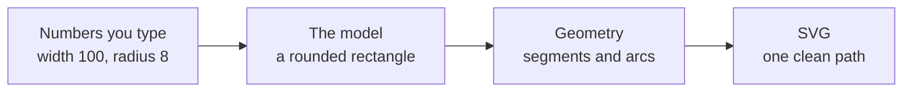

# The software

**Synoptic Studio** is a set of editors for drawing **synoptic views**: the schematic pictures an operator watches to supervise a plant, a network or a building — pumps, valves, tanks and the pipes between them, each symbol showing a live state.

## The idea

Most drawing tools let you draw freely with the mouse. Synoptic views ask for the opposite. A symbol is used thousands of times, scaled, recoloured and animated; a crooked line or a radius of 7.3 pixels shows everywhere. So in Synoptic Studio **every shape is defined by numbers**:

- a rectangle is a width, a height and a radius for each corner;
- a polygon is a number of sides fitted in a box;
- a curve is a set of points with their handles;
- a text is measured with the font's own metrics, so it fits exactly where it should.

Every value is a whole number. Lines are horizontal, vertical or follow a declared angle. The result is clean, predictable and the same on every screen.

## From numbers to a drawing

Behind each shape is a short chain of small, named calculations. Each one does a single thing, the way a formula reads in a textbook, and each one rests on a source that was actually read — a specification, a paper, a reference book.

The drawing is never read back from the screen: the numbers are the truth, the picture is computed from them. That is what keeps symbols exact when they are reused.

## Three editors on one library

The calculations live in one library, `editor`. Three editors will be built on it:

| Editor | What it is for |
| --- | --- |
| **Symbol Editor** | drawing a symbol from numbers, with its connection points and the parts that will move or change colour |
| **Configurator** | describing what a symbol represents: its properties, its states, its families |
| **View Editor** | placing symbols on a view, connecting them with orthogonal pipes, adding static drawings |

Today the library and its **playground** exist: a web page that shows each stage at work — draw, select, move, zoom, undo. The editors themselves come once the library is complete.

## Free, then pro

The first version is free and runs locally, in a browser and later as a desktop application. New features after it will belong to a paid edition.
