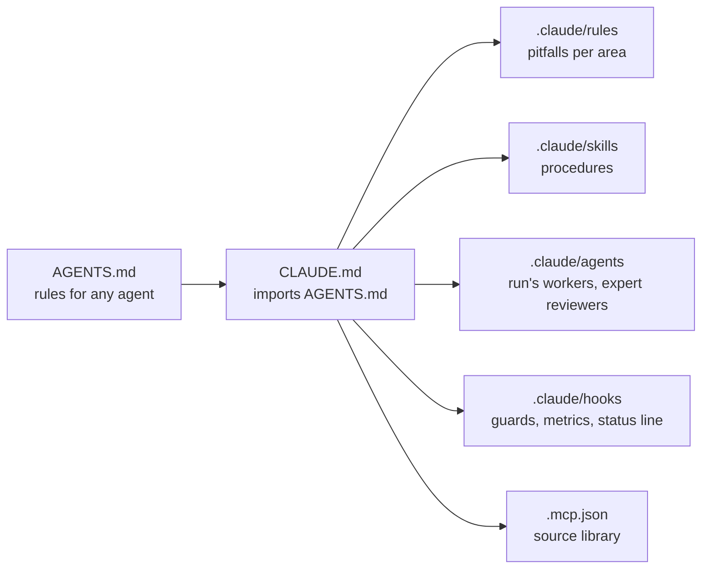

# Agent configuration

The code is written by a coding agent, Claude Code, under the Product Owner's review. Its configuration is committed (ADR-0021): `AGENTS.md` for any agent, `CLAUDE.md` and `.claude/` for Claude Code. `docs/` stays the source of truth: the configuration only adds procedures, pitfalls, guards and tools, and links the rules it applies rather than restating them.



## Files

| Path | Role | Loaded |
| --- | --- | --- |
| `AGENTS.md` | rules for any coding agent (`REF-CC-MEMORY`) | every session, by any tool |
| `CLAUDE.md` | imports `AGENTS.md`, then Claude Code's skills, agents, tools and habits | every session |
| `.claude/rules/library.md`, `docs.md`, `tooling.md` | pitfalls of `src/` and `playground/`, of Markdown, of tooling and tests | when such files are touched |
| `.claude/settings.json` | permissions, hooks, status line, the library server, the subagent cap | every session |
| `.mcp.json` | the source library's MCP server ([sources](./sources.md)) | every session, once approved |

## Skills

| Skill | Does |
| --- | --- |
| `/story` | a story from branch to pull request |
| `/run` | an autonomous run on the feature branch, up to the validation (ADR-0072) |
| `/spike` | a feature's research spike (ADR-0020) |
| `/derivation` | a `DERIV-*` from read sources |
| `/audit` | the feature audit with the reviewing agents |
| `/review` | a feature's demo page and checklist; the epic review (ADR-0023) |
| `/retro` | the epic retrospective (ADR-0023) |
| `/triage` | open issues, each with a recommendation (ADR-0026) |
| `project-rules` | the digest of `AGENTS.md` and `CLAUDE.md`, preloaded by every agent type started without them |
| `worker-brief` | a run's worker brief (ADR-0072), preloaded by `story-worker` and `researcher`, read by path by a `general-purpose` worker |

## Run's workers

**Each agent carries only what its task needs.** A subagent's first request is read again at each of its requests, about 200 per worker, so every token it starts with is paid some 200 times ([research note 0024](../research/notes/0024-f20-context-diet.md)). Each task kind therefore has its agent type, started with `omitClaudeMd` (no `CLAUDE.md`, `AGENTS.md` nor memory index), its rules preloaded as skills, and only the tools it uses; a `general-purpose` worker would also carry every tool's definition and the skill listing (`REF-CC-SUBAGENTS`), about three times the tokens.

| Agent type | Task kind | Tools | Preloaded |
| --- | --- | --- | --- |
| `story-worker` | `US`, `EN`, `NAM`, `CHK`, an `AUD`'s fixes, a `VAL`'s preparation | Bash, Read, Edit, Write, Grep, Glob, the library | `project-rules`, `worker-brief` |
| `researcher` | a research spike (`SP`) | the story worker's, `WebFetch`, `WebSearch` | `project-rules`, `worker-brief`, `spike` |
| `clerk` | journal entries, log rows, backlog statuses, rebases and merges the main thread hands off | Bash, Read, Edit, Write, Grep, Glob | `project-rules` |

- A task no type fits runs on `general-purpose`, given the brief's path inside its worktree.
- A rule a typed worker misses goes into its brief or `project-rules`, not into every agent's context.
- A story's merge and finish stay with the main thread (`story:finish`).
- `npm run context:size` measures a type's first request; a change to a type is measured before and after.

## Expert agents

Read-only reviewers in a fresh context, each with the documents it reads first (`REF-CC-SUBAGENTS`): the skills start them in the background and in parallel; they report and never edit, so that a review cannot change what it reviews. Those that read sources (`auditor`, `math-expert`, `functional-analyst`) have the library's tools and follow its protocol ([sources](./sources.md)): library first, the web only for a page it cannot read. Each starts like a worker, with `omitClaudeMd` and `project-rules` preloaded.

| Agent | Expert in | Started by |
| --- | --- | --- |
| `auditor` | refuting a feature: formulas, values, sources, copies | `/audit` (ADR-0064: no review per story) |
| `math-expert` | plane geometry and floating-point numerics | `/spike`, `/derivation`, `/run` (math stories), `/audit` |
| `verifier` | tests that would catch a wrong implementation | `/story` (test plan), `/run`, `/audit` |
| `functional-analyst` | business rules, domain objects, refinement questions | `/spike`, a feature's refinement |
| `doc-editor` | pages that scan: structure, words, no quotes | `/audit`, `/retro`, a docs pull request |

Agents to add when their epic comes:

| Agent | Would bring | When |
| --- | --- | --- |
| `interaction-designer` | handles, dragging, selection, keyboard: how editors behave | E02, the first editor application |
| `svg-expert` | the SVG specification: paths, strokes, other tools' files | E04 (strokes), E11 (files) |
| `performance` | budgets, profiling, large views | E08 (views), or a first performance budget |

## Models

**Each agent type runs on the cheapest model that does its task as well**, named in its file with the reason in the file's body (EN-066; F20's second round, 2026-10-17). Sonnet 5.5 costs half of Opus 5.5 (`REF-CLAUDE-PROMPT-CACHING`); a task that derives, judges or computes values stays on Opus until a measured trial shows Sonnet does as well.

| Agent type | Model | Why |
| --- | --- | --- |
| `clerk` | `sonnet` | copies given facts into set formats and follows the fixed steps of a merge or a rebase: nothing to derive or judge |
| `story-worker` | `opus` | code, hand-computed tests and the docs of its rules; until one story on Sonnet, measured beside one on Opus, shows Sonnet does as well |
| `researcher` | `opus` | judges what each source states; the feature is built from it |
| `auditor` | `opus` | re-derives formulas and recomputes values; a weaker reviewer than the worker misses more |
| `verifier` | `opus` | mutations by thought and recomputed values |
| `math-expert` | `opus` | formulas, derivations and precision, where the tests' expected values come from |
| `functional-analyst` | `opus` | finds the two readings of a rule and prepares the Product Owner's decisions |
| `doc-editor` | `opus` | a rewrite keeps every fact of the page; read-only and short, so its share of the tokens is small |

The model is taken from the first of these that names one (`REF-CC-SUBAGENTS`): the `Agent` call's `model`, the agent file's, `CLAUDE_CODE_SUBAGENT_MODEL`, the main conversation's. A file naming `opus` stays on Opus whatever the main conversation runs on. The session report gives the tokens per model ([metrics](./metrics.md#session-report)).

## Hooks

| Hook | Event | Does |
| --- | --- | --- |
| `guard-bash` (Rust) | `PreToolUse` (shell) | refuses what would skip a check or lose work: `gh pr merge`, `--no-verify` (`commit -n`), hooks switched off (`HUSKY=0`, `core.hooksPath`), a force push without lease, `git -C`; a full Vitest run outside `npm run test`, which takes the heavy lock; in a story's worktree, a Git command chained with another, answered with the form to run, and `golden:write`; an `npm run` script missing from the `package.json` the command runs against, naming the branch and the rebase that brings it; here-document bodies skipped. A command opening with `cd "<folder>"` is judged in that folder, and one entering a worktree by a later `cd` is judged there too; the brief's `cd "<worktree>" \|\| exit 9` then one Git command goes through (EN-104) |
| `limit-agents` (Rust) | `PreToolUse` (`Agent`, `SendMessage`) | refuses a fourth subagent, started or resumed (ADR-0072), naming the three running; a message that starts none goes through; backed by Claude Code's own cap `CLAUDE_CODE_MAX_CONCURRENT_SUBAGENTS=3` (`REF-CC-ENV-VARS`), which names no subagent and which a resume escapes |
| `library-pages` (Rust) | `PreToolUse` (`WebFetch`, shell) | refuses a `WebFetch`, or a `curl` or `wget` printing a page, with the `library_get` call to make, unless the library stored that page with fewer than 300 characters or its site refused it; a local host, an API or a registry, a file to download or saved under a name that is not a page's, a link check (`-o /dev/null`), a script or an archive piped into `sh`, `bash`, `zsh` or `tar`, headers only or data sent go through; quotes and here-documents are read as the shell does; an agent whose file gives it no library tools is told to name the page to its caller ([sources](./sources.md)) |
| `check-handback` (Rust) | `PreToolUse` (`SubagentHandback`) | refuses once a worker's hand-back whose story branch is not on `origin` at its worktree's head, or whose report leaves a commit unnamed, the reason its next instruction; a second one passes with what is missing above the report; complete, adds a line naming the story, its branch and `story:finish`; leaves alone the main thread, read-only types and agents without a worktree. The story is its branch's, else its folder's; its commits are counted from its feature branch, or `develop` for an epic's own story, and without either the naming is not checked; ten unnamed commits are listed, the others counted. A `general-purpose` agent is checked, so a reviewer naming a worktree is given a read-only type. `SubagentHandback` exists only in auto mode (`REF-CC-HOOKS`): outside it, nothing is checked |
| `session-state.ts` | `SessionStart` | prints the branch, uncommitted files and the started features' progress; removes the files of calls left running for a day |
| `track-tool-call.ts` | `PreToolUse`, in the background | writes the call starting, for the status line ([metrics](./metrics.md)) |
| `log-tool-call.ts` | `PostToolUse`, `PostToolUseFailure`, in the background | logs each call and its duration |
| `status-line.ts` | status line, every second | place in the backlog, step, session, call running ([metrics](./metrics.md#status-line)) |

`limit-agents` and `check-handback` let the call through when they cannot read their input, so that a hook's own failure never blocks work. `library-pages` runs on every `WebFetch` and only on a shell command whose text names `curl` or `wget`, the handlers' `if`, `Bash(*curl*)` and `Bash(*wget*)` (`REF-CC-HOOKS`, `REF-CC-PERMISSIONS`): a command it refuses names one, `/usr/bin/curl` or `sh -c 'curl …'` too, so the filter skips none, and the other commands no longer wait on `cargo run`. It and `check-handback` stop after 30 seconds and let the call through, in place of the 600 of the default, so that a hook waiting on cargo's build lock during a `check:all` holds no call for ten minutes; a rebuild of the crate takes about a second, a run 50 ms (2026-10-18). The Rust hooks live in `tools/hooks`, each with its tests.

## Pushes

During a run, the main thread pushes a notification only for a question that parks a story or a blocker it cannot get around, and only when either prevents finishing the scope asked; never for a merge nor a stop (run skill). A push interrupts the Product Owner, so it is kept for what needs them. `PushNotification` raises a desktop notification, and a phone push when Remote Control is connected (`REF-CC-TOOLS-REFERENCE`). A project's settings can turn Remote Control off, never on (`REF-CC-REMOTE-CONTROL`), so the Product Owner sets it once on their side:

| Setting | Where |
| --- | --- |
| Remote Control for every session | `remoteControlAtStartup: true` in the user settings (`~/.claude/settings.json`), or `/remote-control` in one session |
| phone pushes | **Push when Claude decides** in `/config`, the Claude app signed in with the same account |

A push is skipped while the Product Owner types in or focuses the terminal. Without it, the question is still asked in the chat and written in its parked story.

## Parallel sessions

The Product Owner may talk to a second session while a run works. Both share the main checkout, which belongs to the run (its branch, its uncommitted files), and the repository is the only state both read. So the second session:

1. **Never touches the run's folder** (no `git switch`, `stash` nor commit there): it works in its own worktree, `npm run worktree:new -- <ID>` for a story, or `git worktree add .claude/worktrees/<topic> -b <type>/<topic> origin/develop` for a tooling change without a story; each Bash call starts with `cd "<worktree>" || exit 9`.
2. **Writes each decision in the repository** — domain, ADR, backlog, `AGENTS.md`, skills — on one branch into `develop`; a durable fact also goes to the agent's memory.
3. **Tells the run**: `ListAgents`, then `SendMessage` with what changed, where and what it changes for the run. The run acts on the change once it reaches `develop`, never on the message alone.
4. **Removes its worktree** once merged (`npm run branches:clean`).

Before each story the run merges `origin/develop` into the feature branch when `develop` changed `AGENTS.md`, `CLAUDE.md`, `.claude/`, `docs/domain/`, `docs/adr/`, `docs/backlog/` or `docs/conventions/`, in a worktree of that branch (never a force push on a feature branch), and follows the new versions from that story on; a change to the run's scope or stories is a stop.

## Cloud agents and scheduled tasks

Product Owner, 2026-10-17: every agent works on the Product Owner's machine, in its repository; cloud agents are not used. A scheduled task (`CronCreate`) is made only when the Product Owner asks for one.

## Searching past conversations

The session journal ([journal](../process/journal.md), ADR-0024) is read first; the transcripts, `~/.claude/projects/<project-path>/*.jsonl` (kept in the private records, ADR-0041, ADR-0044), are the full archive:

```sh
cd ~/.claude/projects/<project-path>
grep -l "radius" *.jsonl                                     # which conversation mentions a word
jq -r 'select(.type == "user") | .message.content | strings' <id>.jsonl | grep -i "radius"
```

## Rules for this folder

- A new hook is written in Rust, in `tools/hooks` (ADR-0073). The TypeScript hooks left run with `node`, linted and tested as tooling (`.claude/hooks/*.test.ts`): pure functions exported, effects under `if (import.meta.main)`, a relative import naming its `.ts` file (`REF-NODE-TS`), until F21 rewrites them.
- A rule a hook enforces is not repeated as an instruction: the hook's refusal says it when it matters.
- A guard that blocks legitimate work is changed by a new ADR, never bypassed; `.claude/settings.local.json` (personal, not committed) may add permissions, never remove a guard.
- Changes go to `develop` as tooling, with `chore(tooling): …` commits.
