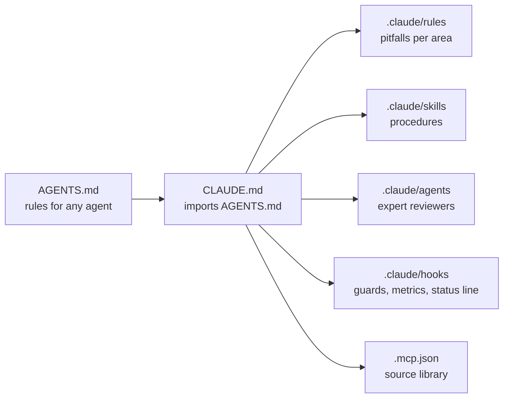

# Agent configuration

The code is written by a coding agent — Claude Code — under the Product Owner's review. Its configuration is committed (ADR-0021): `AGENTS.md` for any agent, `CLAUDE.md` and `.claude/` for Claude Code. `docs/` stays the source of truth; the configuration only adds procedures, pitfalls, guards and tools.



## Files

| Path                       | Role                                                                                                    | Loaded                       |
| -------------------------- | ------------------------------------------------------------------------------------------------------- | ---------------------------- |
| `AGENTS.md`                | rules for any coding agent: project, where to read, rules, work, done, stop, commands (`REF-CC-MEMORY`) | every session, by any tool   |
| `CLAUDE.md`                | imports `AGENTS.md`, then skills, agents, tools and habits of Claude Code                               | every session                |
| `.claude/rules/library.md` | pitfalls of `src/` and `playground/`                                                                    | when those files are touched |
| `.claude/rules/docs.md`    | pitfalls of Markdown, backlog and bibliography                                                          | when Markdown is touched     |
| `.claude/rules/tooling.md` | pitfalls of lint, tests, dependencies, CI, hooks                                                        | when tooling is touched      |
| `.claude/settings.json`    | permissions, hooks, status line, the library server enabled, the subagent cap                           | every session                |
| `.mcp.json`                | the local source library's MCP server ([sources](./sources.md))                                         | every session, once approved |

## Skills

| Skill         | Does                                                                              |
| ------------- | --------------------------------------------------------------------------------- |
| `/story`      | a story from branch to pull request                                               |
| `/run`        | an autonomous run on the feature branch, up to the validation (ADR-0028)          |
| `/spike`      | the research spike of a feature (ADR-0020)                                        |
| `/derivation` | a `DERIV-*` from read sources                                                     |
| `/audit`      | the feature audit with the reviewing agents                                       |
| `/review`     | the demo page and checklist of a feature; the epic review (ADR-0023)              |
| `/retro`      | the epic retrospective: metrics, evolvability, playbook, configuration (ADR-0023) |
| `/triage`     | open issues presented with a recommendation (ADR-0026)                            |

## Expert agents

Read-only reviewers in a fresh context, each with the documents it reads first (`REF-CC-SUBAGENTS`). The skills start them in the background and in parallel; they report, they never edit. The agents that read sources (`auditor`, `math-expert`, `functional-analyst`) have the library's tools (`library_search`, `library_get`, `library_read`) and follow the same protocol as the main agent (`docs/tooling/sources.md`): library first, the web only for a page it cannot read. Until 2026-10-13 they had only `WebFetch` and `WebSearch`, so their pages never reached the library unless their prompt asked for it.

| Agent                | Expert in                                             | Started by                                               |
| -------------------- | ----------------------------------------------------- | -------------------------------------------------------- |
| `auditor`            | refuting a feature: formulas, values, sources, copies | `/audit` (ADR-0064: no review per story)                 |
| `math-expert`        | plane geometry and floating-point numerics            | `/spike`, `/derivation`, `/run` (math stories), `/audit` |
| `verifier`           | tests that would catch a wrong implementation         | `/story` (test plan), `/run`, `/audit`                   |
| `functional-analyst` | business rules, domain objects, refinement questions  | `/spike`, a feature's refinement                         |
| `doc-editor`         | pages that scan: structure, words, no quotes          | `/audit`, `/retro`, a docs pull request                  |

Agents to add when their epic comes, with their trigger:

| Agent                  | Would bring                                                                    | When                                       |
| ---------------------- | ------------------------------------------------------------------------------ | ------------------------------------------ |
| `interaction-designer` | handles, dragging, selection, keyboard: how editors behave (Figma, Inkscape)   | E02, the first editor application          |
| `svg-expert`           | the SVG specification: paths, strokes, import and export of other tools' files | E04 (strokes), E11 (files)                 |
| `performance`          | budgets, profiling, large views                                                | E08 (views), or a first performance budget |

## Hooks

| Hook                                 | Event                                                  | Does                                                                                                                                                                                                                                                                                                                                                                                                                                                                                                                                                                                                                                                                                                                                                                                                       |
| ------------------------------------ | ------------------------------------------------------ | ---------------------------------------------------------------------------------------------------------------------------------------------------------------------------------------------------------------------------------------------------------------------------------------------------------------------------------------------------------------------------------------------------------------------------------------------------------------------------------------------------------------------------------------------------------------------------------------------------------------------------------------------------------------------------------------------------------------------------------------------------------------------------------------------------------- |
| `guard-bash.ts`                      | `PreToolUse` (shell)                                   | denies `gh pr merge`, `--no-verify` (`commit -n`), hooks switched off (`HUSKY=0`, `core.hooksPath`), a force push without lease (`+branch` too), `git -C` included; a full Vitest run outside `npm run test`, which takes the heavy lock (EN-047) — no test path, or only `.`, through `npx` or `node_modules/.bin`, whatever its options (`--project x`); in a story's worktree, a Git command chained with another (`cd … && git …`, `git add && git commit`, a pipe), answered at once with the form to run: `cd "<worktree>" \|\| exit 9`, then the Git command alone, and `golden:write` (EN-052); skips here-document bodies                                                                                                                                                                         |
| `limit-agents` (Rust, `tools/hooks`) | `PreToolUse` (`Agent`, `SendMessage`)                  | refuses a fourth subagent at once (ADR-0063), started by `Agent` or resumed by `SendMessage`, naming the three running and their age; lets a message to the main conversation or to a subagent running through, since it starts none (the target matched by the agent id its launch or resume result names, or the `name` its `Agent` call gave); counts the session's background subagents from its transcript, where the status line's cache (`.git/metrics/status-line-turn.json`) stopped; lets the call through when it cannot read; test `tools/hooks/tests/limit.rs`; run by `cargo run --release`; backed up by `CLAUDE_CODE_MAX_CONCURRENT_SUBAGENTS` set to 3 under `env`, Claude Code's own cap, whose refusal names no subagent and which a resume escapes (`REF-CC-ENV-VARS`, EN-047, EN-063) |
| `session-state.ts`                   | `SessionStart`                                         | prints the branch, uncommitted files, progress of started features; removes the files of calls left running for a day                                                                                                                                                                                                                                                                                                                                                                                                                                                                                                                                                                                                                                                                                      |
| `track-tool-call.ts`                 | `PreToolUse` (every tool), in the background           | writes the call starting, for the status line ([metrics](./metrics.md))                                                                                                                                                                                                                                                                                                                                                                                                                                                                                                                                                                                                                                                                                                                                    |
| `log-tool-call.ts`                   | `PostToolUse`, `PostToolUseFailure`, in the background | logs each call and its duration; removes it from the running calls                                                                                                                                                                                                                                                                                                                                                                                                                                                                                                                                                                                                                                                                                                                                         |
| `status-line.ts`                     | status line, every second                              | place in the backlog, step, session, call running ([metrics](./metrics.md))                                                                                                                                                                                                                                                                                                                                                                                                                                                                                                                                                                                                                                                                                                                                |

## Parallel sessions

The Product Owner may talk to a second session while a run works in the background. Both share the same folder, and the run owns it (its branch, its uncommitted files). The second session:

1. **Never touches the run's folder**: no `git switch`, `stash` nor commit there. It works in its own worktree: `npm run worktree:new -- <ID>` (`.claude/worktrees/<id>`, `node_modules` linked, Husky run so that its own hooks run, EN-052) branches from the story's feature branch on GitHub, from `origin/develop` for an epic's story (`NAM`, `REV`, `RET`); a tooling change without a story id uses `git worktree add .claude/worktrees/<topic> -b <type>/<topic> origin/develop`. Each of its Bash calls starts with `cd "<worktree>" || exit 9`, since a call starts in the main checkout.
2. **Puts each decision in the repository**, the only state both sessions read: domain, ADR, backlog, `AGENTS.md`, skills. One branch, one pull request into `develop` (or straight to `develop` when the Product Owner allows it for tooling and backlog). Durable facts also go to the agent's memory, read by every new session.
3. **Tells the run at once**: `ListAgents`, then `SendMessage` to the busy session with what changed, where it is written and what it changes for the run. A run never acts on a message alone: it waits for the change to reach `develop`, as with any decision.
4. **Removes its worktree** once the pull request is merged: `npm run branches:clean` removes it with its branch.

The run picks up `develop` before every story (run skill, step 1): when `develop` has new commits in `AGENTS.md`, `CLAUDE.md`, `.claude/`, `docs/domain/`, `docs/adr/`, `docs/backlog/` or `docs/conventions/`, it merges `origin/develop` into the feature branch, in a worktree of that branch (no force push on a feature branch), reads them and follows them from that story on. A skill or rule loaded at the start of the run is replaced by the new version; a change to the run's scope or stories is a stop. So the Product Owner never has to repeat in one chat what was decided in the other.

## Cloud agents and scheduled tasks

Decided by the Product Owner on 2026-10-17:

- **Cloud agents** (agents run on a remote machine) are not used in this project: every agent works on the Product Owner's machine, in its repository.
- **Scheduled tasks** (`CronCreate`) exist; the agent schedules one only when the Product Owner asks for it.

## Searching past conversations

Claude Code keeps each conversation as a JSONL file in `~/.claude/projects/<project-path>/` (local, never committed here; saved in the private records, `records/`, ADR-0041 and ADR-0044). The session journal ([journal](../process/journal.md), ADR-0024) is read first; the transcripts are the full archive:

```sh
cd ~/.claude/projects/<project-path>
grep -l "radius" *.jsonl                                     # which conversation mentions a word
jq -r 'select(.type == "user") | .message.content | strings' <id>.jsonl | grep -i "radius"
```

## Rules for this folder

- A new hook is written in Rust, in `tools/hooks` (E17, 2026-10-16), like `limit-agents`. The TypeScript hooks still here run with `node` (type stripping), linted as tooling, tested (`.claude/hooks/*.test.ts`): pure functions exported, effects under `if (import.meta.main)`; a relative import names the `.ts` file (`REF-NODE-TS`); F19 rewrites them.
- A rule enforced by a hook is not repeated as an instruction; a guard that blocks legitimate work is changed by a new ADR, never bypassed.
- `.claude/settings.local.json` (personal, not committed) may add permissions; it never removes a guard.
- Changes go to `develop` like CI changes (tooling), with `chore(tooling): …` commits.
