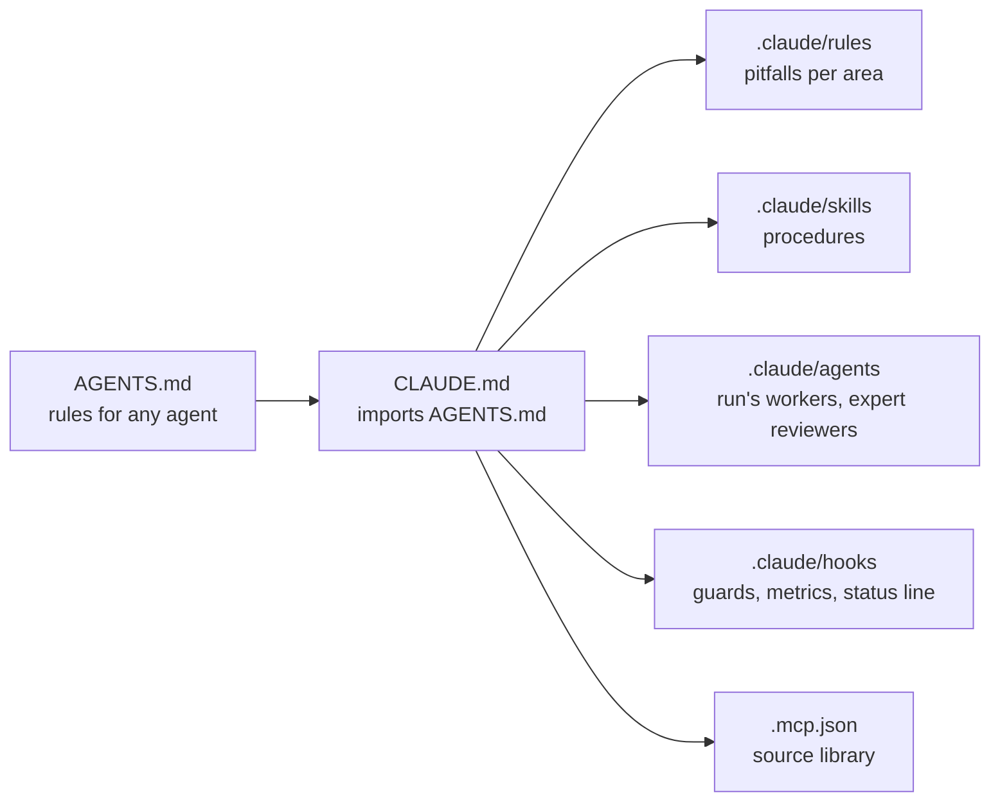

# Agent configuration

The code is written by a coding agent — Claude Code — under the Product Owner's review. Its configuration is committed (ADR-0021): `AGENTS.md` for any agent, `CLAUDE.md` and `.claude/` for Claude Code. `docs/` stays the source of truth; the configuration only adds procedures, pitfalls, guards and tools.



## Files

| Path | Role | Loaded |
| --- | --- | --- |
| `AGENTS.md` | rules for any coding agent: project, where to read, rules, work, done, stop, commands (`REF-CC-MEMORY`) | every session, by any tool |
| `CLAUDE.md` | imports `AGENTS.md`, then skills, agents, tools and habits of Claude Code | every session |
| `.claude/rules/library.md` | pitfalls of `src/` and `playground/` | when those files are touched |
| `.claude/rules/docs.md` | pitfalls of Markdown, backlog and bibliography | when Markdown is touched |
| `.claude/rules/tooling.md` | pitfalls of lint, tests, dependencies, CI, hooks | when tooling is touched |
| `.claude/settings.json` | permissions, hooks, status line, the library server enabled, the subagent cap | every session |
| `.mcp.json` | the local source library's MCP server ([sources](./sources.md)) | every session, once approved |

## Skills

| Skill | Does |
| --- | --- |
| `/story` | a story from branch to pull request |
| `/run` | an autonomous run on the feature branch, up to the validation (ADR-0072) |
| `/spike` | the research spike of a feature (ADR-0020) |
| `/derivation` | a `DERIV-*` from read sources |
| `/audit` | the feature audit with the reviewing agents |
| `/review` | the demo page and checklist of a feature; the epic review (ADR-0023) |
| `/retro` | the epic retrospective: metrics, evolvability, playbook, configuration (ADR-0023) |
| `/triage` | open issues presented with a recommendation (ADR-0026) |
| `project-rules` | the digest of `AGENTS.md` and `CLAUDE.md`, preloaded by every agent type started without them (EN-065) |
| `worker-brief` | the brief of a run's worker (ADR-0072), preloaded by `story-worker` and `researcher`, read by path by a `general-purpose` worker |

## Run's workers

A run starts each task with the agent type its task kind uses (EN-065, the run skill names which). Each type is started with `omitClaudeMd` (no `CLAUDE.md`, `AGENTS.md` nor the memory index), its rules preloaded as skills, and only the tools its task uses: a `general-purpose` worker also receives every tool's definition, the skill listing and the deferred tools' list (`REF-CC-SUBAGENTS`). First request measured by `context:size` on the same small task (EN-065, Measures):

| Agent type | Task kind | Tools | Preloaded | First request, tokens | `general-purpose`, same task |
| --- | --- | --- | --- | --- | --- |
| `story-worker` | `US`, `EN`, `NAM`, `CHK`, the fixes of an `AUD`, the preparation of a `VAL` | Bash, Read, Edit, Write, Grep, Glob, the library | `project-rules`, `worker-brief` | 9,627 | 27,843 |
| `researcher` | a research spike (`SP`) | the story worker's, `WebFetch`, `WebSearch` | `project-rules`, `worker-brief`, `spike` | 11,201 | 27,843 |
| `clerk` | journal entries, log rows, backlog statuses, rebases and merges the main thread hands off | Bash, Read, Edit, Write, Grep, Glob | `project-rules` | 6,901 | 27,843 |

Why: a worker's first request is read again at each of its requests, about 213 per worker in F18 and F19; the run's `general-purpose` worker started at 38,900 tokens ([research note 0024](../research/notes/0024-f20-context-diet.md)). A task none of the types fits keeps `general-purpose`, given the brief's path inside its worktree. A rule a typed worker misses is added to its brief or to `project-rules`, not to every agent's. A story's merge and finishing stay with the main thread (`story:finish`).

## The progress page

A run shows its progress on one claude.ai page, an Artifact the Product Owner opens once per run and leaves open: it updates in place at each publish (EN-087, in place of a terminal view beside Claude Code, improvement log of 2026-10-16). An Artifact is static and reads no local file, and a new session publishes a new page unless given the address (`REF-CC-ARTIFACTS`), so:

- **Written by a tool, published as it is.** `npm run progress:page` (`tools/progress-page/`) writes `.git/metrics/progress.html` from the feature branches on `origin`, the commits since the run's start, the run's subagents' files and `run-totals`' count; the main thread publishes that file in one call. No page text is written by the model: a styled page costs more output tokens than the terminal's text (research note 0024).
- **What it shows.** The run: its start, duration and tokens by kind, the plan's usage. The agents running: their story, type, task, time and tokens. The tree, epic → feature → story, each story's status, the stories in progress (a worktree or an agent running) highlighted, with the duration, tokens and commits of each story and feature, and the tokens of the main thread and of agents outside the stories. A story lasts from its first commit or agent of the run to its `done` commit, to now while an agent of it runs; a feature from its first story's start to its last story's end. An agent idle for 30 minutes counts as stopped.
- **When.** At the run's start, after each merge (`story:finish`) and at the run's stop, as the run skill says.
- **One address per run.** At its first publish, `npm run progress:page -- address <url>` keeps the address with the run's start in `.git/metrics/progress-page.json`; the command then prints it, also in a new session, so the run publishes at the same address. A new run starts a new page.
- **Small and plain.** About 6 KB, its style inline, no script, nothing loaded from elsewhere; it names stories, agent types and commits, never a person, a path nor a session id. 0.1 s, 0.3 s through npm (2026-10-17, a run of 4 workers).

## Expert agents

Read-only reviewers in a fresh context, each with the documents it reads first (`REF-CC-SUBAGENTS`). The skills start them in the background and in parallel; they report, they never edit. The agents that read sources (`auditor`, `math-expert`, `functional-analyst`) have the library's tools (`library_search`, `library_get`, `library_read`) and follow the same protocol as the main agent (`docs/tooling/sources.md`): library first, the web only for a page it cannot read. Until 2026-10-13 they had only `WebFetch` and `WebSearch`, so their pages never reached the library unless their prompt asked for it. Since EN-065 each starts with `omitClaudeMd`, without `CLAUDE.md` nor `AGENTS.md`, and with `project-rules` preloaded: about 7,500 tokens fewer in its first request (EN-065, Measures).

| Agent | First request before, tokens | After, tokens |
| --- | --- | --- |
| `auditor` | 15,103 | 7,608 |
| `verifier` | 13,753 | 6,258 |
| `doc-editor` | 13,641 | 6,146 |
| `math-expert` | 15,450 | 7,925 |
| `functional-analyst` | 15,439 | 7,916 |

| Agent | Expert in | Started by |
| --- | --- | --- |
| `auditor` | refuting a feature: formulas, values, sources, copies | `/audit` (ADR-0064: no review per story) |
| `math-expert` | plane geometry and floating-point numerics | `/spike`, `/derivation`, `/run` (math stories), `/audit` |
| `verifier` | tests that would catch a wrong implementation | `/story` (test plan), `/run`, `/audit` |
| `functional-analyst` | business rules, domain objects, refinement questions | `/spike`, a feature's refinement |
| `doc-editor` | pages that scan: structure, words, no quotes | `/audit`, `/retro`, a docs pull request |

Agents to add when their epic comes, with their trigger:

| Agent | Would bring | When |
| --- | --- | --- |
| `interaction-designer` | handles, dragging, selection, keyboard: how editors behave (Figma, Inkscape) | E02, the first editor application |
| `svg-expert` | the SVG specification: paths, strokes, import and export of other tools' files | E04 (strokes), E11 (files) |
| `performance` | budgets, profiling, large views | E08 (views), or a first performance budget |

## Models

Each agent type runs on one model, named in its file with the reason in the file's body (EN-066): Sonnet for the `clerk`, which writes the records, and Opus for the seven others, as decided at F20's second round (2026-10-17). Sonnet 5.5 costs half of Opus 5.5 on every kind of token (`REF-CLAUDE-PROMPT-CACHING`).

The model is taken from the first of these that names one (`REF-CC-SUBAGENTS`):

1. the `Agent` call's `model`;
2. the agent file's `model`;
3. `CLAUDE_CODE_SUBAGENT_MODEL`;
4. the main conversation's model.

A file naming `opus` stays on Opus when the main conversation runs on another model; the earlier `inherit` followed the main conversation. The session report gives the tokens per model ([metrics](./metrics.md)). Model and reason per agent type, the full reason in each agent file:

| Agent type | Model | Why |
| --- | --- | --- |
| `clerk` | `sonnet` | copies facts it is given into formats its files set, and follows the fixed steps of a merge or a rebase: nothing to derive or judge |
| `story-worker` | `opus` | code, hand-computed tests and the docs of its rules; stays on Opus until one story on Sonnet, measured beside one on Opus, shows Sonnet does as well (EN-066, T3) |
| `researcher` | `opus` | judges what each source states; its stories are what the feature is built from |
| `auditor` | `opus` | refutes a feature: re-derives formulas, recomputes values; a weaker reviewer than the worker misses more |
| `verifier` | `opus` | mutations by thought and recomputed values, the audit's reasoning on one story |
| `math-expert` | `opus` | formulas, derivations and floating-point precision, where the tests' expected values come from |
| `functional-analyst` | `opus` | finds the two readings of a rule and prepares the Product Owner's decisions |
| `doc-editor` | `opus` | a rewrite keeps every fact of the page; read-only and short, so its share of the tokens is small |

## Hooks

| Hook | Event | Does |
| --- | --- | --- |
| `guard-bash.ts` | `PreToolUse` (shell) | denies `gh pr merge`, `--no-verify` (`commit -n`), hooks switched off (`HUSKY=0`, `core.hooksPath`), a force push without lease (`+branch` too), `git -C` included; a full Vitest run outside `npm run test`, which takes the heavy lock (EN-047) — no test path, or only `.`, through `npx` or `node_modules/.bin`, whatever its options (`--project x`); in a story's worktree, a Git command chained with another (`cd … && git …`, `git add && git commit`, a pipe), answered at once with the form to run: `cd "<worktree>" \|\| exit 9`, then the Git command alone, and `golden:write` (EN-052); skips here-document bodies |
| `limit-agents` (Rust, `tools/hooks`) | `PreToolUse` (`Agent`, `SendMessage`) | refuses a fourth subagent at once (ADR-0072), started by `Agent` or resumed by `SendMessage`, naming the three running and their age; lets a message to the main conversation or to a subagent running through, since it starts none (the target matched by the agent id its launch or resume result names, or the `name` its `Agent` call gave); counts the session's background subagents from its transcript, where the status line's cache (`.git/metrics/status-line-turn.json`) stopped; lets the call through when it cannot read; test `tools/hooks/tests/limit.rs`; run by `cargo run --release`; backed up by `CLAUDE_CODE_MAX_CONCURRENT_SUBAGENTS` set to 3 under `env`, Claude Code's own cap, whose refusal names no subagent and which a resume escapes (`REF-CC-ENV-VARS`, EN-047, EN-063) |
| `library-pages` (Rust, `tools/hooks`) | `PreToolUse` (`WebFetch`, shell) | sends every page read to the library ([sources](./sources.md)): refuses a `WebFetch`, or a `curl` or `wget` printing a web page, with the `library_get` call to make instead, unless the library returned that page empty — stored with fewer than 300 characters, or refused by its site — read from the library's file by `sqlite3 -readonly`; a local host, an `api.` host or `/api/` path, a file to download (`.pdf`, `.ttf`…), headers only (`-I`) or data sent go through, and here-document bodies are skipped; test `tools/hooks/tests/pages.rs`; run by `cargo run --release` (EN-101) |
| `check-handback` (Rust, `tools/hooks`) | `PreToolUse` (`SubagentHandback`) | when a worker hands back its report, finds its worktree, the first one its own transcript names (its prompt's), and checks that its story branch is on `origin` at the worktree's head — so its pre-push `check:all` passed, a push without it being refused — and that the report names each of its commits by its short hash or subject; missing, refuses the hand-back once, the reason the worker's next instruction, then lets the next one through with what is missing written above the report; complete, writes above the report a line naming the story, its branch and `story:finish`; leaves alone the main thread, an internal agent, a read-only type (`Explore`, `Plan`, `auditor`, `verifier`, `doc-editor`, `math-expert`, `functional-analyst`…) and an agent without a worktree; lets the call through when it cannot read; test `tools/hooks/tests/handback.rs`; about 50 ms, 180 ms through `cargo run --release` (EN-088, research note 0024) |
| `session-state.ts` | `SessionStart` | prints the branch, uncommitted files, progress of started features; removes the files of calls left running for a day |
| `track-tool-call.ts` | `PreToolUse` (every tool), in the background | writes the call starting, for the status line ([metrics](./metrics.md)) |
| `log-tool-call.ts` | `PostToolUse`, `PostToolUseFailure`, in the background | logs each call and its duration; removes it from the running calls |
| `status-line.ts` | status line, every second | place in the backlog, step, session, call running ([metrics](./metrics.md)) |

## Pushes

During a run, the main thread pushes only a question that parks a story or a blocker it cannot get around, when either prevents finishing the scope; never a merge nor a stop (run skill, Pushes; EN-086). `PushNotification` sends a desktop notification, which needs nothing, and a phone push when Remote Control is connected (`REF-CC-TOOLS-REFERENCE`). The repository cannot turn the phone pushes on: a project's settings may turn Remote Control off, never on (`REF-CC-REMOTE-CONTROL`). The Product Owner sets it once, on their side:

| Setting | Where |
| --- | --- |
| Remote Control for every session | `remoteControlAtStartup: true` in their user settings (`~/.claude/settings.json`), or `/remote-control` in one session |
| phone pushes | **Push when Claude decides** on in `/config`, the Claude app signed in with the same account |

A push is skipped while they type in or focus the terminal (`REF-CC-REMOTE-CONTROL`). Without the setting, or with pushes off, the question is still asked in the chat and written in its parked story.

## Parallel sessions

The Product Owner may talk to a second session while a run works in the background. Both share the same folder, and the run owns it (its branch, its uncommitted files). The second session:

1. **Never touches the run's folder**: no `git switch`, `stash` nor commit there. It works in its own worktree: `npm run worktree:new -- <ID>` (`.claude/worktrees/<id>`, `node_modules` linked, Husky run so that its own hooks run, EN-052) branches from the story's feature branch on GitHub, from `origin/develop` for an epic's story (`NAM`, `REV`, `RET`); a tooling change without a story id uses `git worktree add .claude/worktrees/<topic> -b <type>/<topic> origin/develop`. Each of its Bash calls starts with `cd "<worktree>" || exit 9`, since a call starts in the main checkout.
2. **Puts each decision in the repository**, the only state both sessions read: domain, ADR, backlog, `AGENTS.md`, skills. One branch, one pull request into `develop` (or straight to `develop` when the Product Owner allows it for tooling and backlog). Durable facts also go to the agent's memory, read by every new session.
3. **Tells the run at once**: `ListAgents`, then `SendMessage` to the busy session with what changed, where it is written and what it changes for the run. A run never acts on a message alone: it waits for the change to reach `develop`, as with any decision.
4. **Removes its worktree** once the pull request is merged: `npm run branches:clean` removes it with its branch.

The run picks up `develop` before every story (run skill, step 1): when `develop` has new commits in `AGENTS.md`, `CLAUDE.md`, `.claude/`, `docs/domain/`, `docs/adr/`, `docs/backlog/` or `docs/conventions/`, it merges `origin/develop` into the feature branch, in a worktree of that branch (no force push on a feature branch), reads them and follows them from that story on. A skill or rule loaded at the start of the run is replaced by the new version; a change to the run's scope or stories is a stop. So the Product Owner never has to repeat in one chat what was decided in the other.

## Cloud agents and scheduled tasks

Decided by the Product Owner on 2026-10-17:

- **Cloud agents** (agents run on a remote machine) are not used in this project: every agent works on the Product Owner's machine, in its repository.
- **Scheduled tasks** (`CronCreate`) exist; the agent schedules one only when the Product Owner asks for it.

## Searching past conversations

Claude Code keeps each conversation as a JSONL file in `~/.claude/projects/<project-path>/` (local, never committed here; saved in the private records, `records/`, ADR-0041 and ADR-0044). The session journal ([journal](../process/journal.md), ADR-0024) is read first; the transcripts are the full archive:

```sh
cd ~/.claude/projects/<project-path>
grep -l "radius" *.jsonl                                     # which conversation mentions a word
jq -r 'select(.type == "user") | .message.content | strings' <id>.jsonl | grep -i "radius"
```

## Rules for this folder

- A new hook is written in Rust, in `tools/hooks` (E17, 2026-10-16), like `limit-agents`. The TypeScript hooks still here run with `node` (type stripping), linted as tooling, tested (`.claude/hooks/*.test.ts`): pure functions exported, effects under `if (import.meta.main)`; a relative import names the `.ts` file (`REF-NODE-TS`); F21 rewrites them (ADR-0073).
- A rule enforced by a hook is not repeated as an instruction; a guard that blocks legitimate work is changed by a new ADR, never bypassed.
- `.claude/settings.local.json` (personal, not committed) may add permissions; it never removes a guard.
- Changes go to `develop` like CI changes (tooling), with `chore(tooling): …` commits.
