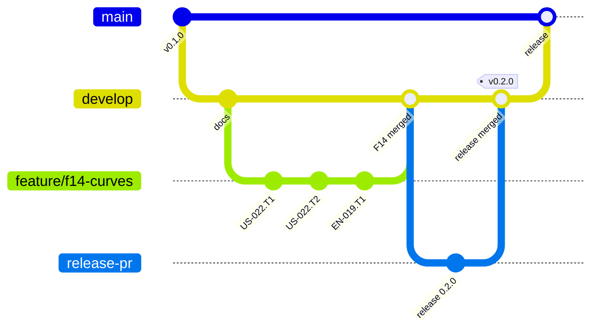

# Git workflow

## Branches and pull requests

Git-flow without release branches (ADR-0038, `REF-GITFLOW`):

| Branch                      | Holds                                                     | Receives                                                                                 | Checked by                            |
| --------------------------- | --------------------------------------------------------- | ---------------------------------------------------------------------------------------- | ------------------------------------- |
| `main`                      | released versions only                                    | pull requests from `develop` (merged by the Product Owner); no push                      | the CI of the pull request (`ci.yml`) |
| `develop`                   | the integration branch: validated features, tooling, docs | agent pushes (tooling, docs, backlog); feature and release pull requests (Product Owner) | local Git hooks                       |
| `feature/f<nn>-<topic>`     | one feature while it is built (ADR-0028)                  | story pull requests (Product Owner, or GitHub in an autonomous run)                      | local Git hooks                       |
| `<type>/<story-id>-<topic>` | one story, one commit per task                            | the agent's commits                                                                      | local Git hooks                       |

- **One branch = one feature**: `feature/f<nn>-<topic>`, created from the up-to-date `develop` when the feature starts, merged into `develop` by the Product Owner at the feature's validation, then deleted.
- **One branch = one story**: `<type>/<story-id>-<topic>`, e.g. `feat/us-004-rectangle-contour`, created from the up-to-date feature branch. The type is the Conventional Commits type of the story's main change.
- **One commit = one task** of the story, with the task ID in a footer (`Refs: US-004.T2`).
- When the story's Definition of Done is met, Claude Code pushes the branch (the pre-push hook runs `check:all`) and opens a pull request **into the feature branch** (template `.github/pull_request_template.md`). No CI runs on it and nobody waits for one. Merge: **rebase merge** — by the Product Owner, or, in an authorized autonomous run, by GitHub as soon as the pull request is labeled `autonomous` (`story-automerge.yml`, ADR-0028).
- At the feature's validation (`VAL`), Claude Code does the validation work on a `VAL` branch made from the feature branch, and opens **one feature pull request** from that branch into `develop`; the Product Owner merges it with a **merge commit** (git-flow's `--no-ff`: the feature stays visible as one bridge in the history, `REF-GITFLOW`).
- **A release**: Claude Code opens a pull request from `develop` into `main`, usually right after a feature pull request is merged. The CI runs on it (about 2 minutes); the Product Owner merges it with a **merge commit**, the only method `main` allows: a rebase would copy the commits under new SHAs and `develop` would no longer be an ancestor of `main` (`REF-GH-MERGE-METHODS`). Before it, the Product Owner merges release-please's release pull request into `develop`; on `main`, release-please only tags that commit and publishes the release ([releases](./releases.md), ADR-0067).
- **After a release**, Claude Code brings `develop` up to `main` by a fast-forward: `git switch develop && git pull && git merge --ff-only origin/main && git push` (a plain `git merge origin/main` if `develop` moved meanwhile).
- No long-lived branch other than `main`, `develop` and the current feature's.
- Branch names are checked by `validate-branch-name` (pattern in `.validate-branch-namerc.json`): `main`, `develop`, `feature/f<nn>-<kebab-case>`, `<type>/<kebab-case>`, plus the bots' `dependabot/…` and `release-please--…`.

How the history reads (ADR-0038, ADR-0067): stories line up on their feature, each feature joins `develop` by a merge commit, the release pull request too, tagged once `main` holds it; each release joins `main` by a merge commit, and `develop` fast-forwards to it.



## After a merge

```sh
git switch feature/f<nn>-<topic>   # or develop, after the feature pull request
git pull --prune
git branch -d <story-branch>
```

The remote branch is deleted by GitHub on merge; `fetch.prune` keeps local references clean.

## Logs merged by union

The three append-only logs — `docs/process/journal.md`, `improvements.md` and `feedback.md` — carry `merge=union` in `.gitattributes` (ADR-0065): when two branches each add a row, a local merge keeps both, without conflict markers, in an order to check (`REF-GIT-UNION`). A row both sides added the same way could appear twice: `tests/logs.test.ts` fails and names it, and checks every row of `improvements.md` and `feedback.md` starts with a date and every session of the journal too. Never for a table kept in a sorted order nor a file with front matter. Whether GitHub's own merge of a pull request applies `merge=union` is not documented: tried once at a later merge before relying on it.

## Commit messages

Conventional Commits (`REF-CONVENTIONAL-COMMITS`), checked by commitlint on every commit and in the CI of the pull requests into `main` (`commitlint.config.ts`):

```text
<type>(<scope>): <subject in imperative mood>

<body: why, wrapped at 100 columns>

<footers>
```

- Types: `feat`, `fix`, `docs`, `refactor`, `test`, `chore`, `build`, `ci`, `perf`, `style`, `revert`. They drive the version ([releases](./releases.md)).
- Scopes: one per layer (`math`, `geometry`, `model`, `routing`, `io`, `render`, `interaction`), plus `playground`, `eslint`, `docs`, `adr`, `backlog`, `ci`, `deps`, `tooling`.
- Header and body lines: 100 characters at most.
- Breaking change: `feat(model)!: …` or a `BREAKING CHANGE:` footer.

## Footers: links to the backlog and the docs

Footers are Git trailers (`Key: value`) after a blank line:

| Footer             | Meaning                                                                             | Example                                              |
| ------------------ | ----------------------------------------------------------------------------------- | ---------------------------------------------------- |
| `Refs:`            | task, story, feature, ADR, domain question, research request this commit relates to | `Refs: US-004.T2, ADR-0007, Q11`                     |
| `Closes:`          | story completed by this commit (last task of the branch)                            | `Closes: US-004`                                     |
| `BREAKING CHANGE:` | incompatible API change, described                                                  | `BREAKING CHANGE: polygonToPathData takes a Contour` |
| `Co-Authored-By:`  | co-author                                                                           | added on commits written by Claude Code              |

```text
feat(geometry): add fillet setback

Setback of a corner fillet, d = r / tan(θ/2), with hand-computed tests.

Refs: EN-001.T2, DERIV-local-radius-clamp
```

## Hooks (`.husky/`)

| Hook         | Runs                                                                                                                                                                                                                                                                          |
| ------------ | ----------------------------------------------------------------------------------------------------------------------------------------------------------------------------------------------------------------------------------------------------------------------------- |
| `pre-commit` | `lint-staged` (`.lintstagedrc.json`): Prettier + ESLint `--fix` on staged TypeScript and Markdown, Prettier on JSON, HTML, CSS and YAML, secretlint on every staged file                                                                                                      |
| `commit-msg` | commitlint, then for a `done` commit (`Closes:`) the docs of a rule its story changes (`tools/rule-docs`, EN-059)                                                                                                                                                             |
| `pre-push`   | no shared file edited on a worker's story branch (`tools/shared-files`, ADR-0065), branch name (`.validate-branch-namerc.json`), `npm run check:all` (check, latest versions, docs and playground builds), then `npm run golden:check` when a golden file is written (EN-055) |

Hooks are installed by `npm install` (`prepare` script): Husky writes `.husky/_`, a folder Git ignores, and names it as the hooks path, relative, so each checkout runs the hooks of its own branch. A worktree has no `.husky/_` of its own: `npm run worktree:new` runs Husky in every worktree without one, the new one included, so that a push from a story's worktree runs that branch's `.husky/pre-push`, not the main checkout's (EN-052). A worktree made by hand gets the same with `npx husky` run inside it. Bypassing them (`--no-verify`) is not allowed.
