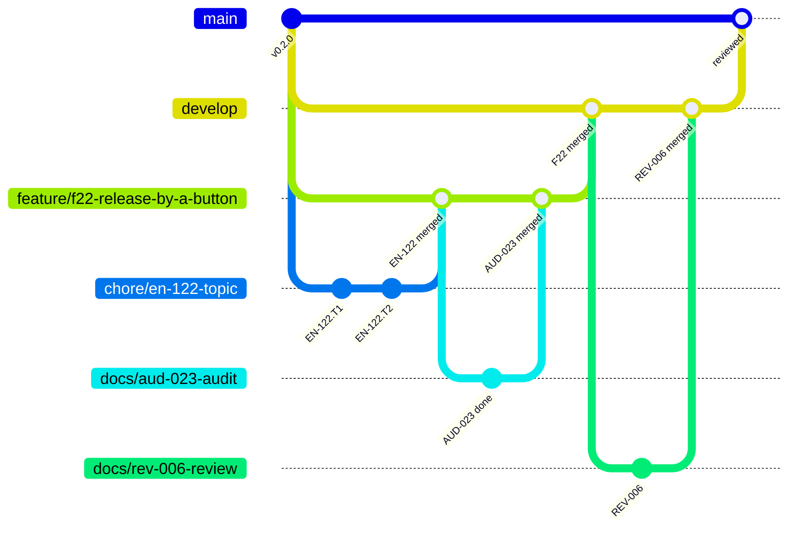

# Git workflow

## Branches and pull requests

Git-flow with a merge commit for every merge (ADR-0072, ADR-0086, `REF-GITFLOW`): each branch holds one kind of work, so that what reaches `main` has been through a feature's audit and a review, and the graph shows a small bubble per story on its feature's line and a big bubble per feature on `develop`.

| Branch | Holds | Receives | Checked by |
| --- | --- | --- | --- |
| `main` | the reviewed work | the pull request `develop` → `main` after each review, merged by the Product Owner; no push | the CI of the pull request (`ci.yml`) |
| `develop` | audited features, reviews, tooling, docs | each feature once audited, each review's `REV` and each epic's refinement `SP`, by the features' auto-merge | local Git hooks; the [`develop` CI](./ci.md#the-develop-ci) after each merge, blocking nothing |
| `feature/f<nn>-<topic>` | one feature while it is built, deleted after its merge | its stories' pull requests | local Git hooks |
| `<type>/<story-id>-<topic>` | one story, one commit per task | the agent's commits | local Git hooks |

- **A story** gets its branch and worktree from `target/release/worktree-new <ID>`, made from its feature branch on GitHub; a story attached to `develop`, a `REV` or an epic's refinement `SP`, from `origin/develop`, a review's bubble named by `--type` and `--topic`. Run in the main checkout, on `develop`, it finds a story whose file is only on its feature branch by `git ls-tree` on `origin`'s feature branches, and refuses one that two branches hold, naming them. The type is the Conventional Commits type of its main change. Each task is one commit, its id in a footer (`Refs: US-004.T2`). Once its Definition of Done is met, it goes into its base by a **merge commit**: in an autonomous run `npm run story:finish` pushes, opens the pull request labelled `autonomous`, waits for GitHub's merge and cleans up; into `develop` it does so for a `REV` and an epic's refinement `SP` (decided on 2026-10-25, REV-009), and opens any other story without the label, saying at once that it waits for the Product Owner's merge, then run again once merged to clean up (EN-118); outside a run the agent opens the pull request and the Product Owner merges it. No CI runs on it: the pre-push hook already ran `check:all`. One story at a time: no two story branches are open at once.
- **A fix without a story of its own** takes the id of the story it serves (`fix/en-073-<topic>`): the pre-push hook and the two auto-merges, `story-automerge.yml` into a feature branch and `feature-automerge.yml` into `develop`, accept one form of work branch, `<type>/<story-id>-<topic>`, the id of a `US`, `EN`, `SP`, `CHK`, `AUD`, `VAL` or `REV`, and refuse any other alike, so that a branch is refused at its push rather than at its merge (I50).
- **A feature** joins `develop` from its feature branch as soon as its audit ends (label `autonomous`, ADR-0100), by a **merge commit**, so that it stays visible as one bubble in the history (`--no-ff`, `REF-GITFLOW`); the feature branch is then deleted, its name staying in the merge commit. It is never rebased: `develop` enters it by a merge.
- **A review** is held at each return of the Product Owner, once or twice a day: a feature under way is finished first; then a `REV` story from `develop` holds the review of the features finished since the last merge into `main`, the naming pass over the code changed since then, the tool incident cards fixed, the method's improvements and the docs, and joins `develop` by a merge commit. The agent then opens `develop` → `main`, its body the features' texts for the release; the CI runs, and the Product Owner merges it by a **merge commit**, the only method `main` allows: a rebase would copy the commits under new hashes (`REF-GH-MERGE-METHODS`). The push to `main` deploys the site and makes no release.
- **A release** is a button: the Product Owner runs `release.yml` on `main` from GitHub's Actions tab, and `release publish` computes the version from the last tag and the commits since, tags `main`'s head and makes the GitHub release; nothing is committed ([releases](./releases.md)).
- No long-lived branch other than `main`, `develop` and the current feature's. The pre-push hook and the CI check the names by one pattern, `BRANCH_PATTERN` in `tools/git-hooks/src/branch.rs` (`git-hooks branch`), `tests/story-automerge.test.ts` checking that it lets a work branch through only when the auto-merge takes it into a base; the bot's `dependabot/…` passes.



## After a merge

`story:finish` removes its story's worktree and branches itself. After any other merge — a feature, a review, a story the Product Owner merged — `target/release/branches-clean` deletes the merged or gone local branches with their worktrees and prunes the remote references; `git branch -a` then shows only `main` and `develop`.

## Logs merged by union

The append-only logs — `docs/process/journal.md`, `improvements.md`, `feedback.md` — carry `merge=union` in `.gitattributes` (ADR-0065): two branches that each add a row merge without conflict markers (`REF-GIT-UNION`). Union fits a file whose lines are independent; never use it for a table kept in order nor a file with front matter, where a merged line can break the whole. A row added twice the same way survives twice: `tests/logs.test.ts` names it, and checks each row's date. Whether GitHub's own merge applies `merge=union` is untried (AUD-020): until a pull request shows it, a conflict on a log at GitHub's merge is resolved by hand, and the first one is logged in the [improvement log](../process/improvements.md).

## Commit messages

Conventional Commits (`REF-CONVENTIONAL-COMMITS`), checked at each commit (`commit-msg`) and in the CI into `main` (`git-hooks commits`) by commitlint 21.2.3's rules with `config-conventional`, ported to Rust (`tools/git-hooks/src/message.rs`, EN-108): the same verdict on every commit of `develop`'s history and on the refused cases of commitlint's own tests. `message.rs` is the list of what passes:

```text
<type>(<scope>): <subject in imperative mood>

<body: why, wrapped at 100 columns>

<footers>
```

- The type drives the version ([releases](./releases.md)): `feat`, `fix`, `docs`, `refactor`, `test`, `chore`, `build`, `ci`, `perf`, `style`, `revert`.
- The scope is one of the 14 `SCOPES` of `tools/git-hooks/src/message.rs`, the one list: a layer of the library, or an area of the project (`docs`, `backlog`, `tooling`…). A scope removed from it stays in `RETIRED_SCOPES` (`eslint`, EN-085), which the CI's history check accepts in the commits already made with it, and the `commit-msg` hook refuses in a new one (EN-128).
- The subject does not start with a capital: an id first (`SP-023 adds…`) is sentence case, refused; a quoted part is left out of the test. No final period.
- Header, body and footer lines: 100 characters at most, a line holding a URL excepted. A breaking change: `feat(model)!: …` or a `BREAKING CHANGE:` footer.
- A footer is a line starting with a token and `: ` (or ` #`): a body line starting with `word: ` ends the body. A missing blank line before the body or the footer is a warning only.
- Merges, reverts, `fixup!`, `squash!` and `amend!` commits, versions and Dependabot's are not checked; a release makes no commit (ADR-0086).
- **On a story branch** (`<type>/<id>-<topic>`, `docs/` excepted), each commit carries `Refs: <ID>.T<n>` or `Closes: <ID>` with the branch's own id; the hook names the footer expected. A feature branch, `develop` and a `docs/` branch are not asked for one.

| Footer | Meaning | Example |
| --- | --- | --- |
| `Refs:` | the task, story, ADR, domain question or research request the commit relates to | `Refs: US-004.T2, ADR-0007, Q11` |
| `Closes:` | the story the commit completes | `Closes: US-004` |
| `BREAKING CHANGE:` | an incompatible API change, described | `BREAKING CHANGE: polygonToPathData takes a Contour` |
| `Co-Authored-By:` | a co-author | on commits written by Claude Code |

## Hooks (`.githooks/`)

| Hook | Runs |
| --- | --- |
| `pre-commit` | `git-hooks pre-commit`, lint-staged's runner ported to Rust (`tools/git-hooks/src/staged.rs`): the formatter, oxlint and the project's linter with `--fix` on staged TypeScript and Markdown, the formatter on the other formats, the secret scan (`target/release/secret-scan`) on every staged file; the fixes staged again, a partly staged file keeping its unstaged lines, everything put back from a backup stash when a command fails. Each command's output is printed only when it fails |
| `commit-msg` | `git-hooks commit-msg`: the [message](#commit-messages), the comment lines of `core.commentChar` left out, and a story branch's footer; then at a `done` commit the docs of a rule its story changes (`tools/rule-docs`), and the notes its story file keeps for the main thread, named by `move-rows --notes` (EN-140) |
| `pre-push` | the [branch name](#branches-and-pull-requests) (`git-hooks branch`), `npm run check:all` (on a story branch, only the tests related to its change, without coverage: [the lanes](./commands.md#the-lanes-of-the-full-check)), then `npm run golden:check` when a golden file is written. A push that only deletes branches stops after the branch name: `git-hooks push-deletes-only` reads the pushed refs, which the hook reads once from its standard input, and exits 0 when each ref's local object name is the zero sha (`REF-GITHOOKS`, `tools/git-hooks/src/push.rs`); nothing new reaches the remote (decided 2026-10-24, REV-008). No ref at all, or a push beside a deletion, runs every check |
| `post-merge` | after a merge or a fast-forward, a `git pull` among them: `git-hooks post-merge` reads the files changed since `ORIG_HEAD`, and when one is a [Rust input](./commands.md#the-lanes-of-the-full-check) rebuilds the release binaries (`cargo build --release --workspace --locked`, as `npm run rust:build`) and names those it wrote again (`tools/git-hooks/src/rebuild.rs`, EN-131); a pull of no Rust input builds and prints nothing |
| `post-rewrite` | after a rebase, a `git pull --rebase` among them, the same rebuild (`git-hooks post-rewrite rebase`); an amend builds nothing. A failed build, in either hook, is printed with the command to run again, `npm run rust:build`, and the hook exits 0: the pull is done, and a post hook cannot undo it |

The hooks are short shell files, tracked, that call the release binaries by their path (`target/release/<binary>`), through `cargo run --release -q -p <crate>` when the binary is missing (`.githooks/tool.sh`). `npm install` installs them once (`prepare`, after the build): `git-hooks install` (`tools/git-hooks`) sets `core.hooksPath` to `.githooks`, relative, so each checkout and each linked worktree runs its own branch's hooks, with nothing written in it (EN-052, EN-108, ADR-0080); `target/release/worktree-new` sets it too when it is not. A hook added to the folder runs with nothing installed again: a checkout runs `post-merge` and `post-rewrite` (EN-131) once its working tree holds them. The pull that brings them runs them with the binary built before it, whose `git-hooks` has no such command and prints its usage: after that one pull, run `npm run rust:build` once (AUD-031, ADR-0089). Nor does `post-merge` run after a merge stopped on a conflict and finished by `git commit` (`REF-GITHOOKS`): the binaries stay as they were, and `npm run rust:fresh` and the `session-state` hook name those older than their sources. Hooks are never bypassed (`--no-verify`, `core.hooksPath` changed by hand): a hook that blocks legitimate work is changed, not skipped.
