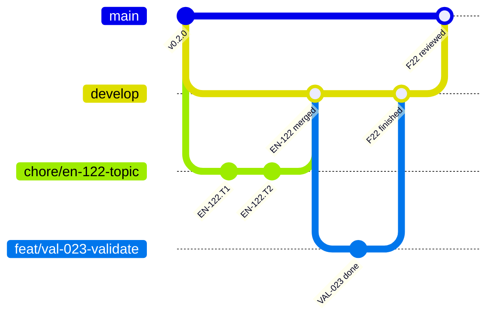

# Git workflow

## Branches and pull requests

Two long-lived branches and one branch per story (ADR-0072, ADR-0086, `REF-GITFLOW`): every story starts from `develop` and returns to it, so that the history shows one loop per story, and `main` receives only whole features the Product Owner reviewed.

| Branch | Holds | Receives | Checked by |
| --- | --- | --- | --- |
| `main` | the features the Product Owner reviewed | the pull request `develop` → `main` of a review, merged by the Product Owner; no push | the CI of the pull request (`ci.yml`) |
| `develop` | integration: stories, tooling, docs | its stories' pull requests; the rows `story:finish` moves into the logs | local Git hooks |
| `<type>/<story-id>-<topic>` | one story, one commit per task | the agent's commits | local Git hooks |

- **A story** gets its branch and worktree from `target/release/worktree-new <ID>`, made from `origin/develop`, a story of a feature as an epic's own; the type is the Conventional Commits type of its main change. Each task is one commit, its id in a footer (`Refs: US-004.T2`). Once its Definition of Done is met, it goes into `develop` by a **merge commit**: in an autonomous run `npm run story:finish -- develop "<title>" <body file>` rebases it on `origin/develop`, pushes, opens the pull request labelled `autonomous`, waits for GitHub's merge (`story-automerge.yml`) and cleans up; outside a run the agent opens the pull request and the Product Owner merges it. No CI runs on it: the pre-push hook already ran `check:all`. One story at a time: no two story branches are open at once.
- **A feature** is finished when its `VAL` merged into `develop`; no branch marks it. The run goes on with the next feature while the finished one waits for the Product Owner's review.
- **A review** opens one pull request `develop` → `main`, only when `develop`'s head is a finished feature: a review asked while a feature is under way waits for that feature's end. It brings every feature finished since the last merge into `main`, its body their texts for the release; the CI runs, and the Product Owner merges it by a **merge commit**, the only method `main` allows: a rebase would copy the commits under new hashes (`REF-GH-MERGE-METHODS`). The push to `main` deploys the site and makes no release.
- **A release** is a button once EN-117 lands: the Product Owner runs `release.yml` on `main` from GitHub's Actions tab, and `release publish` computes the version from the last tag and the commits since, tags `main`'s head and makes the GitHub release; nothing is committed ([releases](./releases.md)).
- No long-lived branch other than `main` and `develop`. The pre-push hook and the CI check the names by one pattern, `BRANCH_PATTERN` in `tools/git-hooks/src/branch.rs` (`git-hooks branch`); `feature/f<nn>-<topic>` and `release/x.y.z`, of the flows before ADR-0086, still pass, and so does the bot's `dependabot/…`.



## After a merge

`story:finish` removes its story's worktree and branches itself. After any other merge — a review, a story the Product Owner merged — `target/release/branches-clean` deletes the merged or gone local branches with their worktrees and prunes the remote references; `git branch -a` then shows only `main` and `develop`.

## Logs merged by union

The append-only logs — `docs/process/journal.md`, `improvements.md`, `feedback.md` — carry `merge=union` in `.gitattributes` (ADR-0065): two branches that each add a row merge without conflict markers (`REF-GIT-UNION`). Union fits a file whose lines are independent; never use it for a table kept in order nor a file with front matter, where a merged line can break the whole. A row added twice the same way survives twice: `tests/logs.test.ts` names it, and checks each row's date. Whether GitHub's own merge applies `merge=union` is untried (AUD-020): until a pull request shows it, a conflict on a log at GitHub's merge is resolved by hand, and the first one is logged in the [improvement log](../process/improvements.md).

## Commit messages

Conventional Commits (`REF-CONVENTIONAL-COMMITS`), checked at each commit (`commit-msg`) and in the CI into `main` (`git-hooks commits`) by commitlint 21.2.3's rules with `config-conventional`, ported to Rust (`tools/git-hooks/src/message.rs`, EN-108): the same verdict on every commit of `develop`'s history and on the refused cases of commitlint's own tests. `message.rs` is the list of what passes:

```text
<type>(<scope>): <subject in imperative mood>

<body: why, wrapped at 100 columns>

<footers>
```

- The type drives the version ([releases](./releases.md)): `feat`, `fix`, `docs`, `refactor`, `test`, `chore`, `build`, `ci`, `perf`, `style`, `revert`.
- The scope is one of the 14 `SCOPES` of `tools/git-hooks/src/message.rs`, the one list: a layer of the library, or an area of the project (`docs`, `backlog`, `tooling`…).
- The subject does not start with a capital: an id first (`SP-023 adds…`) is sentence case, refused; a quoted part is left out of the test. No final period.
- Header, body and footer lines: 100 characters at most, a line holding a URL excepted. A breaking change: `feat(model)!: …` or a `BREAKING CHANGE:` footer.
- A footer is a line starting with a token and `: ` (or ` #`): a body line starting with `word: ` ends the body. A missing blank line before the body or the footer is a warning only.
- Merges, reverts, `fixup!`, `squash!` and `amend!` commits, versions and Dependabot's are not checked; the release commit `chore: release x.y.z` is checked as any other.
- **On a story branch** (`<type>/<id>-<topic>`, `docs/` excepted), each commit carries `Refs: <ID>.T<n>` or `Closes: <ID>` with the branch's own id; the hook names the footer expected. `develop`, `main` and a `docs/` branch are not asked for one.

| Footer | Meaning | Example |
| --- | --- | --- |
| `Refs:` | the task, story, ADR, domain question or research request the commit relates to | `Refs: US-004.T2, ADR-0007, Q11` |
| `Closes:` | the story the commit completes | `Closes: US-004` |
| `BREAKING CHANGE:` | an incompatible API change, described | `BREAKING CHANGE: polygonToPathData takes a Contour` |
| `Co-Authored-By:` | a co-author | on commits written by Claude Code |

## Hooks (`.githooks/`)

| Hook | Runs |
| --- | --- |
| `pre-commit` | `git-hooks pre-commit`, lint-staged's runner ported to Rust (`tools/git-hooks/src/staged.rs`): the formatter, oxlint and the project's linter with `--fix` on staged TypeScript and Markdown, the formatter on the other formats, the secret scan (`target/release/secret-scan`) on every staged file; the fixes staged again, a partly staged file keeping its unstaged lines, everything put back from a backup stash when a command fails. Each command's output is printed only when it fails |
| `commit-msg` | `git-hooks commit-msg`: the [message](#commit-messages), the comment lines of `core.commentChar` left out, and a story branch's footer; then at a `done` commit the docs of a rule its story changes (`tools/rule-docs`) |
| `pre-push` | no shared file on a worker's story branch (`tools/shared-files`, ADR-0065), the [branch name](#branches-and-pull-requests) (`git-hooks branch`), `npm run check:all`, then `npm run golden:check` when a golden file is written |

The hooks are short shell files, tracked, that call the release binaries by their path (`target/release/<binary>`), through `cargo run --release -q -p <crate>` when the binary is missing (`.githooks/tool.sh`). `npm install` installs them once (`prepare`, after the build): `git-hooks install` (`tools/git-hooks`) sets `core.hooksPath` to `.githooks`, relative, so each checkout and each linked worktree runs its own branch's hooks, with nothing written in it (EN-052, EN-108, ADR-0080); `target/release/worktree-new` sets it too when it is not. Hooks are never bypassed (`--no-verify`, `core.hooksPath` changed by hand): a hook that blocks legitimate work is changed, not skipped.
