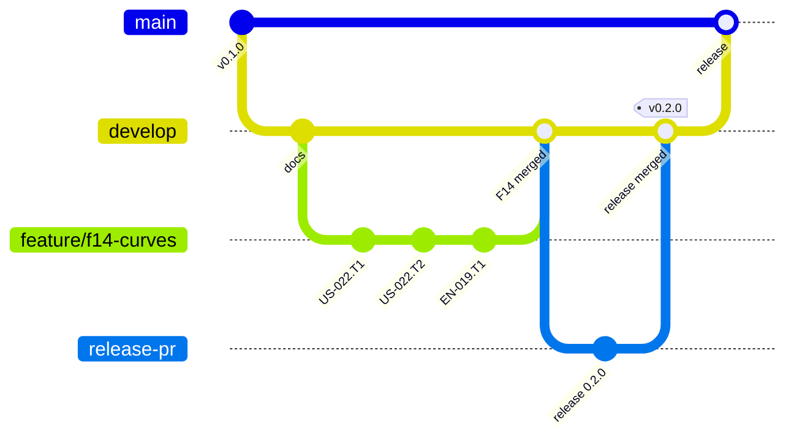

# Git workflow

## Branches and pull requests

Git-flow without release branches (ADR-0072, `REF-GITFLOW`): each branch holds one kind of work, so that what reaches `main` has been through a feature's validation and a release.

| Branch | Holds | Receives | Checked by |
| --- | --- | --- | --- |
| `main` | released versions only | pull requests from `develop`, merged by the Product Owner; no push | the CI of the pull request (`ci.yml`) |
| `develop` | validated features, tooling, docs | the agent's pushes (tooling, docs, backlog); validated features; release-please's pull request | local Git hooks |
| `feature/f<nn>-<topic>` | one feature while it is built | its stories' pull requests | local Git hooks |
| `<type>/<story-id>-<topic>` | one story, one commit per task | the agent's commits | local Git hooks |

- **A story** gets its branch and worktree from `npm run worktree:new -- <ID>`, made from its feature branch on GitHub; the type is the Conventional Commits type of its main change. Each task is one commit, its id in a footer (`Refs: US-004.T2`). Once its Definition of Done is met, it goes into the feature branch by a **rebase merge**: in an autonomous run `npm run story:finish` pushes, opens the pull request labelled `autonomous`, waits for GitHub's merge and cleans up; outside a run the agent opens the pull request and the Product Owner merges it. No CI runs on it: the pre-push hook already ran `check:all`.
- **A feature** joins `develop` from its `VAL` branch once the Product Owner said the validation is done (label `autonomous`), by a **merge commit**, so that it stays visible as one bridge in the history (`--no-ff`, `REF-GITFLOW`).
- **A release** happens only when the Product Owner asks. The Product Owner first merges release-please's pull request into `develop` ([releases](./releases.md)); the agent then opens `develop` into `main`, the CI runs, and the Product Owner merges it by a **merge commit**, the only method `main` allows: a rebase would copy the commits under new hashes and `develop` would stop being an ancestor of `main` (`REF-GH-MERGE-METHODS`).
- **After a release**, `develop` fast-forwards to `main`: `git merge --ff-only origin/main` on an up-to-date `develop`, then push (a plain merge if `develop` moved meanwhile).
- No long-lived branch other than `main`, `develop` and the current feature's. `validate-branch-name` checks the names (`.validate-branch-namerc.json`); the bots' `dependabot/…` and `release-please--…` pass.



## After a merge

`story:finish` removes its story's worktree and branches itself. After any other merge — a feature, a release, a story the Product Owner merged — `npm run branches:clean` deletes the merged or gone local branches with their worktrees and prunes the remote references; `git branch -a` then shows only `main` and `develop`.

## Logs merged by union

The append-only logs — `docs/process/journal.md`, `improvements.md`, `feedback.md` — carry `merge=union` in `.gitattributes` (ADR-0065): two branches that each add a row merge without conflict markers (`REF-GIT-UNION`). Union fits a file whose lines are independent; never use it for a table kept in order nor a file with front matter, where a merged line can break the whole. A row added twice the same way survives twice: `tests/logs.test.ts` names it, and checks each row's date. Whether GitHub's own merge applies `merge=union` is untried (AUD-020): until a pull request shows it, a conflict on a log at GitHub's merge is resolved by hand, and the first one is logged in the [improvement log](../process/improvements.md).

## Commit messages

Conventional Commits (`REF-CONVENTIONAL-COMMITS`), checked by commitlint at each commit and in the CI into `main`; `commitlint.config.ts` is the list of what passes:

```text
<type>(<scope>): <subject in imperative mood>

<body: why, wrapped at 100 columns>

<footers>
```

- The type drives the version ([releases](./releases.md)): `feat`, `fix`, `docs`, `refactor`, `test`, `chore`, `build`, `ci`, `perf`, `style`, `revert`.
- The scope is one of `SCOPES` in `commitlint.config.ts`: a layer of the library, or an area of the project (`docs`, `backlog`, `tooling`…).
- Header and body lines: 100 characters at most. A breaking change: `feat(model)!: …` or a `BREAKING CHANGE:` footer.

| Footer | Meaning | Example |
| --- | --- | --- |
| `Refs:` | the task, story, ADR, domain question or research request the commit relates to | `Refs: US-004.T2, ADR-0007, Q11` |
| `Closes:` | the story the commit completes | `Closes: US-004` |
| `BREAKING CHANGE:` | an incompatible API change, described | `BREAKING CHANGE: polygonToPathData takes a Contour` |
| `Co-Authored-By:` | a co-author | on commits written by Claude Code |

## Hooks (`.husky/`)

| Hook | Runs |
| --- | --- |
| `pre-commit` | `lint-staged` (`.lintstagedrc.json`): the formatter, oxlint and the project's linter with `--fix` on staged TypeScript and Markdown, the formatter on the other formats, secretlint on every staged file |
| `commit-msg` | commitlint, then at a `done` commit the docs of a rule its story changes (`tools/rule-docs`) |
| `pre-push` | no shared file on a worker's story branch (`tools/shared-files`, ADR-0065), the branch name, `npm run check:all`, then `npm run golden:check` when a golden file is written |

`npm install` installs them (`prepare`): Husky writes `.husky/_` and names it as the hooks path, relative, so each checkout runs its own branch's hooks. A worktree needs its own `.husky/_`, which `npm run worktree:new` writes (`npx husky` inside a worktree made by hand); otherwise a push from it runs the main checkout's hooks. Hooks are never bypassed (`--no-verify`, `HUSKY=0`): a hook that blocks legitimate work is changed, not skipped.
