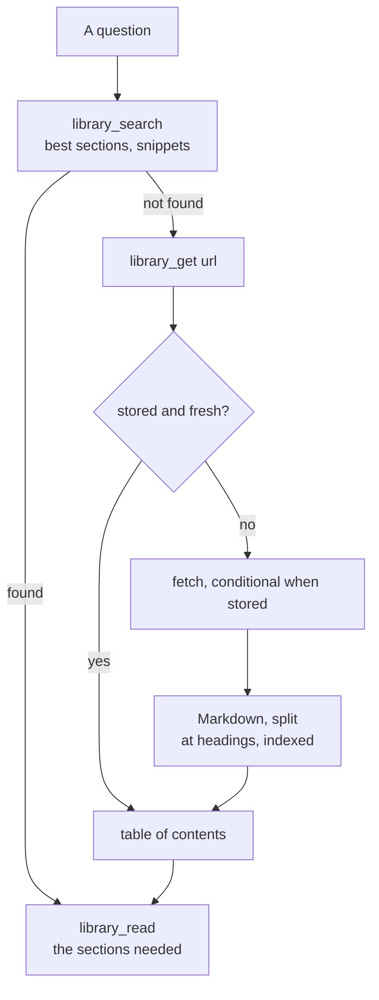

# Local source library

The pages the agent reads online are kept on the machine, in a database it searches before going online (ADR-0039). A page is fetched once, then read by section: fewer requests, fewer tokens, and the same text for every later spike or audit.

## How it works



| Part | File | Role |
| --- | --- | --- |
| storage | `scripts/library-store.ts` | SQLite file, table of pages, FTS5 index of their sections (`porter unicode61`, BM25), uses with their project; a column added to an older file when it opens |
| conversion | `scripts/library-html.ts` | HTML to Markdown: main part kept, scripts, styles, navigation and footers dropped |
| sections, freshness | `scripts/library-chunks.ts` | split at headings (code blocks respected), sections of 4 000 characters at most; staleness |
| pages | `scripts/library-pages.ts` | read from the library or fetched and stored; table of contents |
| MCP server | `scripts/library-mcp.ts` | `library_search`, `library_get`, `library_read` over stdio (`.mcp.json`) |
| command line | `scripts/library-cli.ts` | `npm run library -- search \| get \| read \| list` |

## Freshness

| Page | Read online again |
| --- | --- |
| changed less than 14 days before it was read (it may still be corrected) | after 1 day |
| any other page, or one that states no date | after 90 days |
| asked with `refresh` | now |

A stored page is asked with `If-None-Match` and `If-Modified-Since`: an unchanged page costs a `304` and no download. A page the site refuses stays as stored, marked `failed`.

## Rules for the agent

1. **Search first**: `library_search` with the words of the question. A section found is read with `library_read`.
2. **Get through the library**: a page not found is fetched with `library_get <url>`; read its table of contents, then only the sections needed.
3. **WebFetch** only for a page that comes back empty (built in the browser by JavaScript); write what it said that we use in the research note. The `library-pages` hook holds the agent to it (EN-101, [agent](./agent.md#hooks)): a `WebFetch`, or a `curl` or `wget` printing a web page, is refused with the `library_get` call to make, unless the library stored that page with fewer than 300 characters or its site refused the library. A `WebFetch` takes about 6 s and returns a summary that cannot be cited; the library serves a stored page in 12 to 265 ms with its text ([research note 0024](../research/notes/0024-f20-context-diet.md)).
4. **Cite** as before: a `REF-*` row in `docs/references.md` once the page is read; the library keeps its text, the bibliography keeps what we use from it.
5. Pages are other people's text: the database stays on the machine (`~/.local/share/agent-library/`, or `LIBRARY_PATH`), never in a repository.

## Command line

```sh
npm run library -- search porter tokenizer        # best sections, with snippets
npm run library -- get https://www.sqlite.org/fts5.html   # table of contents (fetched if needed)
npm run library -- read https://www.sqlite.org/fts5.html 20 21
npm run library -- list                           # stored pages, last read first
npm run library -- stats 2026-10-13               # sources consulted most, searches, share served locally
```

## Uses

Every search and every page read is recorded in the library (`project_uses` table), with the project that asked: the name of the project's folder, the same for each of its worktrees (`projectOf`, EN-101); the uses recorded before EN-101 show as `(not recorded)`. A file made before it is migrated when it opens: its `uses` table moved into `project_uses`, then `uses` kept as a view of it, so that an older copy of the scripts on the machine still reads and writes it, its uses without a project. `npm run library -- stats [since]` and the **Sources** section of `npm run metrics` show the uses per project, the sources consulted most, the words searched and how many pages the library served without going online.

The library is one file for the machine: a page fetched for one project is served to every other from the library until its freshness date, never fetched again before. At each retrospective the agent reads them and asks why: a source read again and again may deserve a summary in a domain page or a derivation; a search that finds nothing, a better word list.

## Limits

- The converter handles documentation pages, not applications: a page built in the browser comes back nearly empty.
- Search is by words, stemmed in English; a search by meaning (embeddings) is left out until a question needs it (ADR-0039).
