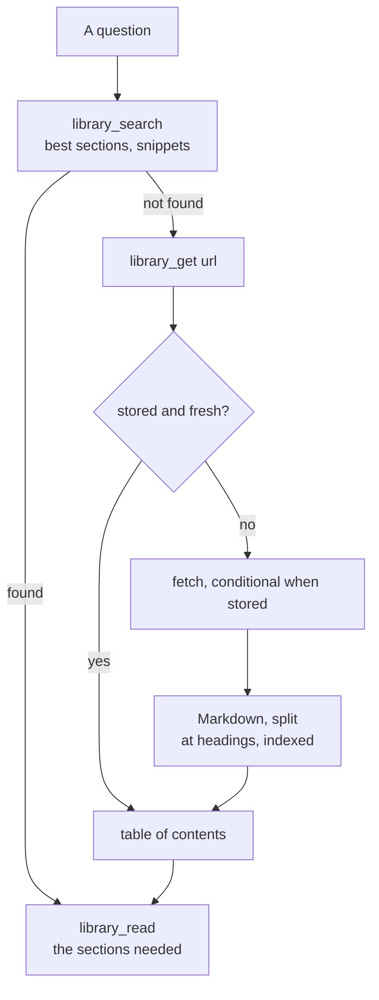

# Local source library

The pages the agent reads online are kept on the machine, in a database searched before going online (ADR-0039). A page is fetched once and then read by section: fewer requests, fewer tokens, and the same text for every later spike or audit.

## How it works



| Part | File | Role |
| --- | --- | --- |
| storage | `scripts/library-store.ts` | SQLite file: the pages, an FTS5 index of their sections (`porter unicode61`, BM25), the uses with their project |
| conversion | `scripts/library-html.ts` | HTML to Markdown: the main part kept, scripts, styles, navigation and footers dropped |
| sections, freshness | `scripts/library-chunks.ts` | split at headings, code blocks respected, 4,000 characters at most; staleness |
| pages | `scripts/library-pages.ts` | read from the library, or fetched and stored; table of contents |
| MCP server | `scripts/library-mcp.ts` | `library_search`, `library_get`, `library_read` over stdio (`.mcp.json`) |
| command line | `scripts/library-cli.ts` | `npm run library -- search \| get \| read \| list \| stats` |

## Freshness

A page is read online again when it may have changed since:

| Page | Read online again |
| --- | --- |
| changed less than 14 days before it was read (it may still be corrected) | after 1 day |
| any other page, or one that states no date | after 90 days |
| asked with `refresh` | now |

A stored page is asked with `If-None-Match` and `If-Modified-Since`, so an unchanged page costs a `304`. A page its site refuses stays as stored, marked `failed`.

## Rules for the agent

1. **Search first**: `library_search` with the question's words, then `library_read` on the sections found.
2. **Fetch through the library**: `library_get <url>` for a page not found, then read only the sections needed. `WebFetch` only for a page the library returns empty (built in the browser by JavaScript), and what it said that is used goes into the research note: its answer is a summary that cannot be cited. The `library-pages` hook refuses any other `WebFetch`, `curl` or `wget` of a page with the `library_get` call to make ([agent](./agent.md#hooks)).
3. **Cite** a `REF-*` row of `docs/references.md` once the page is read: the library keeps the text, the bibliography what the project uses from it.
4. **Keep the database off every repository** (`~/.local/share/agent-library/`, or `LIBRARY_PATH`): the pages are other people's text.

## Command line

```sh
npm run library -- search porter tokenizer        # best sections, with snippets
npm run library -- get https://www.sqlite.org/fts5.html   # table of contents (fetched if needed)
npm run library -- read https://www.sqlite.org/fts5.html 20 21
npm run library -- list                           # stored pages, last read first
npm run library -- stats 2026-10-13               # sources consulted most, searches, share served locally
```

## Uses

The library is one file for the machine: a page fetched for one project is served to every other until its freshness date. Each search and page read is recorded with the project that asked, the name of its folder, shared by its worktrees (`project_uses`). `npm run library -- stats [since]` and the **Sources** section of `npm run metrics` show the uses per project, the sources read most, the words searched and the share served without going online.

At each retrospective the agent reads them and asks why: a source read again and again may deserve a summary in a domain page or a derivation; a search that finds nothing, better words.

## Limits

- The converter handles documentation pages, not applications: a page built in the browser comes back nearly empty.
- Search is by words, stemmed in English; a search by meaning is left out until a question needs it (ADR-0039).
